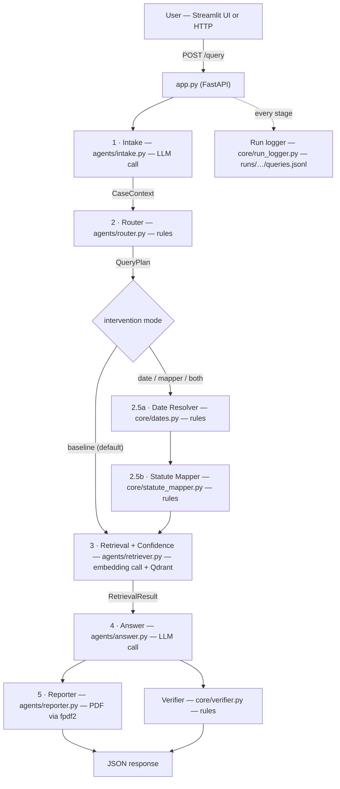
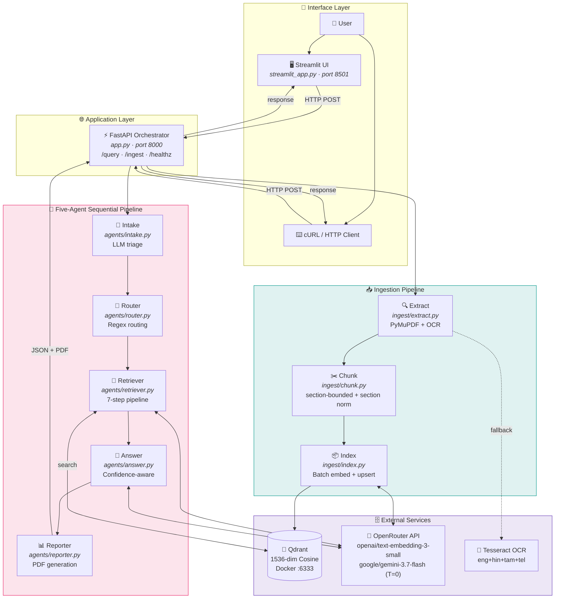
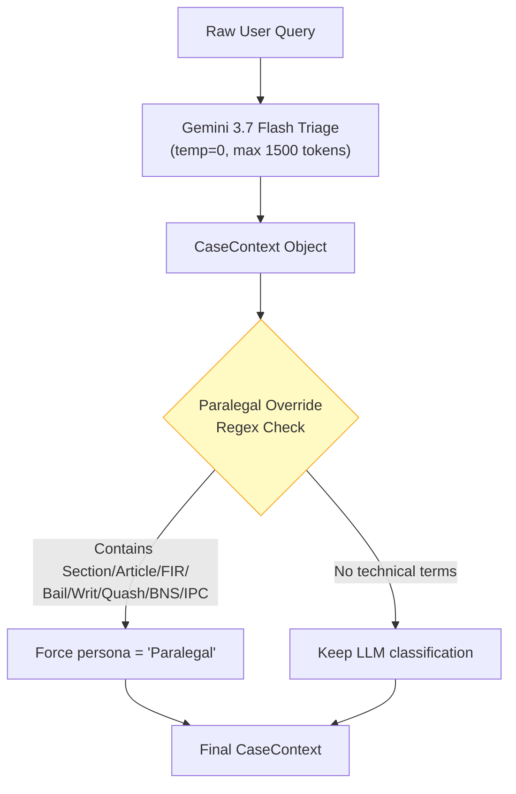
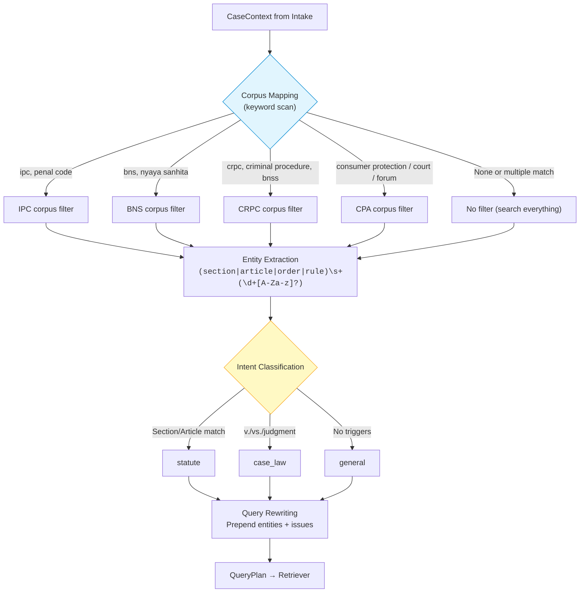
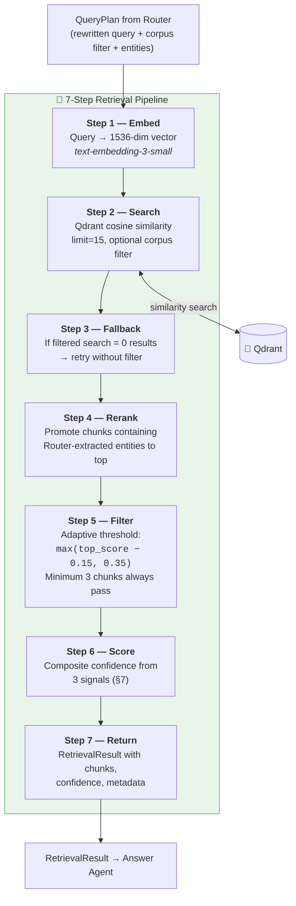
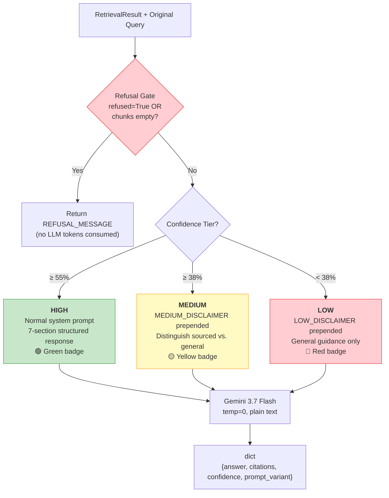
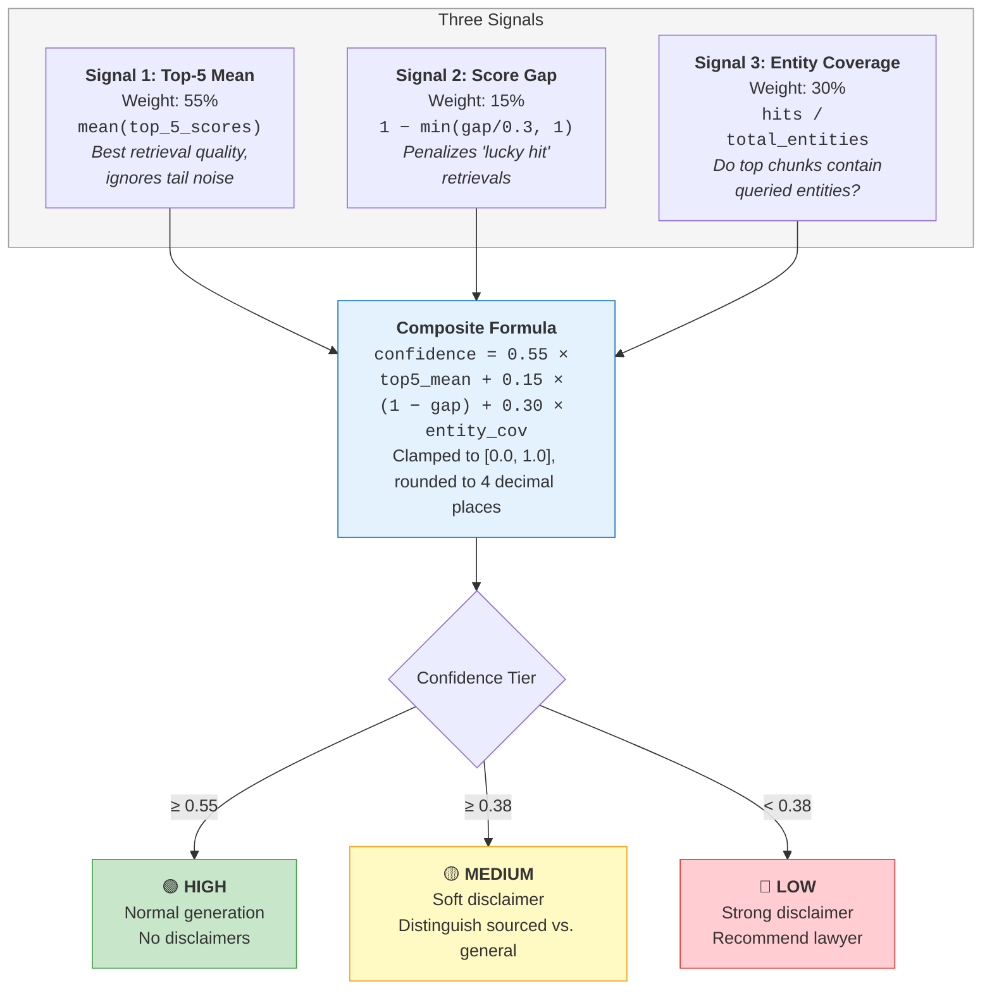
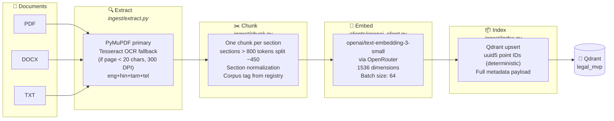
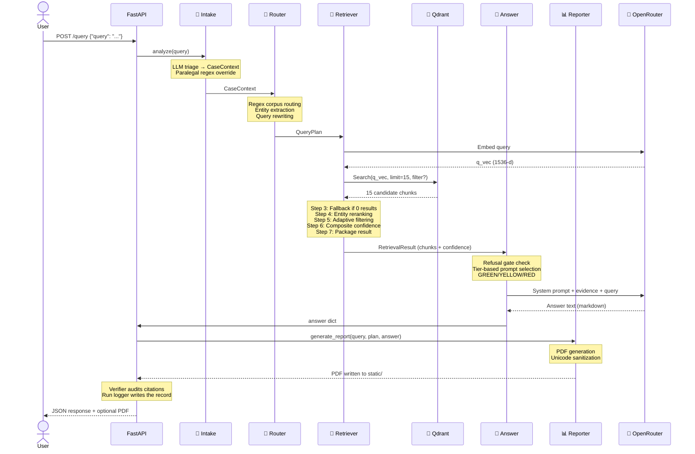

# Legal MVP — Indian Legal RAG, and what measuring it revealed

> **Status, 11 October 2026.** The live branch is **`metrics/sept-01`**. `main` stops at 28 August and is stale.
> Browse it at <https://github.com/uditauniyal/legal-mvp/tree/metrics/sept-01>.

## Part 0 — Start here (written October 2026)

### How this README is organised

| Part | Written | What it is | Trust it for |
|---|---|---|---|
| **Part 0** (this section) | Oct 2026 | Current system, file structure, docs map, how to run it | **Everything.** Every number is checked against a file in `results/` |
| **Part 1** ("Legal MVP — Multi-Agent RAG…") | Feb 2026 | The original design write-up, in its original structure | The *design idea* of each agent. Claims that turned out false have been **corrected in place**, each marked **✱ Corrected Oct 2026** |
| **Part 2** ("What happened since August 2026") | Aug 2026 | Defects found, the four query sets, Phase G/H measurements | History of the measurement work. Corrected in place where a later check overturned a number |
| **Part 3** ("Measurement: 1–3 September 2026") | Sep 2026 | The final measurement waves and the findings | The findings. Read with `docs/AUDIT_2026-10-10.md` |

**If you are studying the project** (viva, presentation, panel questions), read **[`docs/study/`](docs/study/)** instead of this README, in order:

| File | Covers |
|---|---|
| [`00_START_HERE.md`](docs/study/00_START_HERE.md) | Reading order and a 10-minute summary |
| [`01_FUNDAMENTALS.md`](docs/study/01_FUNDAMENTALS.md) | Every concept from zero: APIs, LLMs, embeddings, cosine similarity, vector databases, chunking, RAG, BM25, RRF, calibration |
| [`02_ARCHITECTURE.md`](docs/study/02_ARCHITECTURE.md) | Every stage: input fields, output fields, API calls, why it was built that way, its known defects, one real query traced end to end |
| [`03_MEASUREMENT.md`](docs/study/03_MEASUREMENT.md) | The four query sets, every statistic with a worked example, every finding with its source file |
| [`04_GRILLING_QA.md`](docs/study/04_GRILLING_QA.md) | 67 likely panel questions with answers |

**If you want to know what is wrong:** [`docs/AUDIT_2026-10-10.md`](docs/AUDIT_2026-10-10.md) is a full read-only audit of code, results and documents (10 October 2026). It ranks every problem found, with the command that reproduces it.

### The project in six sentences

1. It is a question-answering system for Indian criminal and consumer law: you ask in plain English, it finds passages in four statute books and writes an answer with citations.
2. It uses **retrieval-augmented generation (RAG)**: an embedding model finds the closest passages in a Qdrant vector database, and a language model writes the answer from them.
3. On 1 July 2024 India replaced the **Indian Penal Code (IPC, 1860)** with the **Bharatiya Nyaya Sanhita (BNS, 2023)**; the index deliberately holds **both**, so the system can confuse the repealed code with the current one.
4. The system was then turned into a **measurement instrument**: 617 logged query runs across four purpose-built question sets, scored against answer keys.
5. The main findings: meaning-based search confuses the two penal codes when nothing tells it which one to search; plain-English questions are pulled toward the procedure code; the answers cite law that was never retrieved; and the confidence score is worse than a single raw similarity number.
6. A date-aware statute mapper (built September 2026) fixes the routing part of the problem in a measured experiment.

### The pipeline as it runs today



| Stage | Input | Output | External call | Key facts |
|---|---|---|---|---|
| 1 Intake | raw question | `CaseContext`: scenario, user_persona, urgency, financial_status, complexity, predicted_legal_domain, legal_issues, missing_facts | OpenRouter chat, JSON mode, `max_tokens` 1500 | A regex override forces persona "Paralegal" if the question has legal terms. ⚠ domain is `"General"` and issues are `[]` in **859 / 859** logged runs — its output never reaches retrieval |
| 2 Router | `CaseContext` | `QueryPlan`: rewritten_query, intent, target_corpus, entities, boost_terms, decision_path | none | Substring rules over `ACT_MAP`. One code named → filter on it; zero or several → search everything. Routes named-code questions correctly **33/33 (IPC)** and **33/33 (BNS)** |
| 2.5a Date Resolver | question + reference date | era: `IPC_ERA` / `BNS_ERA` / `BOTH_ERAS` / `UNKNOWN` | none | **Off by default.** Cutover 1 July 2024 |
| 2.5b Statute Mapper | question + era | `target_corpora`, original → governing provision | none | **Off by default.** Uses the hand-verified `data/recodification_map.json` (44 entries, 33 IPC↔BNS verified) |
| 3 Retrieval | `QueryPlan` | `RetrievalResult`: chunks, confidence, top_k_mean, score_gap, entity_coverage, max_score, refused, refusal_reason, scores_raw | OpenRouter embedding + Qdrant search | 15 passages → entity rerank → keep ≥ `max(best − 0.15, 0.35)`, at least 3 forced through. Refusal gate **never fired** in 859 runs |
| 4 Answer | `RetrievalResult` | answer text (markdown) + citations | OpenRouter chat, plain text | Prompt tone depends on the confidence tier (HIGH ≥ 0.55, MEDIUM ≥ 0.38, LOW) |
| 5 Reporter | answer | PDF advisory in `static/` | none | fpdf2 |
| Verifier | answer + passages | `citation_audit`: n_cited, n_grounded, n_ungrounded, n_out_of_corpus | none | Checks each cited section against the passages the model was shown |

**Per question:** three paid OpenRouter calls (Intake, embedding, Answer) and one local Qdrant search; median latency **9.84 s**.

**Models** (`core/config.py`): generation `google/gemini-3.7-flash`, temperature 0, seed 20260822; embeddings `openai/text-embedding-3-small` (1,536 dimensions, cosine). Every call goes through **OpenRouter** with the provider pinned (`only`, `allow_fallbacks: false`, `require_parameters: true`) so the same model on the same hardware answers every time.

**Confidence** (`agents/retriever.py`):
`C = min(0.55·m + 0.15·(1 − min(gap/0.3, 1)) + 0.30·e, 1)`, where *m* = mean of the 5 best scores, *gap* = best − 5th best, *e* = share of named sections found in the top 5 passages (0.5 if none were named).

**Index:** four PDFs in `tests/data/` → **1,899 chunks** — CrPC 742, IPC 595, BNS 424, CPA 138. Built by `scripts/reingest.py`.

### Key results (each traceable to a file)

| Finding | Number | Source |
|---|---|---|
| Search alone, **router filter off**, IPC-numbered vs BNS-numbered question | correct code retrieved **97.0%** vs **51.5%** | `results/routing_confusion.csv` |
| Same questions **with** the deployed router | **33/33** and **33/33** routed correctly | `results/routing_confusion.csv` |
| Plain-English (layman) questions | right section retrieved **15.0%**; answer cites a section anyway **66.7%** | `results/robustness.csv` |
| Fully grounded answers (right section retrieved *and* cited) | **27 / 617** overall; **0 / 120** layman | `results/retrieval_metrics.csv` |
| Confidence vs one raw number (AUROC, label = right section retrieved) | composite **0.663** vs top-1 score **0.784** | `results/calibration.csv` |
| Refusal gate | **never fired** in 617 measured runs | `results/retrieval_metrics.csv` |
| Date-aware statute mapper (exp11) | routing conflicts resolved **0/66 → 39/65**; control arm unchanged 29/33 | `results/intervention.csv` |

Caveats on each number are in `docs/study/03_MEASUREMENT.md` and `docs/AUDIT_2026-10-10.md`. In particular, the 97.0 vs 51.5 gap is a property of **search with no filter**; the router fixes it whenever the question names its code. The failure that remains is for questions that **name no code**, which is how ordinary people ask.

### File structure

Legend: **LIVE** = used by the running system · **EVAL** = measurement code · **LEGACY** = kept for history, not imported by the live app · **DEBUG** = one-off scripts.

```
legal-mvp/
│
├── app.py                     LIVE   FastAPI app. POST /query runs the whole pipeline (app.py:125-315);
│                                     also /ingest, /healthz, /diag/env, and /static for PDFs
├── streamlit_app.py           LIVE   Web UI on :8501; calls the backend on :8000
├── docker-compose.yml         LIVE   Starts Qdrant on :6333
├── requirements.txt           LIVE   Direct runtime dependencies (regenerated 22 Aug 2026)
├── CLAUDE.md                         Instructions for Claude Code sessions on this repo
├── README.md                         This file
│
├── agents/                    LIVE   The pipeline stages
│   ├── intake.py                     1 · LLM triage → CaseContext, plus the paralegal regex override
│   ├── router.py                     2 · ACT_MAP corpus rules, section-entity regex → QueryPlan
│   ├── retriever.py                  3 · embed, search, rerank, threshold, confidence, refusal gate
│   ├── answer.py                     4 · tier-dependent prompt → answer text
│   └── reporter.py                   5 · fpdf2 PDF advisory
│
├── core/                      LIVE   Shared logic
│   ├── config.py                     All settings and env vars in one place; config.check() for /diag/env
│   ├── schemas.py                    Pydantic: Citation, AnswerJSON
│   ├── dates.py                      2.5a · Date Resolver (era from "last month", "in 2023", …)
│   ├── statute_mapper.py             2.5b · Statute Mapper (IPC ↔ BNS by era)
│   ├── recodification.py             Loads and queries data/recodification_map.json
│   ├── citations.py                  Parses "Section N of the IPC" etc. out of answer text
│   ├── verifier.py                   Checks each cited provision against the retrieved passages
│   ├── run_logger.py                 One JSON line per query to runs/<timestamp>_<sha>/queries.jsonl
│   └── logging.py                    Request IDs
│
├── clients/                   LIVE   The only code that talks to outside services
│   ├── openai_client.py              OpenAI SDK pointed at OpenRouter; chat + embeddings, provider pinning
│   └── qdrant_client.py              Qdrant connection, collection creation
│
├── ingest/                    LIVE   Building the index
│   ├── registry.py                   Maps each PDF to its corpus tag (IPC / BNS / CRPC / CPA)
│   ├── extract.py                    PDF / DOCX / TXT → text (PyMuPDF, pdfplumber, OCR fallback)
│   ├── chunk.py                      Section-bounded chunking; sections over 800 tokens split to ~450
│   ├── index.py                      Embeds in batches of 64, upserts with uuid5 IDs
│   └── extract_backup.py      LEGACY
│
├── report/                    LIVE   render.py + templates/answer.html.j2 for the HTML view of an answer
│
├── data/                             Hand-built reference data (read-only)
│   ├── recodification_map.json       Hand-verified IPC↔BNS / CrPC↔BNSS map used by the Statute Mapper
│   └── ipc_bns_map_candidates.csv    Machine-generated nearest-neighbour map; 10 of 32 overlapping entries disagree with the verified map
│
├── tests/                            237 pytest tests across 12 files
│   ├── test_*.py                     router, confidence, dates, statute_mapper, verifier, citations, metrics, …
│   └── data/                         The four statute PDFs that make up the corpus
│
├── eval/                      EVAL   The question sets and the code that built them (read-only)
│   ├── generated_queryset.jsonl      200 questions generated from corpus sections
│   ├── paired_queryset.jsonl         99 = 33 IPC-numbered / 33 BNS-numbered / 33 neutral, same offences
│   ├── paired_dated_queryset.jsonl   99 IPC-vs-BNS conflicts with a date in the question
│   ├── layman_queryset.jsonl         120 plain-English questions (30 situations × 4 phrasings)
│   ├── scenarios.py, *_queries.py    Builders for each set
│   └── queryset.jsonl                Early hand-written set (legacy)
│
├── scripts/                          Operational scripts
│   ├── reingest.py                   ★ The correct way to build the 1,899-chunk index
│   ├── run_eval.py                   Runs a query set through POST /query; refuses on a dirty git tree
│   ├── analyze_eval.py, compare_runs.py, audit_recorded_runs.py   Run analysis
│   ├── build_ipc_bns_map.py          Builds data/ipc_bns_map_candidates.csv
│   ├── ablate_filter.py, query_cli.py, sync_context.py, backfill_session_log.py
│   └── ingest_cli.py, ingest_cli_debug.py   LEGACY ingestion entry points (use reingest.py)
│
├── experiments/               EVAL   One script per measurement, each with a check script
│   ├── metrics_lib.py                Shared metrics: Wilson CI, bootstrap, AUROC, ECE, Brier, coverage-at-risk
│   ├── exp01_retrieval.py … exp11_intervention.py   The eleven experiments (see table below)
│   ├── check*.py                     Independent re-computations that must agree with each exp
│   ├── assemble_results.py           Builds results/RESULTS.md
│   ├── rerun_stages.py, stages.jsonl Re-runs retrieval stages offline
│   ├── SCHEMA.md                     Column definitions shared by all results CSVs
│   └── make_*.py, *_text.py          Generators for reports, synopsis, figures, workbook
│
├── results/                   EVAL   Outputs — 11 CSVs, 2,969 rows, one shared schema
│   ├── retrieval_metrics.csv  (exp01)    routing_confusion.csv (exp02)   calibration.csv (exp03)
│   ├── ablation.csv           (exp04)    robustness.csv        (exp05)   statute_consistency.csv (exp06)
│   ├── hybrid_comparison.csv  (exp07)    filter_analysis.csv   (exp08)   corrected_composite.csv (exp09)
│   ├── self_naming.csv        (exp10)    intervention.csv      (exp11)
│   ├── RESULTS.md, EXPLAIN.md        Human-readable summaries
│   └── TESTING_WORKBOOK.xlsx         Every test case and result in one workbook
│
├── figures/                          21 PNG figures; figures/mermaid/ has 9 diagram sources
├── runs/                      (gitignored) Raw per-query logs, one folder per evaluation run
├── docs/                             See the documentation map below
├── .claude/                          Claude Code hooks: session start state, guardrails, doc reminders
│
├── answer/, retrieve/         LEGACY Pre-agent version of the pipeline; imported only by app_backup.py
├── app_backup.py              LEGACY Old monolithic app
└── check_pdfs.py, debug_qdrant.py, test_ingest.py, smoke_ingest.sh, full_codebase.py, out.html   DEBUG
```

**The eleven experiments**

| Script | Question it answers | Output |
|---|---|---|
| `exp01_retrieval.py` | Does the right section come back, get cited, get grounded? | `retrieval_metrics.csv` |
| `exp02_routing.py` | IPC-numbered vs BNS-numbered: which code comes back? | `routing_confusion.csv` |
| `exp03_calibration.py` | Does confidence separate good answers from bad? | `calibration.csv` |
| `exp04_ablation.py` | What does each confidence ingredient contribute? | `ablation.csv` |
| `exp05_robustness.py` | Technical vs plain-English phrasing | `robustness.csv` |
| `exp06_statute_consistency.py` | Does a "same statute" signal predict correctness? | `statute_consistency.csv` |
| `exp07_hybrid.py` | Dense vs BM25 vs hybrid (RRF) | `hybrid_comparison.csv` |
| `exp08_filter.py` | What does the 0.35 threshold actually remove? | `filter_analysis.csv` |
| `exp09_corrected_composite.py` | A corrected composite, stress-tested | `corrected_composite.csv` |
| `exp10_self_naming.py` | Does each statute name itself in its own text? (explains why BM25 favours the BNS) | `self_naming.csv` |
| `exp11_intervention.py` | Does the date-aware statute mapper fix routing? | `intervention.csv` |

### Documentation map

| Doc | Status | For |
|---|---|---|
| `docs/study/` | **Current** | Studying the whole project from zero (see above) |
| `docs/AUDIT_2026-10-10.md` | **Current** | Everything known to be wrong, ranked, with reproduction commands |
| `results/RESULTS.md`, `results/EXPLAIN.md` | **Current** | Results summary, generated from the CSVs |
| `docs/NUMBERS_AT_A_GLANCE.md` | Current (Sep) | One-page list of headline numbers |
| `docs/PROJECT_REPORT.md` / `.html` | Current (Sep) | The full project report |
| `docs/SUPERVISOR_BRIEF.md` | Current (Sep) | Short brief for the supervisor |
| `docs/SYNOPSIS_IT118.tex` / `.docx` | Submitted | College synopsis |
| `docs/WORKLOG.md`, `docs/DECISIONS.md` | Append-only | What was done, and every design decision (ADRs) |
| `docs/OPEN_QUESTIONS.md` | Partly stale | Unresolved questions; several are now answered |
| `docs/results/PHASE_G.md`, `PHASE_H.md` | Historical (Aug) | The August measurements, before the September parser fixes |
| `docs/TECHNICAL_REPORT.md` | Superseded | By `PROJECT_REPORT.md` |
| `docs/STATE.md`, `GAPS.md`, `ARCHITECTURE.md`, `DATAFLOW.md`, `FILE_STRUCTURE.md` | Historical (Aug) | Describe the system **before** the August fixes (1,011 chunks, OpenAI keys). Useful for history only |
| `docs/TARGET_ARCHITECTURE.md`, `PLAN*.md`, `RESEARCH_*.md`, `THE_WHOLE_PICTURE.md` | Historical | Plans and research positioning from August |
| `docs/GLOSSARY.md` | Useful | Legal and technical terms (`docs/study/01_FUNDAMENTALS.md` has a newer glossary) |

### Running it

```bash
# 1. Python environment (Windows: venv\Scripts\activate)
python -m venv venv && source venv/bin/activate
pip install -r requirements.txt
pip install numpy pandas scipy matplotlib openpyxl rank-bm25   # only for experiments/

# 2. Secrets — create a file named .env containing:
#    OPENROUTER_API_KEY=<your OpenRouter key>
#    (optional) MODEL_NAME, EMBED_MODEL, QDRANT_URL — defaults are in core/config.py

# 3. Vector database
docker compose up -d                          # Qdrant on :6333

# 4. Build the index (once): 4 PDFs → 1,899 chunks
python scripts/reingest.py

# 5. Backend and UI
uvicorn app:app --reload                      # http://127.0.0.1:8000
streamlit run streamlit_app.py                # http://127.0.0.1:8501

# 6. Checks
curl http://127.0.0.1:8000/healthz            # {"ok": true, ...}
curl http://127.0.0.1:8000/diag/env           # {"ok", "problems", "config"} — never prints key values
pytest -q                                     # 237 tests
```

Two things not to do: **do not run `fix_corpus_tags.py`** (it patched the database instead of the code, which hid a tagging defect for six months), and do not put real case details into a query — every query is logged to `runs/`.

### Known issues

The full ranked list is in [`docs/AUDIT_2026-10-10.md`](docs/AUDIT_2026-10-10.md). The ones that matter most when reading the results:

- **Intake output is lost.** Domain and issues are defaults in every run, so the Router's domain fallback never fires and issues never reach the search query.
- **The Statute Mapper changes the book but not the section number.** After remapping IPC 379 → BNS it still searches the BNS for "Section 379" (121 of 129 remapped runs), so its measured effect is probably an underestimate.
- **The 0.35 threshold is not a floor.** 229 passages scoring below 0.35 reached the model because at least 3 are always forced through.
- **The confidence gap term points the wrong way.** On its own it scores AUROC 0.270, below a coin toss.
- **The Verifier checks only the first 200 characters** of each passage (`app.py:281-282`).

---

# Part 1 — Original design write-up (February 2026)

> Written in February 2026 to describe the system **as designed**. Its structure is kept as it was. Claims that later measurement showed to be false have been corrected in place and marked **✱ Corrected Oct 2026**. Part 0 above describes the system as it actually runs.

<p align="center">
  <h1 align="center">⚖️ Legal MVP</h1>
  <p align="center"><strong>Multi-Agent RAG System for Indian Legal Advisory</strong></p>
  <p align="center">FastAPI · Qdrant · OpenRouter (Gemini 3.7 Flash + OpenAI embeddings) · Streamlit · Five-Agent Architecture · Composite Confidence Scoring</p>
</p>

<p align="center">
  
  
  
  
  
  
</p>

> A multi-agent **Retrieval-Augmented Generation** system for Indian law. Upload legal documents → Ingest into vector store → Ask questions in natural language → Receive **answers with citations and confidence-tiered disclaimers**. Features a **composite confidence score** that combines three retrieval signals to choose the answer's disclaimer level.
>
> ✱ *Corrected Oct 2026:* the original said "production-grade", "grounded answers" and "three orthogonal signals". Measurement showed only 27 of 617 answers are fully grounded, and the signals are not independent: the top-5 mean and the score gap are computed from the same five scores. See Part 0.

---

## Table of Contents

- [System Overview](#system-overview)
- [What's New (v2)](#whats-new-v2)
- [Architecture](#architecture)
  - [High-Level Architecture](#high-level-architecture)
  - [Communication Architecture](#communication-architecture)
- [Agent Deep Dive](#agent-deep-dive)
  - [Agent 1: Intake Agent](#-agent-1-intake-agent)
  - [Agent 2: Router Agent](#-agent-2-router-agent)
  - [Agent 3: Retriever Agent](#-agent-3-retriever-agent)
  - [Agent 4: Answer Agent](#-agent-4-answer-agent)
  - [Agent 5: Reporter Agent](#-agent-5-reporter-agent)
- [Confidence Scoring System (Deep Dive)](#confidence-scoring-system-deep-dive)
  - [The Problem](#the-problem)
  - [Three Orthogonal Signals](#three-orthogonal-signals)
  - [Confidence Tier Thresholds](#confidence-tier-thresholds)
  - [Impact on System Behaviour](#impact-on-system-behaviour)
- [Ingestion Pipeline](#ingestion-pipeline)
  - [Text Extraction](#stage-1-text-extraction)
  - [Chunking](#stage-2-chunking)
  - [Embedding](#stage-3-embedding)
  - [Indexing](#stage-4-indexing)
- [Validation Results](#validation-results)
- [Ingested Legal Corpus](#ingested-legal-corpus)
- [Data Flow & Sequence Diagrams](#data-flow--sequence-diagrams)
- [Directory Layout](#directory-layout)
- [Prerequisites](#prerequisites)
- [Quickstart](#quickstart)
- [Configuration](#configuration)
- [API Reference](#api-reference)
- [Streamlit UI](#streamlit-ui)
- [Design Decisions & Trade-Offs](#design-decisions--trade-offs)
- [Evaluation Protocol](#evaluation-protocol)
- [Troubleshooting](#troubleshooting)
- [Future Work](#future-work)
- [License](#license)
- [Acknowledgements](#acknowledgements)

---

## System Overview

Legal MVP is built around a **five-agent sequential pipeline** that orchestrates the complete lifecycle of legal question-answering — from case triage to cited report generation. Each agent has a single, well-defined responsibility, making every component independently testable, replaceable, and auditable.

| Agent | Role | Method |
|-------|------|--------|
| **1. Intake** | Case triage & persona classification | LLM + regex override |
| **2. Router** | Corpus routing, entity extraction, query rewriting | Deterministic regex (no LLM) |
| **3. Retriever** | Vector search, reranking, confidence scoring | 7-step pipeline |
| **4. Answer** | Confidence-aware answer generation | LLM with tier-based prompts |
| **5. Reporter** | Formal PDF report creation | fpdf2 with Unicode sanitization |

**Key innovations:**

- **Composite confidence scoring** — Weighted fusion of three signals (top-k quality, score gap, entity coverage) that selects the answer's disclaimer tier. ✱ *Corrected Oct 2026:* the signals are not orthogonal, and the composite ranks answers worse than the single best score (AUROC 0.663 vs 0.784, `results/calibration.csv`)
- **Deterministic routing** — Regex-based corpus selection eliminates non-deterministic LLM routing errors in high-stakes legal domains
- **Refusal gate** — System refuses when no passages survive, when every Act the user named is outside the index, or when the best score is below 0.25. ✱ *Corrected Oct 2026:* the gate never fired in 617 measured runs; at least 3 passages are always forced through
- **Citations** — Each answer returns the passages it was given, with source document, page and a 200-character snippet. ✱ *Corrected Oct 2026:* these are the passages *supplied*, not proof the claims are supported; the Verifier found 0 of 120 plain-English answers fully grounded
- **Tier-based disclaimers** — Confidence score directly modifies LLM prompt to distinguish sourced claims from general knowledge
- **Indian law focus** — Covers four statutes: IPC 1860, BNS 2023, CrPC 1973, Consumer Protection Act 2019. ✱ *Corrected Oct 2026:* the BNSS, BSA, Constitution and case law were never ingested

---

## What's New (v2)

| Change | Before | After | Impact |
|--------|--------|-------|--------|
| **Confidence formula** | Mean of all 15 chunks | Weighted composite (top-5 + gap + entities) | 47.0% → 70.6% on one test query (Feb 2026, old index; not re-measurable) |
| **Chunk filtering** | All 15 sent to LLM | Adaptive: within 0.15 of top + 0.35 floor | Reduced hallucination risk |
| **Disclaimers** | Same prompt always | Tier-based prompt modification | LLM distinguishes sourced vs. general |
| **UI thresholds** | 70% / 40% / <40% | 55% / 38% / <38% | Calibrated to legal text score distribution |
| **Entity reranking** | None | Router-extracted entities boost chunks | Section-specific queries hit the right provisions |
| **Section normalization** | None | Bare numbers → "Section X" during chunking | Dramatically improved section-query retrieval |
| **Corpus auto-tagging** | Manual | Keyword-based `guess_corpus()` | ✱ *Corrected Oct 2026:* this mis-tagged the IPC and CPA; replaced in Aug 2026 by `ingest/registry.py` (file → IPC/BNS/CRPC/CPA) |

---

## Architecture

### High-Level Architecture

Two primary data flows converge at Qdrant: the **Ingestion Pipeline** (documents in) and the **Query Pipeline** (questions answered).



### Communication Architecture

The Streamlit frontend (port 8501) communicates with the FastAPI backend (port 8000) via HTTP POST. The backend orchestrates the five-agent pipeline sequentially and returns a JSON response containing the answer, citations, confidence score, paralegal context, and optional report URL. Qdrant (port 6333) is accessed directly by the backend via the `qdrant-client` Python SDK.

---

## Agent Deep Dive

### 📝 Agent 1: Intake Agent

**File:** `agents/intake.py` · **Method:** LLM-based (`google/gemini-3.7-flash` via OpenRouter, temperature=0, JSON mode, max 1500 tokens — raised from 600 because Gemini's hidden reasoning tokens truncated the JSON)

The Intake Agent triages the user's query by classifying scenario, expertise level, urgency, financial status, complexity, legal domain, potential issues, and missing facts. Returns a `CaseContext` Pydantic object.



**CaseContext schema:**

| Field | Type | Example Values |
|-------|------|---------------|
| `original_query` | str | "My sister died after marriage..." |
| `scenario` | str | "Dowry Death", "Neighbor Nuisance" |
| `user_persona` | str | "Layman", "Paralegal" |
| `urgency` | str | "Immediate", "Deferred" |
| `financial_status` | str | "Low Income", "Affluent", "Unknown" |
| `complexity` | str | "Low", "Medium", "High" |
| `predicted_legal_domain` | str | "Criminal", "Civil", "Constitutional" |
| `legal_issues` | List[str] | ["Dowry death", "Cruelty by husband"] |
| `missing_facts` | List[str] | ["Date of marriage", "FIR status"] |

**Paralegal override:** After the LLM produces CaseContext, a deterministic regex check runs. If the query contains technical terms (`Section \d+`, `Article \d+`, `vs.`, `FIR`, `Bail`, `Writ`, `Quash`, `CrPC`, `IPC`, `BNS`, etc.), `user_persona` is forced to `'Paralegal'` regardless of LLM classification.

**Fallback:** If the LLM call fails (network error, JSON parse failure), the agent produces a safe default CaseContext and applies the paralegal override.

✱ *Corrected Oct 2026:* in all 859 logged runs `predicted_legal_domain` is "General" and `legal_issues` is empty although the call succeeded — the reply's key names do not match what the parser accepts, so defaults are used silently. The domain and issues therefore never reach the Router.

---

### 🧭 Agent 2: Router Agent

**File:** `agents/router.py` · **Method:** Entirely deterministic (no LLM)

The Router Agent determines which corpus to search, extracts legal entities, classifies query intent, and rewrites the query for optimal embedding similarity. **This is a deliberate design choice:** in legal contexts, routing errors could lead to citing the wrong statute. Regex is deterministic, sub-millisecond, and predictable.



**Query rewrite example:**

```
Input query: "My sister died within 2 years of marriage. Her in-laws were demanding a car as dowry."
Intake issues: ['Dowry death', 'Cruelty']
Extracted entities: ['Section 304B']

Rewritten: "Dowry death Cruelty Section 304B My sister died within 2 years of marriage..."
```

✱ *Corrected Oct 2026:* the map above is the current `ACT_MAP` (`agents/router.py:54-66`). The original sent "ipc" to the BNS and had BNSS/BSA/Constitution filters for books that were never indexed; that was removed in August 2026. The `comparison` intent exists in the type but is never assigned. This example is illustrative: because Intake's issues are always empty (see Agent 1), in practice the rewrite only prepends extracted section entities. With a named code the Router routes correctly 33/33 (IPC) and 33/33 (BNS) — `results/routing_confusion.csv`.

---

### 🎯 Agent 3: Retriever Agent

**File:** `agents/retriever.py`

The Retriever Agent is the **most significant component** of the system's intelligence. It executes a **7-step pipeline** that searches, filters, reranks, and scores retrieved chunks to produce a confidence-calibrated evidence block.



**RetrievalResult schema:**

| Field | Type | Description |
|-------|------|-------------|
| `chunks` | List[ScoredPoint] | Filtered chunks passed to Answer agent |
| `confidence` | float (0–1) | Composite: 55% top-k + 15% gap + 30% entity |
| `top_k_mean` | float | Mean score of top 5 retrieved chunks |
| `score_gap` | float | Score difference between best and 5th chunk |
| `entity_coverage` | float | Fraction of entities found in top 5 chunk texts |
| `max_score` | float | Highest single chunk score |
| `total_chunks` | int | Chunks after filtering (sent to LLM) |
| `total_retrieved` | int | Raw chunks from Qdrant (before filtering) |
| `refused` | bool | True if no chunks, every named Act is outside the index, or best score < 0.25 (✱ *Corrected Oct 2026:* was "only if zero chunks"). Never fired in 617 measured runs |
| `refusal_reason` | str | `no_chunks` / `out_of_corpus_statute` / `below_nonsense_floor` |

---

### 💬 Agent 4: Answer Agent

**File:** `agents/answer.py`

The Answer Agent generates structured legal advice using `google/gemini-3.7-flash` via OpenRouter, with **response style dynamically adjusted based on the confidence tier** from the Retriever.



**Answer structure:** The system prompt instructs the model to produce seven sections: (1) Try an Informal Solution First, (2) Gather Evidence, (3) Immediate Police Help, (4) Relevant Legal Provisions (tabulated), (5) Administrative & Civil Remedies, (6) Practical Tips, (7) Offer to Draft.

**LLM configuration:**

| Parameter | Value | Rationale |
|-----------|-------|-----------|
| Model | `google/gemini-3.7-flash` via OpenRouter, provider pinned | Supports temperature and seed; pinning keeps the same provider on every call |
| Temperature | `0`, seed `20260822` | As repeatable as the provider allows |
| Response format | plain text (markdown) | ✱ *Corrected Oct 2026:* the answer is not JSON and there is no JSON validator; `citations` are built in code from the passages supplied, one per passage, snippet = first 200 characters |

---

### 📊 Agent 5: Reporter Agent

**File:** `agents/reporter.py`

Generates a formal PDF advisory report using **fpdf2** with four sections: Case Summary, Relevant Statutes, Legal Analysis, and References. A robust `clean_text()` function handles Unicode-to-Latin-1 conversion (currency symbols, smart quotes, dashes). Reports are **only generated when the system does not refuse**.

---

## Confidence Scoring System (Deep Dive)

The composite confidence scoring system is the **major innovation** of Legal MVP v2. It addresses a fundamental failure mode in RAG systems: high average retrieval scores masking poor relevance.



### The Problem

In the previous implementation, confidence was the simple mean of all 15 retrieved chunk scores. This suffered from a critical flaw: a query retrieving 3 genuinely relevant chunks (0.50–0.52) alongside 12 mediocre chunks (0.40–0.45) would produce a mean of ~0.44 ("medium confidence") despite having good top results. Conversely, uniformly mediocre results (all 0.42–0.44) produced a similar mean despite having no genuinely relevant content.

### Three Orthogonal Signals

✱ *Corrected Oct 2026:* the heading is kept so old links work, but the signals are **not** orthogonal: the top-5 mean and the score gap are computed from the same five scores, and on its own the deployed gap term scores AUROC 0.270 — the "lucky hit" hypothesis below is backwards (`results/ablation.csv`).

**Signal 1: Top-5 Mean (Weight: 55%)** — Only the top 5 chunks are averaged, capturing best-case retrieval quality while ignoring tail noise. In legal retrieval, the top 3–5 chunks typically contain relevant provisions while chunks 6–15 are tangentially related.

**Signal 2: Score Gap Penalty (Weight: 15%)** — Penalizes "lucky hit" retrievals where one chunk scored much higher than the rest. Formula: `gap_penalty = min((top_score − 5th_score) / 0.3, 1.0)`. When all top-5 score similarly (gap ≈ 0), full 0.15 contributed. Gap of 0.3+: contributes 0.

**Signal 3: Entity Coverage (Weight: 30%)** — Measures whether top chunks actually contain the specific legal entities mentioned in the query. If no entities were extracted, defaults to 1.0 (neutral). Formula: `entity_coverage = count(top-5 chunks containing any entity) / count(entities)`. *(Both halves of this sentence are wrong about the code shipping today: the no-entity default is `ENTITY_NEUTRAL` = 0.5, not 1.0 (`agents/retriever.py:45,134`), and the numerator counts matched ENTITIES, not chunks — `entity_hits / len(entities)` at `:118-119`, which is what bounds it to [0,1].)*

### Confidence Tier Thresholds

Calibrated against the score distribution of `text-embedding-3-small` on the February 2026 index (then typically 0.35–0.55). ✱ *Corrected Oct 2026:* on the rebuilt 1,899-chunk index the best score for plain-English questions ranges 0.256–0.875, median 0.686, so these thresholds no longer sit where they were tuned.

| Tier | Threshold | Calibration Rationale |
|------|-----------|----------------------|
| **HIGH** | ≥ 55% | Achievable only when top-5 chunks are genuinely relevant AND entities match |
| **MEDIUM** | ≥ 38% | Partial relevance; corpus has related content but may lack the exact provision |
| **LOW** | < 38% | Corpus likely does not contain the specific laws needed for authoritative answer |

### Impact on System Behaviour

1. **Chunk filtering** — Chunks within 0.15 of top score AND above 0.35 reach the LLM, but at least 3 are always forced through. ✱ *Corrected Oct 2026:* 229 passages scoring below 0.35 reached the model across 65 runs
2. **Prompt selection** — Tier-specific disclaimers prepended to system prompt instruct LLM to distinguish sourced vs. general knowledge
3. **UI display** — Colour-coded confidence badge (green/yellow/red) with percentage gives users immediate reliability feedback
4. **PDF reports** — Only generated when the system does not refuse. Confidence displayed in Paralegal Dashboard

---

## Ingestion Pipeline

The ingestion pipeline transforms raw legal documents into searchable vector embeddings stored in Qdrant through a four-stage process.



### Stage 1: Text Extraction

**File:** `ingest/extract.py`

| Format | Primary Method | Fallback | Output |
|--------|---------------|----------|--------|
| PDF | PyMuPDF `page.get_text('text')` | Tesseract OCR if page < 20 chars; 300 DPI | `list[tuple[page_num, text]]` |
| DOCX | python-docx `Document(BytesIO)` | None (all text in paragraphs) | `list[tuple[1, full_text]]` |
| TXT | UTF-8 decode, `errors='ignore'` | N/A | `list[tuple[1, full_text]]` |

The OCR fallback is guarded by a `_tesseract_ok()` check verifying the tesseract binary exists on PATH. OCR supports `eng+hin+tam+tel` for multilingual Indian legal documents.

### Stage 2: Chunking

**File:** `ingest/chunk.py`

**Section-bounded splitting** ✱ *Corrected Oct 2026:* Each statutory section becomes one chunk: "Section 41." starts a chunk and it runs until "Section 42.". Only a section longer than 800 tokens is split further, into ~450-token pieces with **no overlap** (the pieces share a `section_number`). Cross-page duplicates are dropped by `scripts/reingest.py`. The February design — sentence groups of ~450 tokens with 1-sentence overlap — cut provisions in half and was replaced in August 2026.

**Section normalization:** A critical legal-domain optimization — bare numbers at line starts (e.g., `41.` or `41A.`) are normalized to `Section 41.` using the regex `(?m)^\s*(\d+\s?[A-Za-z]?)\s*\.` This dramatically improves retrieval when users query specific sections.

**Corpus auto-tagging (February design, now replaced):** Each chunk was tagged by keyword with `guess_corpus()`. ✱ *Corrected Oct 2026:* this tagged the IPC as BNS and the CPA as Unknown. Tags now come from `ingest/registry.py`, one per file: IPC, BNS, CRPC, CPA. The original table:

| Keywords Detected | Corpus Tag | Legal Source |
|------------------|-----------|-------------|
| bns, nyaya, ipc | BNS | Bharatiya Nyaya Sanhita / Indian Penal Code |
| bnss, crpc, procedure | BNSS | Bharatiya Nagarik Suraksha Sanhita / CrPC |
| bsa, evidence, iea | BSA | Bharatiya Sakshya Adhiniyam / Indian Evidence Act |
| constitution, article | Constitution | Constitution of India |
| v., scc, air, judgment | Judgments | Supreme Court / High Court case law |
| (none of the above) | Unknown | Unclassified corpus |

### Stage 3: Embedding

**File:** `clients/openai_client.py`

Chunks are embedded using OpenAI's `text-embedding-3-small` (1536 dimensions), called through OpenRouter as `openai/text-embedding-3-small`, in batches of 64. The small model was chosen over `text-embedding-3-large` for cost efficiency (~1/5 the cost) with sufficient discrimination for legal text.

### Stage 4: Indexing

**File:** `ingest/index.py`

Embedded chunks are upserted into Qdrant's `legal_mvp` collection as `PointStruct` objects whose ID is `uuid5(chunk_id)` — deterministic, so re-ingesting replaces rather than duplicates (the earlier random `uuid4` IDs had duplicated 34% of the index). Full metadata (`doc_name`, `page`, `text`, `corpus`, `lang_detected`, `original_chunk_id`) is stored in the payload. The collection uses 1536-dimension cosine similarity and is auto-created on startup via `ensure_collection()`.

---

## Validation Results

> ✱ *Corrected Oct 2026:* these two test cases were run in February 2026 on the old 1,011-chunk index with the old confidence code (entity default 1.0). They cannot be reproduced today and are not part of the measured results. The measured results are in Part 0 and Part 3.

### Test Case 1: Dowry Death Query (HIGH Confidence)

**Query:** "My sister died within 2 years of marriage. Her in-laws were demanding a car as dowry."

| Signal | Value | Interpretation |
|--------|-------|---------------|
| Top-5 Mean | 0.499 | Chunks contain Section 304B (Dowry Death) — direct hit |
| Score Gap | 0.037 | Very consistent across top 5; all chunks genuinely relevant |
| Entity Coverage | 1.00 | No specific entities in query; defaults to neutral |
| **Composite** | **70.6% (HIGH)** | Correct: corpus HAS the relevant statutes |

**Previous system** (simple mean of 15): **47.0%**. The old metric was diluted by tail chunks. New composite correctly elevated to 70.6%.

### Test Case 2: FIR Quashing Query (MEDIUM Confidence)

**Query:** "Can an FIR for Section 307 IPC be quashed on compromise? Summarize Narinder Singh vs State of Punjab."

| Signal | Value | Interpretation |
|--------|-------|---------------|
| Top-5 Mean | ~0.40 | Chunks about IPC Sections 209, 158, 73 — tangentially related |
| Score Gap | Small | Consistently mediocre; no lucky hit |
| Entity Coverage | Low | "Narinder Singh" and "Section 307" NOT found in top chunks |
| **Composite** | **43.3% (MEDIUM)** | Correct: corpus does NOT contain the judgment text |

The LLM transparently stated it could not find the specific judgment text and used general knowledge with caveats — precisely the medium-confidence behaviour.

---

## Ingested Legal Corpus

| Document | Pages | Corpus Tag | Description |
|----------|-------|-----------|-------------|
| Bharatiya Nyaya Sanhita (BNS), 2023 | 102 | BNS | New Indian penal code (Act 45/2023) replacing IPC — 424 chunks |
| Indian Penal Code (IPC), 1860 (Repealed) | 119 | IPC | Repealed penal code, kept for old-to-new comparison — 595 chunks |
| Code of Criminal Procedure (CrPC), 1973 | 263 | CRPC | Criminal procedure: FIR, arrest, bail, trial, appeals — 742 chunks |
| Consumer Protection Act, 2019 | 39 | CPA | Consumer disputes, commissions, mediation, e-commerce — 138 chunks |

✱ *Corrected Oct 2026:* tags and page count fixed (the original tagged the IPC as BNS, the CrPC as BNSS and the CPA as Unknown). Total 1,899 chunks.

---

## Data Flow & Sequence Diagrams

### Query Pipeline — Full Sequence



---

## Directory Layout

```
legal-mvp/
│
├── app.py                        # ⚡ FastAPI orchestrator: /ingest, /query, /healthz, /diag/env
├── streamlit_app.py              # 🖥️ Streamlit UI: confidence badges, paralegal dashboard
├── docker-compose.yml            # 🐳 Qdrant v1.12.4 container @ port 6333
│
├── agents/                       # 🤖 FIVE-AGENT PIPELINE
│   ├── intake.py                 #   📝 Agent 1: LLM triage → CaseContext + paralegal override
│   ├── router.py                 #   🧭 Agent 2: Regex routing, entity extraction, query rewriting
│   ├── retriever.py              #   🎯 Agent 3: 7-step pipeline, composite confidence scoring
│   ├── answer.py                 #   💬 Agent 4: Confidence-aware generation, refusal gate
│   └── reporter.py               #   📊 Agent 5: PDF report with clean_text() Unicode handling
│
├── core/                         # ⚙️ Core Services
│   ├── config.py                 #   All settings: OPENROUTER_API_KEY, MODEL_NAME, EMBED_MODEL, QDRANT_URL, …
│   ├── logging.py                #   Request IDs (new_req_id) and a req_id-tolerant formatter
│   ├── run_logger.py             #   One JSONL record per query — LIVE, wired at app.py:33
│   ├── dates.py                  #   Conduct date -> legal era (368 lines)
│   ├── statute_mapper.py         #   IPC<->BNS mapping across the recodification (225 lines)
│   ├── recodification.py         #   Corpus boundary + old/new statute tables
│   ├── citations.py              #   Citation extraction and normalisation
│   ├── verifier.py               #   Are cited provisions present in retrieved text?
│   └── schemas.py                #   Pydantic: Citation, AnswerJSON (CaseContext lives in agents/intake.py)
│
├── clients/                      # 🔌 External Clients
│   ├── openai_client.py          #   embed_texts() batch embedding, chat_json() for LLM
│   └── qdrant_client.py          #   qdrant() client, ensure_collection() auto-create
│
├── ingest/                       # 📥 Ingestion Pipeline
│   ├── extract.py                #   PDF (PyMuPDF + OCR), DOCX, TXT — all byte-based
│   ├── chunk.py                  #   Section-bounded chunks, section normalization
│   ├── registry.py               #   File → corpus tag (IPC / BNS / CRPC / CPA)
│   └── index.py                  #   Batch embed + Qdrant upsert (batch=64, uuid5 IDs)
│
├── retrieve/                     # 🔎 Legacy Retrieval (v1 modules)
│   ├── decision.py               #   Rule-based routing (superseded by agents/router.py)
│   ├── search.py                 #   Qdrant k=24 search (superseded by agents/retriever.py)
│   └── pack.py                   #   Evidence packer [1]..[k]
│
├── answer/                       # ✍️ Legacy Answer (v1 modules)
│   ├── prompt.py                 #   Jinja2 prompts (superseded by agents/answer.py)
│   ├── llm.py                    #   LLM wrapper
│   └── validate.py               #   JSON parser with auto-repair
│
├── scripts/                      # 🛠️ reingest.py (builds the index), run_eval.py, analysis scripts
├── tests/                        # 🧪 237 pytest tests across 12 files; tests/data/ holds the 4 PDFs
├── data/, eval/, experiments/, results/, figures/   # added Aug–Sep 2026 — see Part 0
├── requirements.txt              # 📦 Python dependencies
└── .gitignore

✱ Corrected Oct 2026: the full, current annotated tree is in Part 0 → "File structure".
```

---

## Prerequisites

- **Python 3.10+** (virtualenv recommended)
- **Docker** & **Docker Compose** (for Qdrant)
- **OpenRouter API key** (for embeddings + generation; ✱ *Corrected Oct 2026:* was OpenAI)
- *(Optional)* **Tesseract** for OCR on scanned PDFs — Windows: `choco install tesseract` (add to PATH)

---

## Quickstart

```bash
# 1. Create virtual environment & install dependencies
python -m venv venv
source venv/bin/activate          # Windows: .\venv\Scripts\activate
pip install -r requirements.txt

# 2. Configure environment (there is no .env.example — create .env yourself)
# .env → OPENROUTER_API_KEY=<your key>

# 3. Start Qdrant vector database
docker compose up -d

# 3b. Build the index once: 4 PDFs → 1,899 chunks
python scripts/reingest.py

# 4. Run FastAPI server
uvicorn app:app --host 127.0.0.1 --port 8000 --log-level info

# 5. (Optional) Launch Streamlit UI
streamlit run streamlit_app.py
```

**Verify setup:**

| Service | URL | Expected |
|---------|-----|----------|
| API Health | `http://127.0.0.1:8000/healthz` | `{"ok": true}` |
| API Diagnostics | `http://127.0.0.1:8000/diag/env` | `{"ok": true, "problems": [], "config": {...}}` — never prints key values |
| Streamlit UI | `http://localhost:8501` | Web interface |

---

## Configuration

```env
OPENROUTER_API_KEY=<your key>
EMBED_MODEL=openai/text-embedding-3-small   # default; needs the openai/ prefix on OpenRouter
MODEL_NAME=google/gemini-3.7-flash          # NOT GEN_MODEL — see core/config.py:42
QDRANT_URL=http://localhost:6333
INTERVENTION=baseline                       # baseline | date | mapper | both
USE_TRANSLATION=false
LANGS_OCR=eng+hin+tam+tel
```

---

## API Reference

| Method | Endpoint | Description | Request / Response |
|--------|----------|-------------|-------------------|
| `GET` | `/healthz` | Health check | `{"ok": true, "build": "abc12345"}` |
| `GET` | `/diag/env` | Check configuration | `{"ok", "problems", "config"}` — reports missing settings, never their values |
| `POST` | `/ingest` | Upload & index docs | multipart form → `{files_received, chunks_indexed, errors}` |
| `POST` | `/query` | Ask legal question | `{query, query_id?, intervention?, reference_date?}` → `{answer, citations, confidence, refused, prompt_variant, paralegal_context, report_url, citation_audit, req_id, …}` (`style` is accepted but unused) |
| `GET` | `/static/*` | Serve PDF reports | Returns generated PDF file |

---

## Streamlit UI

The Streamlit application (`streamlit_app.py`, port 8501) provides a polished web interface:

- **Sidebar:** Backend URL config, answer style toggle (Detailed/Summary), raw JSON toggle, document upload (PDF/DOCX/TXT multi-file), Ingest button
- **Main area:** Query textarea, **confidence badge with percentage** (green/yellow/red), formatted answer with `[n]` superscripts, **Paralegal Dashboard** (scenario, persona, urgency, complexity, financial, confidence as metric widgets), missing facts warning, **PDF download button**, expandable citations
- **History:** Last 5 queries stored in session state, rendered as compact cards

---

## Design Decisions & Trade-Offs

### Why Regex-Based Routing (Not LLM)?

Routing errors in legal contexts could lead to citing the wrong statute. Regex is deterministic, sub-millisecond, and predictable. Trade-off: reduced flexibility for unusual phrasings, mitigated by Intake domain fallback.

### Why Not Refuse on Low Confidence?

Low-confidence queries still get answers with strong disclaimers. Even general guidance pointing toward the right type of lawyer is more helpful than flat refusal. ✱ *Corrected Oct 2026:* the gate refuses on no chunks, on a named Act outside the index, or on a best score below 0.25 — never on the confidence tier. It never fired in 617 measured runs.

### Why text-embedding-3-small?

~1/5 cost of the large model with sufficient discrimination for legal text. Legal queries occupy a narrow semantic space, reducing the marginal benefit of higher-dimensional embeddings.

### Why Monolithic Architecture?

Agents communicate via function calls (not network), eliminating inter-service latency. Qdrant is the only external dependency, deployed via Docker Compose.

### Why 450-Token Chunks?

Shorter chunks split provisions across boundaries; longer chunks produce semantically broad embeddings. ✱ *Corrected Oct 2026:* this was not measured, and it was replaced in August 2026 by one chunk per statutory section (split at ~450 tokens only above 800), with no overlap.

---

## Evaluation Protocol

**Recommended setup (February plan):** 30–50 queries across corpora (CPA, CrPC, BNS, etc.) with 20% "trick" questions (out-of-corpus queries that should trigger MEDIUM/LOW confidence)

✱ *Corrected Oct 2026:* the evaluation actually run uses four purpose-built sets (generated 200, paired 99, dated 99, layman 120) and 617 measured runs. None of the targets below was met; see Part 0 and Part 3 for the measured values.

| Metric | Description | Target |
|--------|-------------|--------|
| **Correctness** | % factually correct answers | ≥ 85% |
| **Groundedness** | Every claim has supporting citation | 100% |
| **Citation accuracy** | Citations truly support their claims | ≥ 90% |
| **Confidence calibration** | HIGH queries are correct, LOW queries are OOD | ≥ 80% alignment |
| **Recall@k** | Gold snippet in top-k results | ≥ 80% |
| **MRR** | Mean reciprocal rank of first relevant chunk | ≥ 0.7 |
| **Latency p50 / p95** | Response time | ≤ 3s / ≤ 5s |

---

## Troubleshooting

| Problem | Solution |
|---------|----------|
| **401 / invalid key** | Ensure `.env` has `OPENROUTER_API_KEY=…`; verify via `GET /diag/env` |
| **Logger KeyError: req_id** | Handled by tolerant formatter — see `core/logging.py` |
| **Git Bash `curl (26)`** (Windows) | Use `curl.exe` (PowerShell) or Streamlit uploader |
| **Low confidence on valid queries** | Check corpus auto-tagging; verify section normalization in chunks |
| **All queries get MEDIUM** | Embedding model may need recalibration; check Qdrant collection dimensions |
| **UI timeouts** | Increase Streamlit timeout (120–180s); reduce prompt/context size |

---

## Future Work

- [ ] **Multilingual support** — `USE_TRANSLATION` flag exists but is inactive. Hindi, Tamil, Telugu query support via cross-lingual embeddings or translation preprocessing
- [ ] **Case law expansion** — Current corpus focuses on statutes. Adding SC/HC judgments would enable high-confidence case law responses
- [ ] **Cross-encoder reranking** — Replacing entity-match reranking with a cross-encoder (e.g., `ms-marco-MiniLM`) for improved reranking quality
- [ ] **Agentic follow-up** — Using `missing_facts` from Intake to proactively ask clarifying questions before answer generation
- [ ] **Evaluation framework** — Systematic eval suite with labelled query-answer pairs for retrieval recall, answer accuracy, and confidence calibration
- [ ] **Auth & quotas** — Per-tenant API keys, rate limiting
- [ ] **Full containerization** — Dockerfile for FastAPI + Streamlit (compose with Qdrant)
- [ ] **Caching layer** — Redis-based embedding and result cache for repeated queries

---

## License

This repository is provided for academic and research use.

---

## Acknowledgements

- **[Qdrant](https://qdrant.tech/)** — High-performance vector search engine
- **[FastAPI](https://fastapi.tiangolo.com/)** + **Uvicorn** — Modern async Python web framework
- **[Streamlit](https://streamlit.io/)** — Rapid prototyping UI framework
- **[OpenRouter](https://openrouter.ai/)** — Embeddings (`openai/text-embedding-3-small`) and chat completions (`google/gemini-3.7-flash`); ✱ *Corrected Oct 2026:* originally OpenAI `gpt-4o-mini`
- **[fpdf2](https://py-pdf.github.io/fpdf2/)** — PDF report generation
- **[PyMuPDF](https://pymupdf.readthedocs.io/)** — PDF text extraction
- **[Tesseract](https://github.com/tesseract-ocr/tesseract)** — OCR fallback for scanned documents

---

<p align="center"><i>Upload docs → Ingest → Ask → Get answers with citations and confidence-tiered disclaimers.</i></p>

---
---

# PART 2 — WHAT HAPPENED SINCE AUGUST 2026

**Recorded 28 August 2026.** Everything from 8 August onward: the code written, the questions tested, the design decisions taken, the wrong turns, the measurements, and the plan ahead.

Part 1 above describes the system **as designed**. This part describes what happened when it was **measured**.

---

## Contents of Part 2

| Section | Subject |
|---|---|
| 2.1 | Why the work restarted, and what changed |
| 2.2 | The research problem: India's 2024 recodification |
| 2.3 | Complete timeline, 8 to 28 August |
| 2.4 | Phase E — the eight defects |
| 2.5 | Phase F — the four query sets |
| 2.6 | Phase G and H — every measurement |
| 2.7 | Corrections to Part 1 |
| 3 | Architecture: designed against built |
| 4 | Research position and novelty |
| 5 | The plan ahead |
| 6 | Repository state and what is pushed |

---

## 2.1 Why the work restarted

The system was left in working order in February 2026. By August the reasoning behind several design choices was unrecoverable without re-deriving it from source. Six months had erased context that took months to build.

Three things then changed within a fortnight.

**The supervisor gave a work order.** Prof. Nisheeth Joshi replied on 6 August 2026 with five specific items:

| Item | Task |
|---|---|
| 1 | Build a well-annotated evaluation set, at least 50 to 100 queries with ground-truth statutory sections |
| 2 | Add complete logging for retrieval signals, confidence values, routing decisions, retrieved sections |
| 3 | Evaluate retrieval performance, confidence calibration, and answer correctness |
| 4 | Investigate the routing issue and compare the current router against a hybrid routing strategy |
| 5 | Perform an ablation on the confidence score components against suitable baselines |

He added a framing judgement that governs the whole project: *the confidence score alone is not the contribution.* The paper should be a rigorous empirical evaluation of calibration, retrieval quality, routing behaviour, and failure analysis. And: *prioritise the quality of the evaluation over meeting the earliest deadlines.*

**The infrastructure changed.** The OpenAI key stopped working. The system moved to OpenRouter, an intermediary that routes requests to whichever company actually runs the model. Because OpenRouter load-balances between providers by default, and different providers can produce different output, every call had to be **pinned** to a named provider. Otherwise the same query on two different days could give different answers, which would destroy reproducibility.

**A blocking discovery.** A full code review produced `docs/GAPS.md` — 23 findings, each with a command that reproduces it. The critical one was finding 11: **nothing was logged.** The system had never recorded a single retrieval score. That made items 3, 4 and 5 of the supervisor's list impossible, and it independently confirmed his item 2.

---

## 2.2 The research problem

### What happened on 1 July 2024

India replaced three colonial-era law books on a single day.

```
                    BEFORE 1 JULY 2024          ON AND AFTER 1 JULY 2024
                    --------------------        ------------------------
  what is a crime   Indian Penal Code    -->    Bharatiya Nyaya Sanhita
                    IPC, 1860                   BNS, 2023
                                                repealed IPC by s.358(1)

  arrest, bail,     Code of Criminal     -->    Bharatiya Nagarik
  FIR, trial        Procedure, 1973             Suraksha Sanhita, BNSS
                    CrPC                        repealed CrPC by s.531(1)

  evidence          Indian Evidence      -->    Bharatiya Sakshya
                    Act, 1872                   Adhiniyam, BSA
                                                repealed IEA by s.170(1)
```

Same offences. Different section numbers.

### Why this is genuinely hard, not merely inconvenient

Both books remain live law. Which one applies depends on **when the conduct happened**, not on when the question is asked. Old law is preserved for old conduct by savings provisions and by section 6 of the General Clauses Act 1897. Article 20(1) of the Constitution separately forbids applying a heavier punishment retrospectively.

```
   THE SAME SENTENCE HAS TWO CORRECT ANSWERS

   "my husband beats me -- this happened in March 2023"   -->   IPC 498A
   "my husband beats me -- this happened last month"      -->   BNS 85

   Identical words. Only the date decides.
```

And it is **not** simple renumbering. IPC 379, theft, became BNS 303(2), which also **adds community service** for first-time theft under five thousand rupees. A system that merely swaps numbers is still wrong about the law.

### Why it matters for access to justice

Someone typing *"my husband beats me"* does not know the IPC exists, let alone that it was replaced. They will not supply a date. Yet the section number they are given is the one that goes on their police complaint.

---

## 2.3 Complete timeline, 8 to 28 August

### Chapter 1 — 8 to 17 August: reading a system nobody had measured

A full review of the codebase produced `docs/GAPS.md`: 23 findings, each with reproducing evidence. The most serious:

| Finding | Description |
|---|---|
| 1 | The confidence score's third signal divided a count of **passages** by a count of **entities** — different units. It could reach 5.0 on a scale bounded at 1.0 |
| 2 | When no section number appeared in the question, that signal defaulted to 1.0, granting **30 percent of the score for free** |
| 3 | 95 percent of the IPC was tagged `Unknown` and therefore unreachable by any IPC-filtered search |
| 5 | The router mapped "consumer protection" to a corpus that no longer existed. The filter matched nothing, and the code then **silently searched everything** |
| 6 | "Criminal" was treated as a synonym for "penal code", so arrest, bail and FIR questions were routed to the offence book instead of the procedure book |
| 8 | **Six of seven sampled answers cited statutory authority that was never retrieved** |
| 11 | **Nothing was logged.** No retrieval score had ever been recorded |

Documentation was written alongside: `ARCHITECTURE.md`, `FILE_STRUCTURE.md`, `DATAFLOW.md`, `GLOSSARY.md`, `RESEARCH_CONTEXT.md`, `EVALUATION_PLAN.md`.

### Chapter 2 — 17 to 21 August: planning, and a question that went unanswered

Four automation hooks were installed so documentation could not be skipped by accident.

```
   one working session, left to right
   ---o------------------o------------------------o---------------o---->
      |                  |                        |               |
  SessionStart      UserPromptSubmit         PreToolUse          Stop
      |                  |                        |               |
  reads STATE.md    appends to               blocks the two   prompts the
  and WORKLOG,      SESSION_LOG.md,          commands that    WORKLOG
  injects them      re-injects the           must never run   entry
                    standing rules
  so a new session                           a guardrail,
  starts informed   fires on EVERY           not a document
                    single message
```

On 21 August a question was raised that shaped everything afterward, and was not answered until 27 August:

> *"I really want to make my paper about something which is not saturated. I feel centering around the matchmaking of BNS and IPC seems trivial. Don't you think the three orthogonal signals of a confidence score are the part which is standing out?"*

A research paper on Query Performance Prediction was supplied and read the same evening. The conclusions were never written up. Section 4.3 below finally answers the question.

### Chapter 3 — 21 to 22 August: the architecture agreed

Design decisions taken, in the project owner's own words:

> *"D — search both and say the answer depends on the date. I think we should use the missing facts field as one of the parameters in routing and retrieving. For the loop's relevance we should stick to deterministic."*

These became `docs/TARGET_ARCHITECTURE.md` — nine stages and eight numbered design decisions.

The understanding of what would follow was stated explicitly:

> *"Before stage H you are just going to check the current architecture and review the testing result. On the results finding you will start implementing the architecture we discussed so many times above, and then again do the testing which Nishit sir mentioned in the mail."*

That is, Phase H meant **build the whole agreed architecture, then re-test**. What was actually built was two of its nine stages. Section 3 records the gap precisely.

### Chapter 4 — 22 to 23 August: Phase E, fixing the instruments

The governing principle of the entire project:

> **You cannot measure a system with broken instruments.**

Eight defects were fixed. **Not one of them crashed.** Every one returned a believable number. That is precisely why they survived for six months: a crash tells you where to look, whereas a plausible wrong number gets published.

Test suite: 52 tests to 89. Index rebuilt: 1,933 chunks to 1,899.

### Chapter 5 — 23 August: Phase G, the first honest measurement

617 query runs, zero transport failures. And immediately, a trap. Section 2.6 records it.

### Chapter 6 — 23 August: Phase H, the intervention

Two components built, a Date Resolver and a Statute Mapper, and measured against the Phase G baseline on 99 further questions.

### Chapter 7 — 26 to 28 August: the audit

A complete re-read of all documentation, all source, and all 4,923 records of the working session. Nine further findings, recorded in `docs/AUDIT_2026-08-26.md`.

---

## 2.4 Phase E — the eight defects

Every one produced a plausible number rather than an error.

| | Defect | What it was silently doing |
|---|---|---|
| E1 | Date experiment scored backwards | 23 of 24 test rows saying "this happened last month" still expected the **old** code's answer. A system citing **current** law scored **wrong**; citing **repealed** law scored **right** |
| E2 | A headline metric always returned zero | It compared `"IPC Section 302"` against `"Section 302"` and called them different. But **statute text never names its own statute** — the IPC says "this Code", never "IPC". The metric returned 0.0 even on perfect answers, for its entire existence |
| E3 | Confidence signal unbounded | Counted passages, divided by entities. Reached 5.0 on a 0-to-1 scale. A cap at 1.0 hid the overflow, so the score always looked plausible |
| E4 | Top score read after reordering | Step 5 of retrieval reorders results by entity match, ignoring score. Step 6 then read position zero as if it were still the highest. The filter loosened exactly when reranking fired |
| E5 | "Vintage error" mislabelled | The mapping was legally correct; only the name overclaimed. Renamed to corpus-vintage mismatch and split by direction |
| E6 | Contents entries and footnotes indexed as law | 14 table-of-contents entries survived on a dash borrowed from the **next** heading on the page. Separately, 13 amendment footnotes were parsed as sections, and **all 13 collided with a real section number** — so a question about IPC 8 could return a 1950 Adaptation Order note instead of the definition of gender |
| E7 | Refusal gate unreachable | An out-of-corpus question about the Negotiable Instruments Act returned **HIGH confidence 0.73** |
| E8 | IPC unreachable unless named | One line sent every criminal-domain question to the BNS. Since laypeople never name a code, this would have decided the date experiment by hardcoded default |

### The measurement that decided E7

Fifteen probe queries against the rebuilt index:

| | highest similarity score |
|---|---|
| **In corpus**, lowest — *"my landlord is not returning my deposit"*, and the CPA **is** indexed | **0.278** |
| **Out of corpus**, highest — *"grounds for divorce under the Hindu Marriage Act"*, never indexed | **0.519** |
| Nonsense, highest — *"how do I bake a chocolate cake"* | 0.208 |

The out-of-corpus question scores **higher** than five of six legitimate ones. The distributions are **inverted**, not merely overlapping. **No similarity threshold can implement a corpus-boundary check.**

The gate was therefore built on **named-statute detection**, which is deterministic: if the user says "Negotiable Instruments Act" and it was never indexed, that is certain rather than probabilistic. Its stated limitation is that laypeople name no statute at all.

---

## 2.5 Phase F — the four query sets

An evaluation needs the correct answer written down **before** the system runs. Otherwise you are grading the system against its own behaviour.

| Set | Rows | Gold certainty | What it tests |
|---|---|---|---|
| `generated_queryset.jsonl` | 200 | Certain by construction | The machinery under ideal conditions |
| `paired_queryset.jsonl` | 99 | Certain by construction | The thesis: 33 verified IPC-to-BNS pairs, three phrasings each |
| `layman_queryset.jsonl` | 120 | 52 uncontroversial, 68 need legal review | The access-to-justice claim |
| `paired_dated_queryset.jsonl` | 99 | Certain by construction | Where the code named and the date given **deliberately disagree** |

**"Certain by construction"** means the question was built **from** the section, so the gold answer needs no legal judgement:

```
   the index contains:   "Section 378. Theft.-Whoever, intending to take
                          dishonestly any movable property..."

   question generated:   "What does Section 378 of the Indian Penal Code provide?"
   correct answer:       IPC 378        <- certain, because of how it was made

   Nobody needs to verify this. 299 of the 518 questions work this way.
```

### The recodification map

`data/recodification_map.json` holds 33 IPC-to-BNS entries, each confirmed by pulling the target section out of the project's own index and reading its bare-Act text to check the subject matched. Ten CrPC-to-BNSS entries are marked unverified because the BNSS is not ingested.

This verification caught a real error. The mapping IPC 420 to BNS 320 is **wrong**: BNS 320 is dishonest removal of property, a different offence. The correct target is **BNS 318(4)**.

---

## 2.6 Phase G and H — every measurement

### The trap that nearly buried the finding

The main evaluation table came back **perfect**: 33 out of 33, and 33 out of 33, with zero errors. Read at face value, the paper's hypothesis was dead.

The number was worthless. The Router reads the Act name from the question and applies a hard database filter:

```
   ipc_numbered   filter = IPC    33 queries
   bns_numbered   filter = BNS    33 queries
```

With that filter on, an IPC-numbered query **cannot** return a BNS passage. The perfect diagonal was guaranteed before a single vector was compared. **The routing was concealing the phenomenon the paper is about.**

### Result 1 — cross-statute retrieval failure

Filter switched off, retrieval only, 66 questions that each name their code outright. "Chance" is the share of the index that code occupies, that is, what you would get by ignoring the question entirely.

| Question explicitly names | to IPC | to BNS | correct | chance |
|---|---|---|---|---|
| **the IPC**, repealed 2024 | 32 | 1 | **97.0%** [84.7, 99.5] | 31.3% |
| **the BNS**, in force | **16** | 17 | **51.5%** [35.2, 67.5] | 22.3% |

Top-scoring passage only:

| Question names | to IPC | to BNS | correct |
|---|---|---|---|
| IPC | 30 | 3 | 90.9% [76.4, 96.9] |
| BNS | **19** | 14 | **42.4%** [27.2, 59.2] |

A question saying *"Section 318(4) of the Bharatiya Nyaya Sanhita"* receives an **IPC** passage as its top result **19 times out of 33**.

The bracketed figures are **95 percent confidence intervals**, the range the true value plausibly occupies given the number of questions asked. These two ranges do **not** overlap, which is what makes this result solid.

Reproduce with `python scripts/ablate_filter.py`.

### Result 2 — for laypeople, the pipeline is barely retrieval-augmented

| Query set | gold section **retrieved** | gold section **cited** | gap |
|---|---|---|---|
| generated, ideal conditions | 69.2% | 96.0% | +26.8 points |
| paired | 73.7% | 94.9% | +21.2 points |
| **layman** | **15.0%** | **66.7%** | **+51.7 points** |

✱ *Corrected Oct 2026:* the layman row read 63.3% / +48.3, from the pre-fix citation parser. 66.7% is the post-fix value (`results/robustness.csv`). The other two rows are from `results/retrieval_metrics.csv` at stage `raw_15`.

A real example from the run:

```
   question    "i was sexually assaulted ... it has been long time now"
   should be   IPC 376
   retrieved   IPC 354, CrPC 473, CrPC 303        <- 376 is NOT among them
   answered    IPC 354, 354A, 376, 376(2), CrPC 473, CrPC 357A, LSA 12
   supported   IPC 354, CrPC 473                  <- only these two came
                                                     from the corpus
```

**Only 136 of 985 sections cited in layman answers (13.8 percent) were among the passages the model was given, and 0 of 120 layman answers are fully grounded** (`results/robustness.csv`; section-level re-check in `docs/AUDIT_2026-10-10.md`). The answers come from the language model's own knowledge of Indian law, not from the loaded documents. ✱ *Corrected Oct 2026:* this sentence previously said "83.8 percent … absent", an August figure from the old parser that is in no results file.

Two further observations. Even under **ideal** conditions, where a question is built from a section and names its number, retrieval returns that section only **69.2 percent** of the time (`raw_15`, k = 15). That is a ceiling on everything else. And, in the August Phase G run, the generated set's answers cited a BNSS or BSA provision in roughly four cases out of five, while the index holds neither (August figure; not in a results CSV).

### Result 3 — what laypeople are actually served

Every passage retrieved across the 120 layman questions:

| Book | Passages | Share |
|---|---|---|
| **CrPC**, procedure, repealed | 427 | **70.2%** |
| IPC, penal, repealed | 91 | 15.0% |
| **BNS**, penal, in force | 46 | **7.6%** |
| CPA, consumer | 44 | 7.2% |

Two-thirds of layman questions come back dominated by the **procedure** book, not the book that says what offence occurred. In the August Phase G run, the **repealed IPC was named about twice as often as the current BNS** across layman answers, 29.3 percent against 14.6 percent (August figure with the old parser; not in a results CSV).

**The base-rate control**, which the evaluation plan requires and without which the claim would be unfalsifiable. Both rows are at the `filtered_n` stage; at `raw_15` the same ratio is 1.49x, and `PLAN.md` §4.1 requires the stage to be named because the two differ:

| | CrPC share |
|---|---|
| Its share of the index | 39.1% |
| Its share of layman retrieval, `filtered_n` | **70.2%** |

**1.80x over-representation at `filtered_n`, 1.49x at `raw_15`.** The claim survives its control at both stages.

Two honest attributions. This confirms an observation made independently on 5 August: *"on civil or consumer phrasings the retrieval seems to drift towards the CrPC even where the Consumer Protection Act would be correct."* And it is partly **caused by a change made on 23 August**, when the router's fallback moved from "always BNS" to "no filter at all". It therefore measures unfiltered dense retrieval over an unbalanced corpus, which is the baseline the designed router is meant to beat.

### Result 4 — the date experiment

Thirty situations, four date conditions each. ✱ *Corrected Oct 2026:* these are August Phase G figures (`docs/results/PHASE_G.md`), computed with the old citation parser; they are not in a results CSV and have not been recomputed.

| Variant | N | gold retrieved | gold cited | correct book |
|---|---|---|---|---|
| no date | 28 | 7.1% | 96.4% | 35.7% |
| "in March 2023" | 28 | 10.7% | 89.3% | 28.6% |
| **"last month"** | 23 | 8.7% | **60.9%** | **17.4%** |
| vague | 28 | 10.7% | 92.9% | 46.4% |

Retrieval is flat across all four, because nothing in the pipeline read the date. The interesting column is the third. Told the conduct was recent, so that the BNS governs, the system becomes **markedly worse** at naming the applicable provision, because it keeps reaching for the IPC.

### Result 5 — confidence, a negative result

**AUROC** asks: if you pick one good answer and one bad answer at random, how often does the score rank the good one higher? **0.5 means a coin flip.** Measured on 617 query runs. Here "good" means **the gold section was retrieved in the top 15** (327 of 617 positives). ✱ *Corrected Oct 2026:* this previously said the label was "fully grounded" (27 positives); that label gives composite 0.531 vs max score 0.589, and "cited" gives 0.591 vs 0.689 (`results/ablation.csv`). The composite loses under every label.

| Signal | AUROC | Reading |
|---|---|---|
| `entity_coverage`, carrying 30 percent of the weight | **0.581** | **Barely above a coin flip** |
| the full composite | 0.663 | Weak |
| `score_gap`, uninverted | 0.730 | Weak |
| `top_k_mean` | 0.757 | Weak |
| **raw maximum similarity**, a single plain number | **0.784** | **Best of all** |

Two results, both uncomfortable, both reportable. A signal carrying 30 percent of the weight sits at chance. And the elaborate three-signal composite performs **worse than the single number it was built to improve on**.

Two caveats must be disclosed with these figures. The grounded label has only 27 positives, so estimates on it are noisy; the retrieved label used in the table has 327. And the section normaliser rewrites any line beginning with a number and a full stop into `"Section N."`, so a passage can match `"Section 41"` merely because page 41 began with `41.` That is a confound on the very signal measured at 0.581.

### Result 6 — the intervention

Ninety-nine dated questions: 66 where the code named and the date given deliberately disagree (33 name the IPC, 33 the BNS), and 33 controls where they agree.

| Measure | Baseline | With intervention | Source |
|---|---|---|---|
| Searched the correct code | **0.0%** | **100.0%** | `docs/results/PHASE_H.md` |
| Retrieved repealed law, IPC-named conflicts, lower is better | 81.8% | **0.0%** | `docs/results/PHASE_H.md` |
| Gold section retrieved, all 66 conflicts | **0 / 66** | **39 / 65** (60.0%) | `results/intervention.csv` |
| … BNS-named conflicts | 0 / 33 | 28 / 33 | `results/intervention.csv` |
| … IPC-named conflicts | 0 / 33 | 11 / 32 | `results/intervention.csv` |
| Answer states the law changed, IPC-named conflicts (n = 33) | 39.4% [24.7, 56.3] | 63.6% [46.6, 77.8] | `docs/results/PHASE_H.md` |
| Control, gold section retrieved | 29 / 33 | 29 / 33, unmoved | `results/intervention.csv` |

✱ *Corrected Oct 2026:* the "exact right section" row read "36.4 to 78.8%"; it is replaced by the September re-marking in `results/intervention.csv`. Of the 65 conflict runs, 44 have a gold section the index can return, and the intervention retrieves 39 of those 44 (88.6%). The IPC-named arm is low mainly because 22 of its 33 gold labels name a sub-section the index does not store separately.

The control not moving is what makes this a genuine fix rather than a flipped preference.

**The gap between the first and fourth rows is the finding.** The largest retrieval improvement physically possible, from nothing to perfect, moved the answer by roughly 20 points, and it still fails a third of the time. Those two intervals overlap, so the answer improvement is **suggestive, not established**.

Two metrics had to be retired mid-analysis. `core/citations.py` assigned a statute to a section number by proximity in the answer text (✱ *Corrected Oct 2026:* this parser was replaced on 1 September 2026; `tests/test_citations_bug.py` pins the fix). These answers legitimately mention both codes, so an answer citing **BNS 190** was recorded as `"IPC Section 190"` because the phrase "Indian Penal Code" appeared earlier. The metric therefore reads 100 percent both before and after the intervention, and cannot separate *wrongly relied on repealed law* from *correctly explained the law changed*.

### Result 7 — the machine-generated map is 31 percent wrong

`data/ipc_bns_map_candidates.csv` maps all 511 IPC sections to BNS sections by nearest-neighbour search over the existing embeddings. Thirty-two of those overlap with the hand-verified map.

**Twenty-two agree. Ten disagree, a 31.3 percent error rate.** ✱ *Corrected Oct 2026:* this read "nine disagree, 28 percent"; a recount gives ten (IPC 161, 307, 325, 326, 379, 384, 406, 420, 500, 506). IPC 161 has no BNS counterpart at all — it was repealed in 1988 — yet the nearest-neighbour map proposed one.

| IPC | Hand-verified against the Act | Nearest-neighbour proposed |
|---|---|---|
| **420** cheating | **BNS 318(4)** | BNS **320**, a different offence |
| 307 attempt to murder | BNS 109 | BNS 110 |
| 379 theft | BNS 303(2) | BNS 134 |
| 406 criminal breach of trust | BNS 316(2) | BNS 306 |
| 500 defamation | BNS 356(2) | BNS 352 |

This is independent evidence for the central thesis, obtained from a second direction at no cost: **embeddings cannot reliably align the two codes.**

### Result 8 — refusal never fires

**Zero refusals across 617 query runs**, including the five whose correct answer is unreachable because the BNSS was never ingested. This is the named-statute gate behaving exactly as its documented design predicts: laypeople name no statute, so the gate never engages.

### Cost of all measurement

| | |
|---|---|
| Queries recorded in logs | 859 |
| Language-model input tokens | 2,401,487 |
| Language-model output tokens | 1,435,725 |
| Spent on the key, all time | approximately 1,728 rupees |
| Of which Phases G and H | approximately 148 rupees |
| Per query | approximately 0.46 rupees |

A **token** is a chunk of text slightly smaller than a word; roughly 100 tokens make 75 English words. Both input and output are billed, and **output costs five times input**.

The single most important cost fact for planning: **experiments that do not generate a written answer are effectively free.** The headline finding above cost under one rupee, because `scripts/ablate_filter.py` only searches; it never asks the model to write.

---

## 2.7 Corrections to Part 1

| Part 1 states | Measured reality | Evidence |
|---|---|---|
| Corpus covers BNS, BNSS, BSA, CrPC, Constitution, CPA, IPC and judicial precedents | **Four documents only**: IPC, BNS, CrPC, CPA. The BNSS, BSA, Constitution and case law were **never ingested**. Tags for them existed only as artefacts of substring matching | `GAPS.md` finding 10 |
| "Calibrated refusal, system refuses rather than hallucinating" | The refusal gate **never fired once** in 617 measured query runs | Result 8 |
| Composite confidence scoring is the key innovation | The composite, 0.663, scores **worse** than a single raw similarity number, 0.784. Its weakest signal sits at 0.581, and the gap term as deployed sits at 0.270, below a coin flip | Result 5, and Part 3 §3.3 |
| "Grounded answers, every claim backed by citations" | **0 of 120** layman answers are fully grounded; only 13.8 percent of the sections they cite were supplied (✱ *Corrected Oct 2026:* was "83.8 percent absent") | Result 2 |
| Deterministic routing eliminates routing errors | Routing was the largest single source of error. The domain fallback sent every criminal query to the penal code, making the IPC unreachable | `GAPS.md` finding 6, defect E8 |
| 1,011 chunks | **1,899** after the ingest rebuild | Phase E |
| GPT-4o-mini | `google/gemini-3.7-flash` via OpenRouter, provider pinned | Chapter 2 |
| Validation results in the architecture PDF, section 8 | Section 8.2 **cannot be produced by the stated formula**. Do not carry it into any paper | `GAPS.md` finding 21 |
| *(this document, 28 Aug)* "a counting bug halved a published figure, 7.5 percent should be 15.0 percent" | **False, and retracted 1 September.** Both figures were correct at their own retrieval stage. The text-parsing rule was verified correct 4,906 times out of 4,906, a 0.0 percent error rate | `experiments/check02_reproduce.py`, `check03_stage_effect.py`, `WORKLOG.md` 2026-09-01 |

---

# 3. ARCHITECTURE: DESIGNED AGAINST BUILT

## 3.1 The pipeline as it runs today

```
   a person types:  "my husband beats me"
           |
   +-------v---------+
   | 1  INTAKE       |   language-model call
   |                 |   story -> structured facts about the situation
   +-------+---------+
   +-------v---------+
   | 2  ROUTER       |   fixed rules, no model
   |                 |   which book to search, and which rule decided
   +-------+---------+
   +-------v---------+
   | 2.5 DATE        |   fixed rules              ADDED IN PHASE H
   |     RESOLVER    |   when did it happen -> which code governs
   +-------+---------+
   +-------v---------+
   | 2.6 STATUTE     |   fixed rules              ADDED IN PHASE H
   |     MAPPER      |   translate the citation to the code in force
   +-------+---------+
   +-------v---------+
   | 3  RETRIEVAL    |   database search
   |                 |   1,899 passages -> the 15 closest, plus confidence
   +-------+---------+
   +-------v---------+
   | 4  ANSWER       |   language-model call
   |                 |   write the reply using those passages
   +-------+---------+
   +-------v---------+
   | 4.5 VERIFIER    |   fixed rules              ADDED IN PHASE E
   |                 |   does the answer cite what was retrieved?
   +-------+---------+
   +-------v---------+
   | 5  REPORTER     |   the PDF
   +-----------------+

   Two model calls only, at stages 1 and 4, plus one embedding call
   at stage 3. Everything else is fixed rules, because a measuring
   instrument that gives different answers on different runs is not
   a measuring instrument. (Date Resolver and Statute Mapper run only
   when intervention mode is not "baseline"; the Verifier runs after
   the Reporter in app.py.)
```

## 3.2 The agreed design, and what exists

`docs/TARGET_ARCHITECTURE.md` specifies nine stages. **Twenty of its twenty-six specified items were never built.** *(Written 28 Aug. Superseded in part: `statute_consistency` was built in Wave 3 and the date resolver and statute mapper are now implemented and wired at `app.py:175-191`. The count is not re-derivable from any file and should be recomputed or dropped.)*

| Stage | Built | Missing |
|---|---|---|
| 0 Language handler | none | entire stage, deferred by agreement |
| 1 Intake | none (✱ *Corrected Oct 2026:* `date_expression` was listed as built; it does not exist in Intake — dates are read by `core/dates.py`) | `date_expression`, `date_mentioned`, `missing_facts_prompt` |
| 1.5 Date Resolver | era values | `event_date`, `date_confidence`, `date_range`, model fallback. **And it sits at 2.5, not 1.5** |
| 2 Router | `target_corpora` as a list | `corpus_reason`, structured `Entity` objects, date-based routing, both-codes-when-date-unknown, **penal against procedural split** |
| 2.5 Statute Mapper | basic translation | `MappedProvision`, one-to-many relations, `mapping_note`, **always-runs behaviour** |
| 3 Retriever | none of the new work | **`statute_consistency`, the fourth confidence signal**, the corrective retry loop, `assess()` |
| 4 Answer | none | **`DUAL_REGIME` prompt variant**, `date_caveat`, `cost_usd` |
| 4.5 Verifier | complete | none |
| 5 Reporter | none (✱ *Corrected Oct 2026:* no citation audit section exists in the PDF; the audit is returned in the JSON as `citation_audit`) | citation audit section, Unicode font support |
| Ingest | `in_force_from` | `section_heading` |

## 3.3 The position error, and what it costs

```
   AS DESIGNED (TARGET_ARCHITECTURE.md, stage 1.5)
   -------------------------------------------------------------------
   +---------+    +------------------+    +----------+    +-----------+
   | 1 Intake|--->| 1.5 Date Resolver|--->| 2 Router |--->|3 Retrieval|
   +---------+    |     -> era       |    | CAN USE  |    +-----------+
                  +------------------+    | the era  |
                                          +----------+
   Works for EVERY question. The Router knows the era even when the
   question names no statute at all.


   AS BUILT
   -------------------------------------------------------------------
   +---------+    +----------+    +------------------+   +--------------+
   | 1 Intake|--->| 2 Router |--->| 2.5 Date Resolver|-->| 2.6 Statute  |
   +---------+    | decides  |    +------------------+   |     Mapper   |
                  |  BLIND   |<---- overrides afterwards |  fires ONLY  |
                  +----------+                           |  if a code   |
                                                         |  is NAMED    |
                                                         +--------------+
   Works ONLY when the question names a statute. Layman questions name
   none, so the date is computed and then discarded.
```

**Verified:** *"husband beats me since 2019"* resolves correctly to both eras, and the Statute Mapper then returns **no filter**, because there is no citation to translate.

**Tested for effect on 27 August, at a cost of one paisa.** Moving the Date Resolver to its designed position changes the outcome of **3 questions out of 120**. It should therefore be built for legal correctness and because it was agreed, **not** because it improves accuracy.

## 3.4 The most consequential omission

`statute_consistency`, the fourth confidence signal. `TARGET_ARCHITECTURE.md` line 352 says of it:

> *"This is the signal that would have caught every routing failure in the recorded runs. It is also the thing the paper argues generic confidence signals lack."*

In plain terms, it measures: **did the passages we found come from the book this question implies?** The three existing signals only examine similarity numbers. This one examines whether the answer is in the right book at all.

It was never built at the time this was written. It was built in Wave 3 and measured **offline from the logs** (it is not in the deployed pipeline): AUROC 0.6845 pooled, and 0.8300 on the 197 runs of the dated set — both arms, including the agree-controls (`results/statute_consistency.csv`).

---

# 4. RESEARCH POSITION

All claims below come from arXiv searches run on 26 and 27 August, with paper identifiers for checking.

## 4.1 Where the work is genuinely novel

| Element | Evidence |
|---|---|
| The IPC-to-BNS recodification as a retrieval problem | A search for `"Bharatiya Nyaya Sanhita" OR "recodification"` returned **three papers, none of which study the transition** |
| Corpus-composition default to repealed law | No published work reports this mechanism |
| Asymmetric naming failure, 97.0 percent against 51.5 percent | Unreported |
| The routing filter **concealing** the failure it exists to prevent | Methodological; reviewers value this kind of self-scrutiny |
| Phase H as a controlled context-compliance experiment | Chen et al. 2605.14473 name this problem and describe it as open |
| The verified IPC-to-BNS mapping table | A citable data artifact |
| Nearest-neighbour mapping 31 percent wrong (10 of 32) | New, 27 August; recounted Oct 2026 |

## 4.2 Where the work is not novel

| Element | Prior work |
|---|---|
| Legal RAG hallucination | **Das et al.** 2608.14210, August 2026 — eight legal RAG systems, hallucination from under 10 percent to nearly half |
| Laypeople asking Indian legal questions | **ILSIC**, Findings of EACL 2026, IIT Kharagpur — 836 test queries, over 500 statutes |
| Confidence signals failing to generalise | **Soudani et al.** 2505.07459, **Chifu et al.** 2504.01101 |
| Threshold-based abstention failing | **GRAB-RAG** 2608.22228, August 2026 |

**ILSIC is the closest competitor.** The opening it leaves: **its corpus is the IPC and CrPC, the repealed books. It never mentions the BNS.** A 2026 benchmark for laypeople, built on law repealed in 2024.

## 4.3 The open question, finally answered

The question from 21 August: are the three orthogonal confidence signals the part that stands out?

**Query Performance Prediction**, or QPP, is a field of information retrieval that estimates how well a search performed **without** being told the correct answer. It dates from the early 2000s. Its standard predictors are **all functions of the score distribution**:

| Standard QPP predictor | What it examines |
|---|---|
| WIG | how far the top scores sit above the collection average |
| NQC | the spread of the top scores |
| SMV | magnitude and variance together |
| Clarity | how focused results are against the whole collection |

Compared with the signals in this system:

| Signal | Is it a QPP re-derivation? | AUROC |
|---|---|---|
| `top_k_mean` | **Yes**, essentially WIG without normalisation | 0.757 |
| `score_gap` | **Yes**, a crude NQC | 0.730 raw; 0.270 as deployed (inverted) |
| `entity_coverage` | **No**, it examines content rather than scores | 0.581 |
| **`statute_consistency`** | **No**, domain-specific | **0.685** pooled, **0.830** dated-conflict |

**Two of four are re-derivations. Two are not.** The two QPP-derived signals outperform `entity_coverage`; `statute_consistency` beats neither overall but does on the dated set. ✱ *Corrected Oct 2026:* AUROCs updated to the September values in `results/ablation.csv` and `results/statute_consistency.csv` (label: retrieved@15). The August values 0.659 / 0.645 are superseded.

**This was settled in September.** `statute_consistency` was built (Wave 3): 0.685 pooled — no better than existing signals — but 0.830 on the dated set, the hard case. The two outcomes as framed in August:

| If it works | If it does not |
|---|---|
| "Generic score-based signals fail; a domain-specific consistency signal succeeds." A contribution to the QPP literature **and** to legal RAG | "Even a domain-specific signal fails, so the problem is deeper than signal design." A stronger negative result than currently exists |

## 4.4 Recommended framing

Not recodification alone. Not confidence alone. **Both, joined.**

```
   THE SPINE OF THE PAPER

   A person asks an undated question in ordinary words
          |
          v
   The system returns the LARGEST book by base rate, 70.2 percent
   CrPC at filtered_n, and names repealed law twice as often
          |
          v
   With the router's filter switched off, meaning-based search finds
   the current code 51.5 percent of the time when the question names
   it, and the repealed one 97.0 percent. (With the filter on, the
   router sends named-code questions to the right book 33/33.)
          |
          v
   Its own confidence signals detect none of this: the deployed
   composite scores 0.663, worse than one raw number (0.784)
          |
          v
   A domain-specific signal is the thing that could      <-- statute_consistency
          |
          v
   And when corpus routing is fixed from 0 to 100 percent, the ANSWER
   barely follows (39.4 -> 63.6 percent, intervals overlap).
```

The recodification is the **setting** that makes the failure visible and measurable. Confidence is the **mechanism** that fails to catch it. Neither carries a paper alone; together they do, and together they satisfy all five of the supervisor's items.

## 4.5 Papers that must be cited

| Paper | Why |
|---|---|
| Reuter et al. 2510.06999, NLLP 2025 | Names **DRM**, document-level retrieval mismatch. This work is a **temporal** instance of it |
| Ovcharov 2605.17639 | Ukrainian statute retrieval, temporal decay. Nearest neighbour |
| bBSARD 2412.07462 | *"BM25 remains a competitive baseline"* for statutory retrieval. Direct support for hybrid search |
| Magesh et al. 2405.20362 | Commercial legal RAG hallucinates 17 to 33 percent. The motivation |
| Gao et al., ALCE 2305.14627 | The established citation-precision protocol. Adopt rather than invent |
| Soudani et al. 2505.07459, Chifu et al. 2504.01101 | Confidence estimation in RAG is an open problem. Frame the negative result against these |

---

# 5. THE PLAN AHEAD

## 5.1 Budget position

| | |
|---|---|
| Account balance | approximately 2,700 rupees |
| **This key's own spending cap, remaining** | **approximately 32 rupees** |
| Spent on this key, all time | approximately 1,728 rupees |

The key carries a spending cap separate from the account balance. Raising it is a settings change on openrouter.ai, not a payment.

## 5.2 The phases

### Phase A — Fix the two measurement bugs. Zero cost, half a day. **[COMPLETE — Wave 1. `agents/answer.py:164` now writes `tier_for_confidence(retrieval.confidence)`.]**

**The counting bug — RETRACTED 1 September 2026. There was no bug.**

This section previously claimed that the analysis mis-identified retrieved passages by parsing the first 160 characters of text instead of reading the `section_number` field, and that this "already halved one published figure: layman retrieval reported as 7.5 percent is actually 15.0 percent."

**Both figures were always correct. They are different retrieval stages.**

| Stage | Layman gold retrieved |
|---|---|
| `raw_15`, what the database returned | **15.0 percent** [9.7, 22.5] |
| `reranked_15` | 15.0 percent [9.7, 22.5] |
| `filtered_n`, what actually reached the model | **7.5 percent** [4.0, 13.6] |

The "correction" compared `raw_15` against a `filtered_n` figure. Measured against the authoritative `section_number` on 4,906 Stage-C chunks, the text-parsing rule recovered the section correctly **4,906 times out of 4,906 — a 0.0 percent error rate**, with zero misses and zero false matches. The 1,020 chunks carrying no section number are preamble, split continuations and demoted footnotes; they are not sections, so scoring them as "not the gold section" was always correct.

Section 4.1 of `docs/PLAN.md`, which requires every retrieval figure to be labelled with its stage, is the rule that caught this. Evidence: `experiments/check02_reproduce.py` and `experiments/check03_stage_effect.py`.

**The tier bug.** `agents/answer.py` sets `prompt_variant` to `"HIGH"` and never updates it, even when applying a LOW-confidence disclaimer.

| Actual tier from the score | Logged as | Count |
|---|---|---|
| HIGH | HIGH | 490, correct |
| **MEDIUM** | **HIGH** | **354, wrong** |
| **LOW** | **HIGH** | **15, wrong** |

**43 percent of all records state the wrong tier.** The disclaimer was applied correctly; only the log is wrong. But the evaluation plan calls tier separation *"the honest headline"* for calibration, and it cannot be computed from these logs.

**Nothing else can be trusted until this is done.**

### Phase B — Compute the metrics never computed. Zero cost, one day. **[COMPLETE — `results/retrieval_metrics.csv`, `calibration.csv`, `reliability_diagram.png`.]**

All of these are required by `docs/EVALUATION_PLAN.md`, none exist, and all are computable from logs already paid for.

| Metric | What it answers |
|---|---|
| **Recall at k**, for k of 1, 3, 5, 10 and 15 | How deep in the results does the right passage appear? |
| **Precision at k** | What fraction of returned passages are relevant? |
| **MRR**, mean reciprocal rank | On average, how far down is the first correct passage? |
| **ECE**, expected calibration error | When the system says 66 percent, is it right 66 percent of the time? **The standard calibration metric, and the supervisor's item 3 implies it** |
| **Reliability diagram** | The figure that shows calibration at a glance |
| **Tier separation** | Do HIGH, MEDIUM and LOW queries actually differ in accuracy? |
| **Citation recall** | Of the relevant provisions retrieved, how many did the answer actually cite? |

### Phase C — Build `statute_consistency`. Zero cost, half a day. **[COMPLETE — 0.685 pooled, 0.830 dated-conflict, `results/statute_consistency.csv`.]**

**The highest-value item in the plan.** It answers the 21 August question with data, and it converts a negative result into a negative result with a proposed fix, which is the shape the supervisor asked for.

### Phase D — Hybrid search comparison. Approximately 2 rupees, one day. **[COMPLETE — `results/hybrid_comparison.csv`, 648 rows.]**

**BM25** is exact-word search, the opposite of meaning-based search. It is precise about *"318"* and useless at paraphrase. **Hybrid** runs both and merges the two ranked lists using reciprocal rank fusion.

```
   query: "punishment under Section 318(4) BNS"

   +---------------------------+   +---------------------------+
   | DENSE, what exists today  |   | BM25, not yet built       |
   | matches by MEANING        |   | matches EXACT WORDS       |
   |                           |   |                           |
   | finds paraphrases         |   | "318" matches only 318    |
   | but "318" and "420" look  |   | but misses "cheating"     |
   | nearly identical to it    |   | when text says "deceiving"|
   +-------------+-------------+   +-------------+-------------+
                 |                               |
                 +---------------+---------------+
                                 v
                  +--------------------------------+
                  | HYBRID: merge both ranked lists|
                  | rank 1 in EITHER scores high   |
                  +---------------+----------------+
                                  v
                        one merged list -> the answer
```

This is the supervisor's outstanding item 4, and the sharpest reviewer objection: *exact-match search would separate IPC 420 from BNS 318 trivially, so is the failure real or an artefact of choosing the wrong retriever?*

**Either result is publishable.** If hybrid fixes it, a lexical component is **necessary** rather than optional. If it does not, the failure is **architectural**, a stronger claim than currently exists.

This was previously estimated at 100 rupees. That estimate was wrong: comparing which passages come back requires no written answers, so the true cost is about **2 rupees**.

### Phase E — Second embedding model. Zero cost, half a day. **[STILL OPEN — no second-embedding result exists. Now expected outcome 3 in the synopsis.]**

`bge-m3` runs locally at no cost. It answers the objection *is this a fact about Indian law, or about one embedding model?*

### Phase F — Build the missing architecture. Zero cost, one to two days.

In value order: `missing_facts` into routing and retrieval; the `DUAL_REGIME` answer variant that states the answer depends on the date; the Date Resolver moved to stage 1.5; the penal against procedural split; the corrective retry loop.

### Phase G — The no-retrieval baseline. Approximately 50 rupees. Requires the cap raised.

Run the questions with **no retrieval at all** and compare. The evaluation plan calls this *"Important. If the LLM alone scores comparably, retrieval is adding little."*

The existing data already hints at the answer: the right section is cited 85 percent of the time while retrieval supplies it 15 percent of the time. **This turns a hint into a demonstration**, and it may become the most quotable number in the paper.

### Phase H — Full re-run. Approximately 150 rupees. Requires the cap raised.

Everything enabled, answers generated, end-to-end effect measured.

### Phase I — Write. Zero cost, one week.

## 5.3 Summary

| Phase | Cost | Time | Affordable now |
|---|---|---|---|
| A, fix measurement bugs | **0** | half day | yes |
| B, compute missing metrics | **0** | 1 day | yes |
| **C, build `statute_consistency`** | **0** | half day | yes |
| D, hybrid and BM25 | **approx 2** | 1 day | yes |
| E, second embedding model | **0** | half day | yes |
| F, missing architecture | **0** | 1 to 2 days | yes |
| G, no-retrieval baseline | approx 50 | 2 hours | needs cap raised |
| H, full re-run | approx 150 | 1 day | needs cap raised |
| I, write | **0** | 1 week | yes |
| **Total** | **approx 202** | **approx 6 days plus writing** | |

**Phases A through F, everything that changes the paper, cost approximately 2 rupees and fit inside the current balance.**

## 5.4 Multilingual work

Deferred, and recommended for deferral beyond this paper. The corpus is English-only, so a Hindi question must be translated before it can match anything; the measurement would capture a translation step rather than a legal-retrieval finding. It also doubles every table at a point where confidence intervals are already too wide.

The layman set already contains code-mixed Hinglish, for example *"ek aadmi ne mujhse paise liye saying double karke dega"*. Reporting how those performed costs nothing and captures the point honestly. Future Work receives one paragraph.

---

# 6. REPOSITORY STATE

## 6.1 What is pushed to GitHub

Remote: `https://github.com/uditauniyal/legal-mvp.git`

| | |
|---|---|
| Live branch | **`metrics/sept-01`** (pushed). `main` stops at 28 August |
| All source code, tests, query sets and results documents | **pushed** on `metrics/sept-01` |

✱ *Corrected Oct 2026:* this section was written 28 August, when everything was on `main`.

## 6.2 What is not yet committed

| File | Status |
|---|---|
| `docs/THE_WHOLE_PICTURE.md` | New, uncommitted |
| `docs/AUDIT_2026-08-26.md` | New, uncommitted |
| `docs/RESEARCH_POSITION_AND_PLAN.md` | New, uncommitted |
| `docs/ANSWERS.md` | New, uncommitted |
| `core/verifier.py` | **Modified and left half-finished.** Two functions were added for the citation-binding fix, then work was stopped mid-edit. ~~It is missing an `import re` that the new code requires~~ **Resolved**: `core/verifier.py:65` has `import re` |
| `docs/SESSION_LOG.md` | Appended automatically by a hook on every command |

**`core/verifier.py` must be either finished or reverted before the next commit**, so the repository never contains a half-applied change.

✱ *Corrected Oct 2026:* this table is a 28 August snapshot. All the files listed were committed later, and `core/verifier.py` was finished and committed.

## 6.3 Test suite

```
./venv/Scripts/python.exe -m pytest tests/ -q   ->  237 passing
```

| File | Tests |
|---|---|
| `tests/test_metrics_known_answers.py` | 41 |
| `tests/test_dates.py` | 35 |
| `tests/test_tier_bug.py` | 31 |
| `tests/test_citations_bug.py` | 23 |
| `tests/test_chunk_filters.py` | 20 |
| `tests/test_citations.py` | 20 |
| `tests/test_statute_mapper.py` | 18 |
| `tests/test_confidence.py` | 12 |
| `tests/test_router.py` | 12 |
| `tests/test_verifier.py` | 11 |
| `tests/test_corpus_tagging.py` | 7 |
| `tests/test_run_logger.py` | 7 |

✱ *Corrected Oct 2026:* per-file counts updated to the current 12 files (total unchanged at 237).

Every expected value in the metric tests is worked out by hand in its docstring. A test whose expectation was produced by running the code proves only that the code is deterministic.

## 6.4 Documentation map

| Document | Purpose |
|---|---|
| `docs/STATE.md` | Read first. Where the project stands today |
| `docs/THE_WHOLE_PICTURE.md` | The complete narrative, A to Z |
| `docs/AUDIT_2026-08-26.md` | Nine findings from the full re-read |
| `docs/results/PHASE_G.md` | The baseline, every table with confidence intervals |
| `docs/results/PHASE_H.md` | The intervention, measured against that baseline |
| `docs/TARGET_ARCHITECTURE.md` | The agreed design, nine stages |
| `docs/EVALUATION_PLAN.md` | The supervisor's five items as runnable experiments |
| `docs/RESEARCH_CONTEXT.md` | The correspondence, verbatim, and the literature |
| `docs/GAPS.md` | The original 23 findings. **Partly historical** |
| `docs/WORKLOG.md` | What happened, in order. Append-only |
| `docs/DECISIONS.md` | Why things are as they are. Append-only |
| `docs/OPEN_QUESTIONS.md` | Unresolved questions, with how to settle each |
| `docs/SESSION_LOG.md` | Automatic record of every prompt and command |
| `docs/study/` | **Added Oct 2026.** Study guide: fundamentals, architecture, measurement, panel Q&A |
| `docs/AUDIT_2026-10-10.md` | **Added Oct 2026.** Full audit, supersedes `AUDIT_2026-08-26.md` |
| `docs/PROJECT_REPORT.md` | **Added Sep 2026.** The full report |
| `docs/NUMBERS_AT_A_GLANCE.md`, `docs/SUPERVISOR_BRIEF.md` | **Added Sep 2026** |
| `results/RESULTS.md`, `results/EXPLAIN.md` | **Added Sep 2026.** Results and plain-English explanations |

`GAPS.md`, `ARCHITECTURE.md`, `FILE_STRUCTURE.md` and `DATAFLOW.md` predate Phase E and still describe defects that are now fixed. Where they disagree with `WORKLOG.md` or `docs/results/`, the latter are correct.

## 6.5 Reproducing the headline finding

```bash
python scripts/ablate_filter.py        # the August measurement
python experiments/exp02_routing.py    # the September re-measurement -> results/routing_confusion.csv
```

Retrieval only. No answers generated. Costs under one rupee.

---

**End of Part 2.**

---
---

# PART 3 — MEASUREMENT: 1–3 SEPTEMBER 2026

Part 2 ended with a plan and a set of defects. Part 3 records what happened when
the plan was executed: five waves of measurement, two retractions of claims made
in Part 2, and the closing of the last gap between a headline finding and a
machine-readable source.

**Same rule as Part 2, applied harder:** every number below appears inside a
sentence explaining why it matters, and every one of them is extracted from
`results/*.csv` by a filter that must match exactly one row or the program stops.
The full ledger is Appendix B of [`docs/PROJECT_REPORT.md`](docs/PROJECT_REPORT.md).

---

## 3.1 What the five waves were for

The problem at the end of August was not a shortage of numbers. It was that
nobody had checked the instruments that produced them. A metric that crashes is
harmless; a metric that quietly returns a believable wrong number is how this
project lost six months earlier in its life.

So the work was sequenced deliberately:

| Wave | Purpose |
|---|---|
| **0** | Read the actual log files rather than the documentation. Build one shared measurement library. Test it against answers worked out by hand in advance |
| **1** | Fix three things corrupting the measurements — a mislabelled confidence tier, a citation parser binding statutes by proximity, and an investigation of the score filter |
| **Gate** | Compute three sanity numbers and stop, before spending anything on the full analysis |
| **2** | Five metric families in parallel: retrieval, routing, calibration, ablation, robustness |
| **3** | Two experiments: the fourth confidence signal that had been specified and never built, and keyword search as an alternative to meaning-based search |
| **4** | Assemble everything, and list separately every number that changed, every assertion that failed, and everything that could not be computed |

The gate earned its place immediately. It caught **two defects in the
measurement library written during Wave 0**, one of which silently returned zero
correct answers out of 617 while nothing crashed and every number looked like a
real finding. That is precisely the failure the sequencing existed to catch.

**Total cost of all five waves: about ₹0.09.** Everything was computed from data
already on disk, apart from one retrieval-only re-run and one embedding batch.

---

## 3.2 What the measurements found

Six findings. The full argument, with figures, is in
[`docs/PROJECT_REPORT.md`](docs/PROJECT_REPORT.md); this is the record.

### The system is more reliable on the law that no longer applies

With the router's corpus filter **switched off** — search alone — a question naming the repealed Indian Penal Code retrieves mostly IPC text
**97.0%** of the time, against a chance baseline of 31.3% — that is the share of
the index the IPC occupies, so it is what a retriever ignoring the question
entirely would score. A question naming the Bharatiya Nyaya Sanhita, which is
the code actually in force, manages **51.5%** against a 22.3% baseline: real, but
weak. Both rest on 33 questions per arm, so the intervals are wide — [84.7%,
99.5%] and [35.2%, 67.5%] — and narrowing them needs more questions, not better
analysis.

The misses have a direction. When a BNS-named question fails, what comes back is
overwhelmingly the repealed code. That directionality is what makes this a
finding rather than noise.

**This reproduced cell-for-cell** after three bug fixes, a rebuilt measurement
library, and a fresh run against the live index — which is the strongest
reproducibility evidence the project has.

✱ *Corrected Oct 2026:* the deployed router, filter on, sends these same named-code questions to the right book **33/33** (IPC) and **33/33** (BNS). The failure therefore bites in the system as deployed only when a question names **no** code — which is how ordinary people ask.

### Keyword search does not fix it; it breaks the other half

Exact-word search raises accuracy on questions naming the code in force from
51.5% to **97.0%**, a large real improvement. But on questions naming the
repealed code it collapses from 97.0% to **0.0%** — below the 31.3% a system
ignoring the question would score. Fusing the two methods lands between them on
both arms and beats neither at what it was good at.

**Averaging two opposite failure modes produces a system that fails twice.** This
answers the sharpest objection the paper will face: that the failure is an
artefact of choosing a meaning-based retriever.

### The cause is in how the statutes are written

The word *sanhita* appears in **30** of the 1,899 indexed passages, and every
single one is Bharatiya Nyaya Sanhita text — a perfect signpost, informativeness
**4.116**. The word *penal* appears in **110** passages, but only **23** are
Indian Penal Code while **82** are Code of Criminal Procedure.

**Searching for the Penal Code by its own name points at the procedure code
about 3.6 times more often than at the Penal Code itself** (82 against 23).

The reason is mundane once seen. The 1860 drafters had no occasion to write
"penal" inside the Penal Code — you do not name the book you are in. The
procedure code cites it constantly, because procedure refers to offences. Both
statutes name themselves rarely: the BNS in 7.1% [5.0, 9.9] of its own passages,
the IPC in 3.9% [2.6, 5.7]. The asymmetry that matters is not how often they say
their names, but whether saying the name identifies the book.

This is a property of legal drafting, not of any retriever, and it should recur
in any jurisdiction that replaces a statute rather than amending it.

✱ *Corrected Oct 2026:* this explains the **keyword (BM25)** inversion directly, because BM25 matches words. For the **meaning-based** failure it is the likely cause, not a proven one: embeddings do not count words.

### The confidence score is worse than a number the system already had

The deployed three-signal composite scores AUROC **0.6631** at predicting whether
the right section was retrieved. The single highest similarity from the search — a number
already sitting in the logs, costing nothing — scores **0.7837**. Its own
`top_k_mean` ingredient alone scores 0.7571, and the raw score gap — which
enters the blend only in inverted form — 0.7298.

**A blend of three signals is worse than one of the signals alone.**

See section 3.3 for what happened when that finding was stress-tested.

### There is no confidence setting that makes the system safe

If the system answered only its most confident questions, what share could it
answer while being wrong at most one time in ten? For the composite, judged on
**whether the right section was retrieved**, the answer is **0.0000** — no
threshold anywhere on the curve reaches that error rate. (Judged on whether the
gold section was merely *cited*, it is 0.648; on *grounded*, 0.0 —
`results/calibration.csv`.)

The reason is visible in the shape of the curve rather than in any summary
number. A well-behaved confidence score climbs steadily. This one rises through
the middle of its range and then **falls back at the top**, so the answers it is
most sure about are no better than its middling ones. A single calibration error
figure — 0.2410 for the composite against 0.1270 for the simple score — tells
you it is worse, but cannot tell you the curve bends the wrong way at the end,
which is the part that matters for safety.

**One thing does work, in one place.** A fourth signal was built for the first
time: the fraction of retrieved passages coming from the statute the question
and its date imply. Overall it scores **0.6845**, no better than what already
existed. But on the 197 runs of the dated set — built around questions where the named
code and the offence date disagree, and including the agree-controls — it reaches **0.8300**.
It was computed offline from the logs; it is not in the deployed pipeline. The catch is that on
most other questions the search filter was itself built from the same date
information, so the signal cannot fail there by construction.

### None of this shows up in the answers

The gap between the two arms of the paired set is **0.5455** when measured on
what was *retrieved*. Measured on what was *cited* it is **-0.0303**, an interval
straddling zero, meaning the data cannot distinguish the arms at all.

The mechanism was measured directly: the model cites correct sections from its
own training regardless of what the search returned. **Anyone evaluating this
system by reading its answers would conclude it works.** A legal system whose
failures are invisible is more dangerous than one whose failures are obvious.

✱ *Corrected Oct 2026:* part of the retrieved gap is a reachability ceiling (see 3.5): the BNS arm's
11/33 is exactly its ceiling, so the 0.5455 gap is not all retriever failure.

---

## 3.3 The corrected composite — stress-testing our own finding

One of the composite's three ingredients turned out to be **wired backwards**.
The gap between the best and fifth-best result is evidence of a clear winner,
but the deployed code treats it as evidence of doubt. Measured alone, that
inverted term scores **0.2702** — below 0.5, meaning it actively points the wrong
way, while the same signal uninverted scores 0.7298.

That raised the obvious objection: perhaps the whole confidence finding is just
this bug.

**It is not, and the check that settled it is worth recording.** Before anything
else, the deployed formula was reconstructed from `agents/retriever.py` and
required to reproduce the logged confidence values. It matched to **1.0e-04**,
exactly the four-decimal rounding floor. Only then was the sign flipped.

Correcting the sign lifts the composite from 0.6631 to **0.7207** — a real
improvement, significant at p<0.0001. But the simple similarity score remains
ahead at 0.7837, and the corrected composite still loses by **-0.0630**, with an
interval [-0.0946, -0.0325] nowhere near zero.

**The sign error explains about half of the original -0.1207 shortfall. The
other half is the blend itself.** And when the three corrected signals are given
the best weighting that can be found, then tested on questions the weight search
never saw, they reach **0.7631** against the simple score's 0.7624 — a tie, never
a win.

The claim this permits is stronger and more defensible than the one it replaces:

> **No weighting of these three signals beats a single raw cosine similarity, and
> correcting the known sign error does not change that.**

**Do not write "the composite is worse because of the sign error."** It explains
about half. Attributing all of it would be false.

---

## 3.4 A documentation gap, and closing it

When the first supervisor-facing document was assembled, one claim could not be
included: the self-naming mechanism behind the keyword-search inversion existed
only as prose in `results/EXPLAIN.md` and appeared in **no results file**. Under
the project's own sourcing rule — no number typed, everything filtered from a
CSV — it had to be dropped from the document.

That is an uncomfortable position: the mechanism behind the strongest finding
had no machine-readable source. `experiments/exp10_self_naming.py` closed it,
producing `results/self_naming.csv`.

The check that matters is the last one it runs. It asserts that the freshly
computed figures reproduce the prose claims made during Wave 3 — `sanhita` in 30
passages, all BNS, informativeness 4.12; `penal` in 82 CrPC passages and 23 IPC
ones, informativeness 2.79. **All six assertions passed exactly.** The prose was
right; it simply had no source until now.

**An unexpected result from the same run.** A sweep for other terms concentrated
in a single statute returned almost no further self-naming vocabulary. What it
returned instead was procedural register — *thinks*, *pleader*, *thereupon*,
*magistrates*, *triable* — every one of them 100% Code of Criminal Procedure.
**The CrPC is lexically distinctive because it is written differently, not
because it identifies itself.**

---

## 3.5 What changed from Part 2

Two claims made in Part 2 are retracted here, with the evidence that overturned
them. Both were caught by this project's own checks rather than by review.

**The counting bug did not exist.** Part 2 reported that a bug had halved a
published figure and that 7.5% should read 15.0%. It measured wrong. Both figures
were correct at their own retrieval stage — 7.5% after the score filter, 15.0%
before it. The text-parsing rule was verified correct **4,906 times out of
4,906**, a 0.0% error rate. The mistake was comparing an unfiltered probe against
a filtered figure.

**A ceiling was misreported as a failure.** BNS-named gold recall of 33.3% was
presented as a retrieval failure. It is a **reachability ceiling**: 22 of the 33
gold labels for that arm name a subsection the index stores only as a whole
section, so no retriever of any kind can score them. Meaning-based and fused
retrieval both reach 11 of 33 — **saturating the ceiling exactly**. On everything
reachable **in that arm**, retrieval is perfect (✱ *Corrected Oct 2026:* this said "on everything reachable", which is true only of the BNS-named arm). Pooled, only **85.7%** [82.4, 88.5] of the 518
questions have a reachable answer, and every recall figure in this project must
be read against that rather than against 100%.

Three further corrections, all documentation rather than defects:

- ✱ *Corrected Oct 2026:* this bullet said the formula in `CLAUDE.md` and Part 1 is wrong. That was
  itself wrong: Part 1's formula, `0.15 × (1 − min(gap/0.3, 1))`, matches the code,
  and `CLAUDE.md` contains no formula. The incorrect formula is the one written in
  the notes column of `results/calibration.csv` (`0.15*score_gap`). The logged
  scores were always right.
- `GAPS.md` findings 1 and 2 describe **superseded code**. The entity-coverage
  signal does not exceed 1.0 and grants no free default; it takes only the values
  0, 0.5 and 1.0, and its discrimination is 0.5806, not the 0.492 repeatedly
  quoted.
- The confidence figures 0.610 and 0.663 record neither which correctness
  definition nor which retrieval stage produced them, and none reproduces the
  pair. **Superseded, not reconcilable.**

---

## 3.6 Where the project stands

| | |
|---|---|
| Waves complete | 0, 1, 2, 3, 4, plus the gate |
| Measurements | 2,969 rows across eleven results files, one shared schema (✱ *Corrected Oct 2026:* was 2,959 / ten; `intervention.csv` added) |
| Automated tests | 237 |
| Explanation blocks | 14, eight fixed headings each |
| Figures | 21 PNG files in `figures/`, plus 9 Mermaid diagram sources in `figures/mermaid/` |
| Total API spend, September | about ₹0.09 |

**The documents.** [`docs/PROJECT_REPORT.md`](docs/PROJECT_REPORT.md) is the one
to read and the one to send: the whole argument, with figures, written for
someone with no prior exposure to this codebase.
[`docs/TECHNICAL_REPORT.md`](docs/TECHNICAL_REPORT.md) is superseded by it and
kept for reference. [`results/RESULTS.md`](results/RESULTS.md) holds every
measurement with its appendices on changed numbers and failed assertions.
[`results/EXPLAIN.md`](results/EXPLAIN.md) explains each output in plain English.

**What remains is not code.** Independent expert validation of the gold labels —
all of which were decided by one person — is the largest outstanding threat to
every finding above, and the cheapest to fix. The framing and the venue are
judgement calls. Whether to re-derive gold labels at subsection granularity,
which would raise the 85.7% ceiling but revise the evaluation set, is a decision
that should be taken deliberately rather than quietly.
