# When the code changes: retrieval failure across India's 2024 statutory recodification

A report on a legal question-answering system, what was measured in it, and
what those measurements mean. Every technical term is defined in Appendix A.

No number in this report was typed by hand. Each one is extracted from a
results file by a filter that must match exactly one row or the program stops.
The full ledger — every value with its confidence interval, sample size and
regenerating command — is Appendix B.

---

## Contents

| Section | Page |
|---|---|
| 1 · The six sentences | 1 |
| 2 · The problem | 1 |
| 3 · Where this began, and what changed | 2 |
| 4 · What was built | 4 |
| 5 · How it was measured | 7 |
| 6 · The findings | 9 |
| 7 · What we got wrong | 15 |
| 8 · Limitations | 16 |
| 9 · What could be done next | 16 |
| Appendix A · Glossary | 17 |
| Appendix B · Provenance | 18 |
| Appendix C · File index | 21 |

---

## 1 · The six sentences

If you read nothing else, read these. There are no numbers in them, because the
findings do not depend on the numbers being memorised.

1. **A system searching Indian criminal law finds the repealed code far more
   reliably than the code actually in force.**
2. **Switching from meaning-based search to keyword search does not fix this —
   it breaks the opposite half, and combining the two is worse than either.**
3. **The cause lies in how statutes are written: the new code names itself in
   its own text, the old one never did, so the old code's name now belongs to a
   different book.**
4. **The system's own confidence score is worse at telling right from wrong
   than a simpler number it already had for free, and correcting a genuine bug
   inside it does not close the gap.**
5. **There is no confidence setting at which the system can answer some
   questions and be reliably right about them.**
6. **None of this is visible in the answers the system writes, because the
   language model cites correct law regardless of what the search found.**

---

## 2 · The problem

### India replaced three law books in one day

On 1 July 2024 India replaced its colonial-era criminal statutes. What counts
as a crime moved from the Indian Penal Code of 1860 to the Bharatiya Nyaya
Sanhita of 2023. Arrest, bail and trial procedure moved from the Code of
Criminal Procedure to the Bharatiya Nagarik Suraksha Sanhita. Evidence moved
from the Indian Evidence Act to the Bharatiya Sakshya Adhiniyam.

Same offences. Different section numbers.

### Why this is genuinely hard, not merely inconvenient

Both books remain live law. Which one applies depends on **when the conduct
happened**, not on when the question is asked. Old law is preserved for old
conduct by savings provisions and by section 6 of the General Clauses Act 1897.
Article 20(1) of the Constitution separately forbids applying a heavier
punishment retrospectively.

That produces a situation with no equivalent in ordinary document search:

> **"My husband beats me — this happened in March 2023."** The answer is
> **IPC 498A**.
>
> **"My husband beats me — this happened last month."** The answer is
> **BNS 85**.
>
> Identical words. Only the date decides.

And it is not simple renumbering. IPC 379, theft, became BNS 303(2) — which
also **adds community service** for a first offence under five thousand rupees.
A system that merely swaps numbers is still wrong about the law.

### Why it matters

Someone typing *"my husband beats me"* does not know the Indian Penal Code
exists, let alone that it was replaced last year. They will not supply a date.
Yet the section number they are handed is the one that goes on their police
complaint.

That is the gap this project measures: between what a person can be expected to
say, and what the system needs in order to be right.

---

## 3 · Where this began, and what changed

### The system that already existed

This project did not start from nothing. A working five-agent pipeline was built
and documented before any of the measurement in this report took place. That
document described the architecture reproduced in section 4: intake, routing,
retrieval, answering, reporting.

It named one component as the project's principal contribution — the composite
confidence score. Three signals combined by fixed weights: the average
similarity of the best five retrieved passages at 55%, a penalty for uneven
scores at 15%, and a check for whether those passages contain section numbers
named in the question at 30%. Three confidence tiers followed from it, and the
tiers changed the system's behaviour: which warning was attached to the answer,
which passages reached the model, what colour badge the user saw.

It also stated three design principles as achieved properties: that answers are
grounded, with every claim traceable to a stored passage; that the system
refuses rather than hallucinating when retrieval fails; and that routing is
deterministic and therefore free of routing errors.

### What that evidence could and could not support

The evidence was two queries.

Not two hundred. Two — chosen by hand, examined after the fact, with no record
of what the correct answer should have been. Nobody had written down in advance
which statutory section each question ought to retrieve, so there was nothing
for the system to be right or wrong against. And no retrieval score had ever
been written to disk, so the two numbers reported could not be recomputed even
in principle.

Both of those are ordinary for an architecture document. Neither is sufficient
for a claim about how well a system performs.

**One of the two worked examples reproduces exactly; the other does not.** This
is checkable by hand from the formula that document states.

The first reported a top-five mean of 0.499, a score gap of 0.037, and entity
coverage of 1.00, giving 70.6%. Working it through: the first term is
0.55 × 0.499 = 0.2745. The gap penalty is 0.037 ÷ 0.3 = 0.123, so the second
term is 0.15 × (1 − 0.123) = 0.1315. The third is 0.30 × 1.00 = 0.30. They sum
to 0.7060. Exact.

The second reported 43.3%, with a top-five mean of about 0.40, a score gap
described as "Small", and entity coverage described as "Low". Entity coverage is
a count of matching passages divided by a count of entities, so with the two
entities in that query it can only take values such as 0, 0.5 or 1.0 — nothing
in between. Taking 0.5, reaching 43.3% requires the gap term to contribute
0.063, which needs a score gap of roughly 0.17. On a scale where 0.3 is the
maximum, 0.17 is not small. **The row contradicts its own description**, and it
should not be carried into any paper.

**The same document already contained the evidence of a defect nobody had
noticed.** Its corpus table lists the Indian Penal Code tagged as BNS, and the
Code of Criminal Procedure tagged as BNSS. Both tags are wrong, and they are
wrong in exactly the direction that matters here: the repealed statute labelled
as the one that replaced it. The corpus-tagging defect that later measurement
confirmed was sitting in the original documentation, in a table, unremarked.

### The pivot

The work described in this report began by changing the question.

The original question was *does the system work?* Two examples cannot answer
that. The replacement question was *what does it get wrong, and why?* Two
examples cannot answer that either — but a properly constructed evaluation set
can, and that is what section 5 describes building.

Three things followed from the change.

**The confidence score changed role.** It stopped being the contribution and
became the object of study. Finding 6.4 reports what measuring it produced, and
the result is negative — which is a contribution of a different and more durable
kind than the one originally claimed.

**The recodification changed role.** In the original document the coexistence of
the old and new criminal codes is background, a fact about the corpus. Here it
is the subject. The cross-statute failure is not a defect found along the way;
it is the phenomenon being studied.

**The routing bug changed role.** Under the first framing it is an
embarrassment to be fixed quietly. Under the second it is data.

### What was added to the architecture

The pipeline in section 4 is not the pipeline that was first documented. Two
stages were inserted between routing and retrieval, because measurement showed
they were needed.

A **date resolver** reads the question for any indication of when the conduct
happened — "last month", "in 2023", an explicit date — and converts it into
which legal era governs. A **statute mapper** then takes the section numbers the
router extracted and translates them across the recodification, so that a
question naming a repealed section can also be searched for under the section
that replaced it.

Both were measured rather than assumed. On the question set where the code named
in the question and the date of the conduct disagree — the hard case, and the
one a member of the public is most likely to produce — retrieval of the correct
section rose from **0.293** [0.212, 0.389]
to **0.694** [0.597, 0.776]. The two intervals
do not overlap, which means the improvement is larger than sampling noise could
explain. It is the largest single gain recorded in this project.

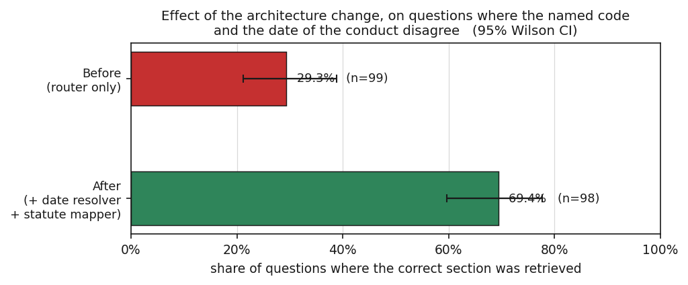

*F10 — Adding a date resolver and a statute mapper more than doubled retrieval of the correct section on the hard case: where the question names one code but the conduct falls under the other. The two intervals do not overlap, so the gain is larger than sampling noise could explain.*

### The scale of what changed

| | As first documented | As measured now |
|---|---|---|
| Evidence base | 2 hand-picked queries | 518 questions across four purpose-built sets |
| Correct answers recorded in advance | none | all 518, fixed before any output was seen |
| Retrieval scores written to disk | none | 859 runs, 80 fields each |
| Individual measurements | 2 confidence values | 2,959 rows, each with sample size and interval |
| Automated tests | none | 237, including known-answer tests |
| Alternative retrievers compared | none | keyword search and rank fusion |
| Figures | 5 architecture diagrams | 17, nine of them measured results |
| Indexed passages | stated as 1,011 | 1,899 after a rebuilt ingest |

**What did not change is the five-agent structure itself.** The pivot was in
what was asked of the system, not in rebuilding it. The two new stages were
added because a measurement said they were needed, and their effect was then
measured in turn.

---

## 4 · What was built

A five-stage pipeline. A question in plain English goes in; an answer with
citations and a PDF report comes out. Two stages use a language model; the rest
are fixed rules or database search.

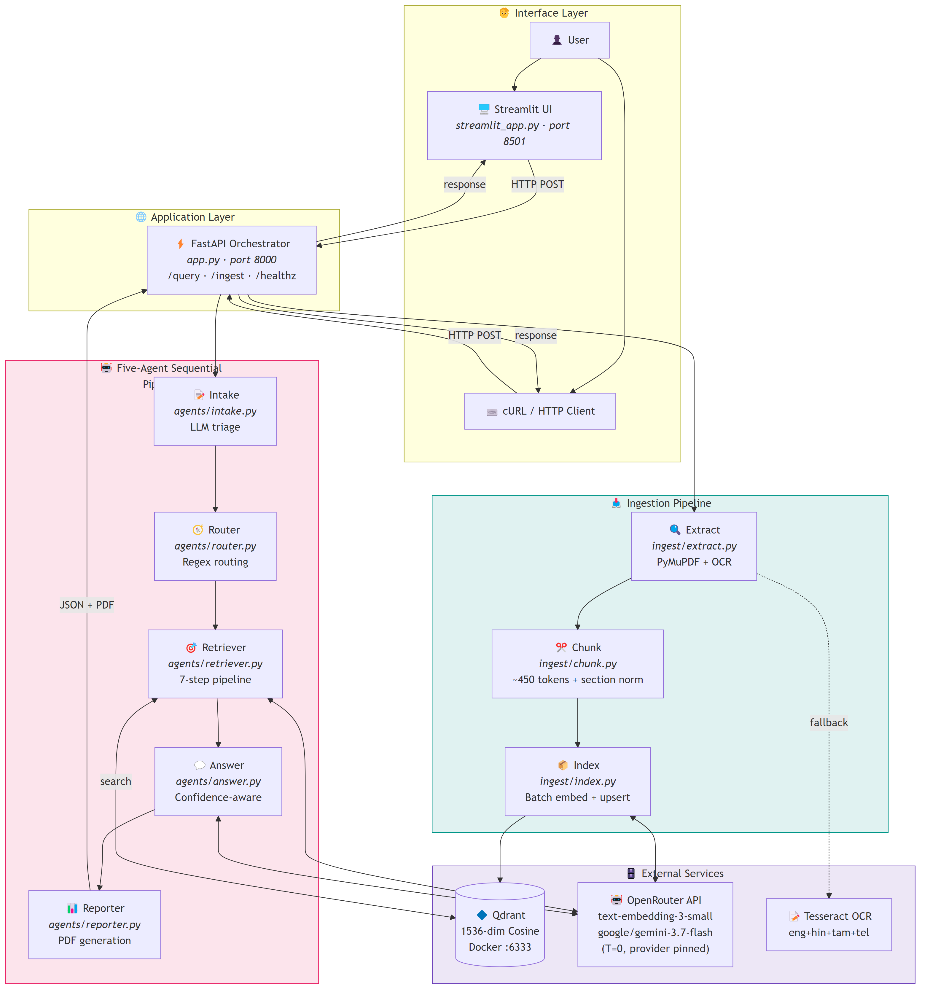

*M1 — The whole system. A question enters at the left and a cited answer with a PDF leaves at the right. Pink boxes use a language model; blue boxes are fixed rules or database search.*

The corpus holds **1,899 passages** of statutory text. That
number matters because every proportion in this report is a share of it, and
because it is smaller than the system's original documentation claimed. Four
statutes are present: the Code of Criminal Procedure 1973 with
742 passages, the Indian Penal Code 1860 with
595, the Bharatiya Nyaya Sanhita 2023 with
424, and the Consumer Protection Act 2019 with
138.

**Four things the original documentation claimed that are not true, and are not
reproduced here.** The corpus does *not* contain the BNSS, the Bharatiya Sakshya
Adhiniyam, the Constitution, or case law — those were never ingested. The
refusal mechanism does *not* protect users, because it has never once triggered.
The composite confidence score is *not* the system's key innovation, because it
performs worse than a simpler alternative. And the passage count is not 1,011.
Section 7 sets out the full list.

### How a question moves through the system

The first stage reads the question and extracts structure from it — what kind of
legal problem it is, and what facts are missing.

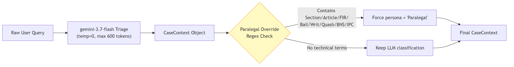

*M2 — The intake stage. It reads the question and extracts structure: what kind of legal problem this is, and which facts are missing.*

The second stage decides which law book to search. It works by matching words
in the question against a fixed table. **Three of its branches point at books
that are not in the index at all**, marked on the diagram: a question about
evidence law is routed to a filter that matches nothing, and the search then
silently falls back to searching everything.

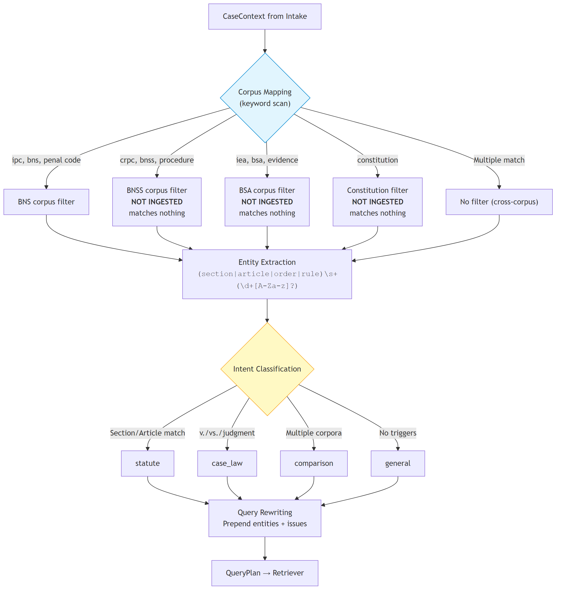

*M3 — The routing stage, which decides which law book to search by matching words against a fixed table. Three branches point at books that were never ingested and therefore match nothing; the search then silently falls back to searching everything.*

The third stage is the retrieval pipeline, and it is where every headline
finding in this report is measured. Seven steps: embed the question, search,
fall back if needed, reorder, filter by score, score confidence, return.

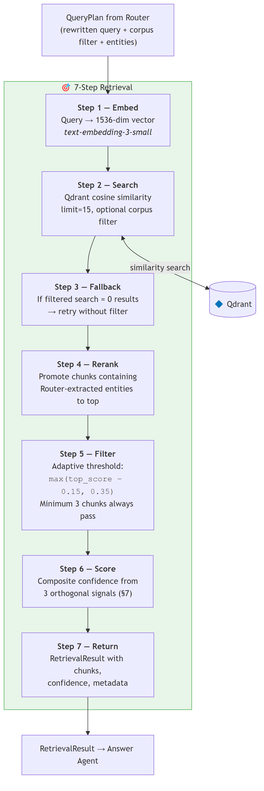

*M4 — The seven retrieval steps. Every headline finding in this report is measured here. Note steps 4 and 5: reranking reorders the fifteen results, and the adaptive filter discards the weakest, which is why a recall figure must always name which of the three stages produced it.*

Two of those steps deserve names, because the rest of this report distinguishes
them constantly. The **corpus filter** restricts the search to one statute
*before* it runs. The **adaptive score filter** discards weak results *after*.
Confusing the two produces meaningless numbers, and earlier versions of this
project did exactly that.

The fourth stage writes the answer using only the passages it was given.

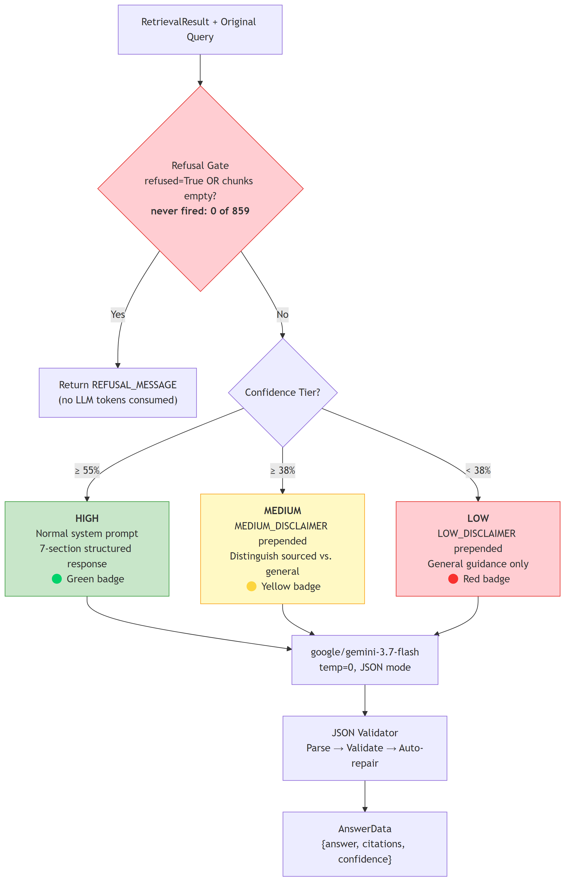

*M5 — The answer stage. The refusal gate is real code, but it has never triggered in 859 recorded queries, so in practice every question is answered.*

Confidence is computed from three signals and used to pick which warning to
attach to the answer.

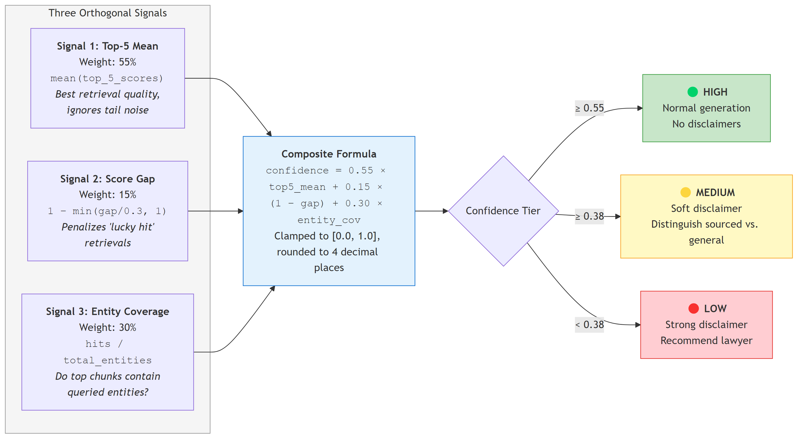

*M6 — How confidence is computed: three signals combined by fixed weights. Finding 6.4 shows this combination performs worse than one of its own inputs used alone.*

Ingestion, run once, converts PDFs into the indexed passages.

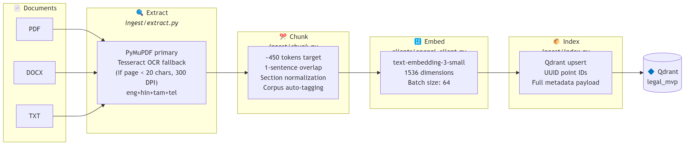

*M7 — Ingestion, run once. PDFs become text, text becomes passages, passages become vectors, vectors go into the database.*

And the whole path, end to end:

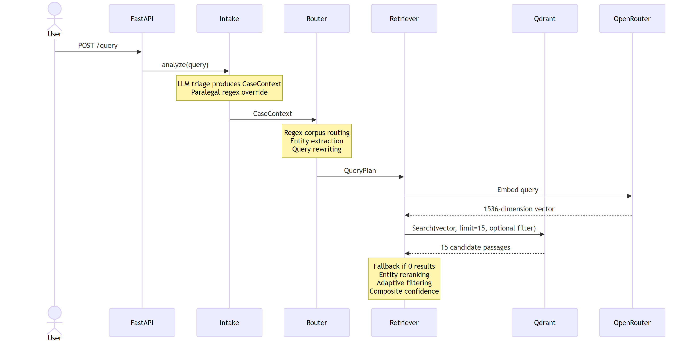

*M8a — The same path in time order, first half: the question arrives, is triaged, routed, embedded, and searched against the database. Split in two so the labels stay legible at page width.*

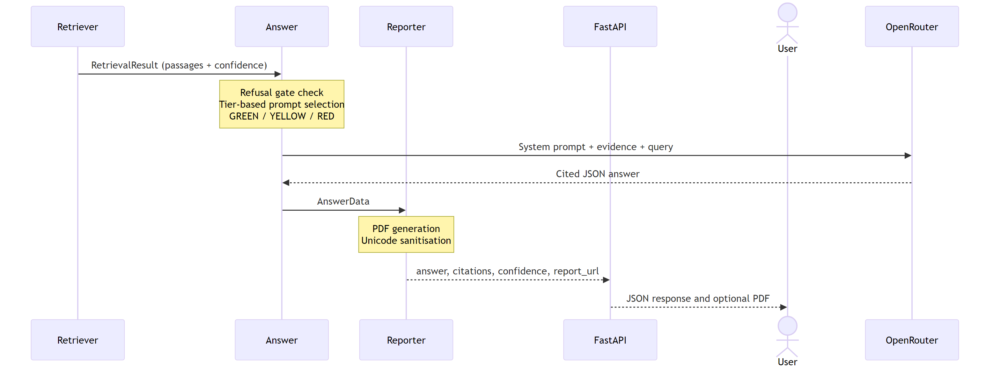

*M8b — Second half: retrieved passages become a cited answer and a PDF, which return to the user.*

---

## 5 · How it was measured

Written for someone who has never evaluated a search system.

### Why "did it work?" is not one question

Suppose you ask *"what is the punishment for cheating under section 420 of the
Indian Penal Code?"* and the system replies with a correct-sounding paragraph
citing IPC 420.

Did it work? There are three different things you might mean.

- **Did the search find the right law?** The system fetches fifteen passages
  before writing anything. Was IPC 420 among them? This is the question about
  *retrieval*, and in this report it is called **retrieved@k**.
- **Did the answer name the right law?** Does IPC 420 appear in the citations?
  This is the question about *writing*, called **cited**.
- **Was the answer actually supported?** Was every section it cited genuinely
  present in the passages it was given, or did the model supply some from
  memory? This is the strict question, called **grounded**.

These come apart, and finding 6.6 is a case where the answer is yes under one
definition and no under another. That is why all three are always reported, and
why every number in this report says which one it used.

### Why the stage matters too

The fifteen fetched passages pass through three states before the model sees
them. They arrive from the database in score order — **raw_15**. They are
reordered to promote passages containing section numbers from the question —
**reranked_15**. Then weak ones are discarded — **filtered_n**, which is what
actually reaches the language model.

A recall figure means a different thing at each. "The right law was found"
could mean the database returned it, or that it survived to the model. Earlier
versions of this project published figures without recording which, and that
single omission made two numbers look like a contradiction when they were both
correct. Every figure here names its stage.

### The questions used

Four sets, 518 unique questions, each with its correct statutory section
recorded **before** any system output was seen.

Three of the four sets are certain by construction, meaning no judgement was
involved in deciding the answer. The generated set of
198 and the paired set of
99 were each built from a known section, so that
section is the answer by definition. The dated-conflict set of
197 is also construction: given a verified pair
of matching provisions and a date, which of the two governs follows mechanically
from the commencement date of 1 July 2024.

Only the layman set of 120 required judgement —
reading a described situation and deciding which section governs it — and that
judgement was made by one person. Section 8 treats this as the largest threat to
everything reported here.

The paired set is the experiment rather than merely the data: it asks the same
legal question twice, once with the old code's number and once with the new
one's. Any difference between the two arms is attributable to the numbering,
because nothing else changed.

### How the measurements were checked

Four safeguards, because a metric that returns a plausible wrong number is the
failure this project was built to avoid.

**237 automated tests**, including tests where the correct output was worked out
by hand before the code ran. **One shared measurement library**, imported by
every experiment, so no two experiments can disagree about what a word means.
**A second, independent re-derivation** inside each experiment, which recomputes
one of its own numbers by a different route and stops if the two disagree. And
**no manual transcription anywhere**: every number in every results document is
extracted by a filter that crashes rather than guess if it matches more than one
row.

That last safeguard caught two real errors while this report was being written,
and both are in section 7.

### 5.5 One query, all the way through

Everything above is aggregate. This is one real question from the layman set,
`L0021`, traced end to end from its log record. Every value below is
read from that log; none is typed.

It is here because it makes section 6.6 concrete: **the search never found the
governing section, and the answer cited it anyway.**

**The question, exactly as it was typed:**

> its been 3 days since they took my father. still not in court. they keep saying wait. he has bp problem needs tablets

**What the intake stage extracted.** It read the situation as
*Illegal Police Detention*, the asker as *Layman*, urgency
*Immediate*, and listed 4 facts it
would need in order to answer properly — beginning with which police station is
holding him. The person asking supplied none of them, which is the normal case.

**What the router decided.** Target corpus `None`, decision
path `no_match`, intent `general`, entities
extracted: none. The question names no statute and no
section number, so no rule matched, **no corpus filter was applied, and the
search ran across all four books at once.**

**The five best passages the search returned**, of fifteen:

| rank | statute | section | similarity | page |
|---|---|---|---|---|
| 1 | CRPC | s. 329 | 0.3403 | p149 |
| 2 | CRPC | no section number | 0.3157 | p239 |
| 3 | CRPC | s. 76 | 0.3147 | p48 |
| 4 | CRPC | s. 331 | 0.3117 | p150 |
| 5 | CRPC | s. 167 | 0.3068 | p85 |

**None is the governing provision.** The top result concerns the trial of a
person of unsound mind. The second is a blank warrant form carrying no section
number at all. Only the third, on producing an arrested person before a court
without delay, is close to the subject.

**What survived the adaptive filter.** 15 passages went in
and **3** came out — the minimum the rule forces
through regardless of score. The best similarity anywhere in the search was
0.3403, which is low.

**The confidence signals, and what they produced:**

| signal | value |
|---|---|
| top-5 mean similarity | 0.3178 |
| score gap | 0.0334 |
| entity coverage | 0.5 |
| statute consistency | not computed at run time; built later, section 6.4 |
| **composite confidence** | **0.4581** |

A composite of 0.4581 falls in the **MEDIUM** band. The log
records the tier as `HIGH`, which is wrong — that is the
tier-logging bug from section 7, visible here in a single record. The refusal
gate did not fire, as it never has.

**The first line the system wrote:**

> *(Disclaimer: The information below is for educational purposes. Detaining an individual beyond 24 hours without court production is a critical legal emergency. Please consult a qualified criminal defense advocate immediately.)*

**What it cited, and whether the retrieved passages actually supported it:**

| provision cited | supported by a retrieved passage? | |
|---|---|---|
| `CRPC Section 76` | yes |  |
| `BNSS Section 57` | no | **not in the corpus at all** |
| `BNSS Section 58` | no | **not in the corpus at all** |
| `CRPC Section 54` | no |  |
| `CRPC Section 55A` | no |  |
| `CRPC Section 97` | no |  |
| `CONSTITUTION Article 22(2)` | no | **not in the corpus at all** |
| `Article 226` | no |  |

**8 provisions cited; 1 supported.** Three
come from books that were never ingested, so no passage could ever have
supported them — the model supplied those from its own training.

**The correct answer** is `CRPC 57` for conduct before 1 July 2024 and
`BNSS 58` on or after it. Neither appears anywhere in the fifteen passages:
present at `raw_15` — False; at `reranked_15` —
False; at `filtered_n` — False.

**So was this query answered correctly?** It depends entirely on the definition:

| definition | verdict | why |
|---|---|---|
| `retrieved@15` | **incorrect** | the governing section was never fetched |
| `cited` | correct | the answer names `BNSS 58` regardless |
| `grounded` | **incorrect** | 7 of 8 citations are unsupported |

**This one row is the whole argument.** Someone asked why their father was still
in custody after three days. The search returned nothing relevant, the system
recorded itself as confident, and the answer it wrote cited the right law
anyway — so nobody reading the output would know the retrieval had failed.

---

## 6 · The findings

Strongest evidence first.

### 6.1 The system is more reliable on the law that no longer applies

**The finding.** When a question names the repealed code, the system usually
finds the right law. When it names the code actually in force, it finds the
right law barely more often than if it had ignored the question entirely.

**What this means in practice.** A law student researching a 2019 offence gets
good results. A citizen asking about something that happened last month — the
case where the answer goes on a police complaint — gets results little better
than chance.

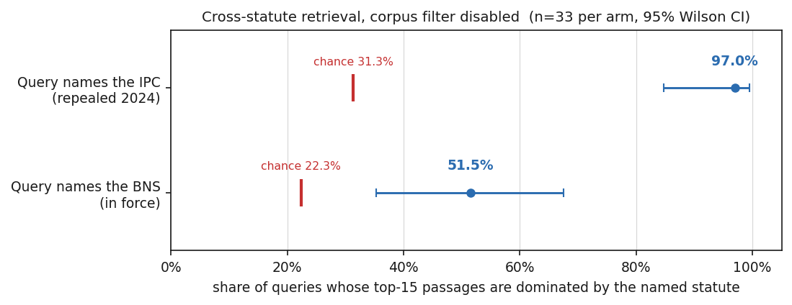

*F2 — Naming the repealed statute works; naming the one in force barely beats chance. Red ticks are the chance baseline: each statute's share of the index, i.e. what a retriever ignoring the question would score.*

Questions naming the Indian Penal Code retrieve mostly IPC text
**97.0%** of the time, and since the IPC occupies
31.3% of the index, that is far above what ignoring the question
would achieve. Questions naming the Bharatiya Nyaya Sanhita retrieve mostly BNS
text only **51.5%** of the time against a 22.3%
baseline — real, but weak. Both rest on 33 questions per
arm, so their 95% confidence intervals are wide: [84.7%, 99.5%]
and [35.2%, 67.5%]. Narrowing them would need more questions,
not better analysis.

The misses do not scatter. When a BNS-named question fails, the passages it
gets back are overwhelmingly from the repealed code — the failure has a
direction, which is what makes it a finding rather than noise.

**The same pattern appears again inside the pipeline.** Of every fifteen
passages fetched for a layman question, the share coming from the procedure
code rises from 1.49 times its fair share to
1.80 times after the weak results are discarded, while
the share from the code in force falls from 0.58 to
0.34 times. A step whose only job is removing noise is
removing substantive criminal law and concentrating procedure.

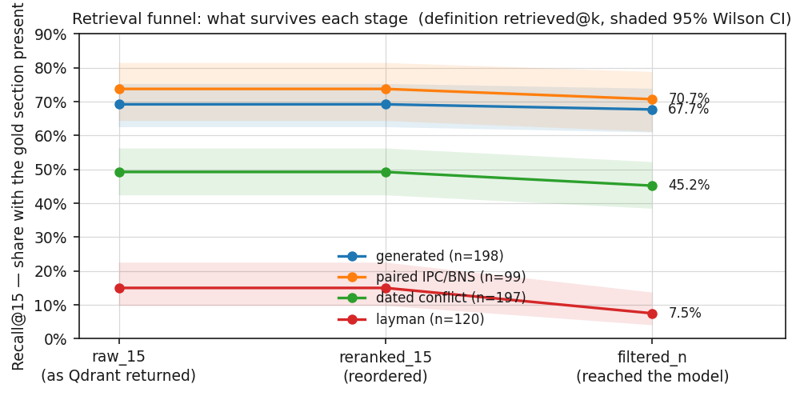

*F5 — Recall@15 is the share of questions whose correct section was present. The adaptive score filter costs every query set a little and the layman set half of what it had. But the layman line starts at 15%: the filter is not the main problem, the retrieval is. Correctness definition retrieved@k; shaded bands are 95% Wilson intervals.*

That filter costs the layman questions half of what they had: recall falls from
0.150 to 0.075. But read the starting point
before drawing the wrong conclusion. Even before any filtering, only
0.150 of layman questions had their correct section retrieved at
all. **Removing the filter entirely would still leave most ordinary-language
questions unanswered.** The filter is a secondary problem.

**How it could be wrong.** The measure is coarse: it asks which statute
*dominates* the fifteen passages, which can score zero even when the single best
passage is correct — finding 6.2 contains exactly such a case. The corpus filter
is switched off for this measurement, because with it on an IPC-named question
physically cannot return BNS text, and the question becomes unaskable. And
33 questions per arm is a small sample.

### 6.2 Keyword search does not fix it; it breaks the other half

**The finding.** The obvious remedy — search for exact words instead of meaning
— fails in the opposite direction, and combining the two methods produces a
system that fails at both.

**What this means in practice.** There is no drop-in retrieval fix. Anyone
proposing to solve this by changing the search engine has to explain which half
of the queries they are willing to lose.

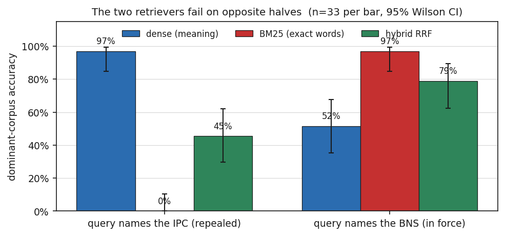

*F3 — Exact-word search does not repair the failure, it reverses it. Fusing the two (green) lands between them and beats neither: averaging two opposite failure modes fails at both.*

Keyword search raises accuracy on questions naming the code in force from
51.5% to **97.0%** — a large and real
improvement. But on questions naming the repealed code it collapses from
97.0% to **0.0%**, which is below the
31.3% a system ignoring the question would score. Fusing the two
methods lands in between on both arms, at 45.5% and
78.8%, and beats neither at what it was good at.
Averaging two opposite failures gives you a system that fails twice.

**How it could be wrong.** The 0.0% figure is an artefact of the
coarse measure. On at least one question, keyword search puts the correct IPC
section *first* and then fills the remaining fourteen slots with procedure-code
cross-references, so "which statute dominates" scores it zero. Judged on the
single best passage instead, keyword search is not catastrophic. The direction
of the finding survives; the magnitude is exaggerated.

### 6.3 The cause is in how the statutes are written

**The finding.** The new code writes its own name inside its own text. The old
one never did. So the old code's name has become, statistically, a word
belonging to a different book.

**What this means in practice.** This is not a bug anyone introduced and not
something a better search engine fixes. It is a property of legal drafting, and
it should recur in any jurisdiction that replaces a statute rather than amending
it.

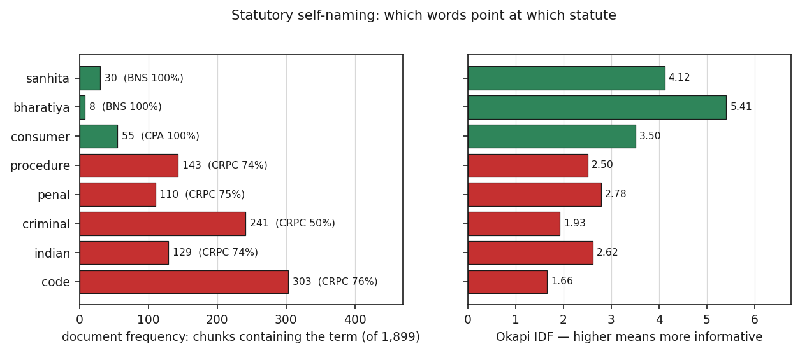

*F4 — Bars are coloured by the statute the term concentrates in (green BNS/CPA, red CrPC, grey mixed). 'sanhita' occurs in 30 chunks, all BNS — a perfect signpost. 'penal' occurs in 110, but 82 are CrPC and only 23 are IPC: the Penal Code's own name points elsewhere.*

The word *sanhita* appears in **30** of the
1,899 passages, and every single one is Bharatiya Nyaya
Sanhita text. A search for it lands in the right book every time — it is a
perfect signpost.

The word *penal* appears in **110** passages. Only
**23** are Indian Penal Code. **82**
are Code of Criminal Procedure. Searching for the Penal Code by its own name
points at the procedure code roughly three times more often than at the Penal
Code itself.

The reason is mundane once seen. The 1860 drafters had no occasion to write
"penal" inside the Penal Code; you do not name the book you are in. The
procedure code, by contrast, cites it constantly, because procedure refers to
offences. So the old statute's name survives mainly in the documents that
mention it, not in the document that is it.

Both statutes name themselves rarely — the Bharatiya Nyaya Sanhita in
7.1% [5.0%, 9.9%] of its own passages, the
Indian Penal Code in 3.9% [2.6%, 5.7%]. The
asymmetry that matters is not how often they say their names, but whether saying
the name identifies the book.

**How it could be wrong.** Only presence was counted, not how many times a word
occurs within a passage; keyword search uses both, so this explains the direction
of the effect without fully reconstructing the ranking. The corpus is four
statutes, and the argument that this generalises is an argument, not a
measurement.

### 6.4 The confidence score is worse than a number it already had

**The finding.** The system combines three signals into a confidence score. That
combination separates right answers from wrong ones less well than the single
simplest number available, and fixing a genuine bug inside it does not close the
gap.

**What this means in practice.** The engineering effort that went into the
composite score bought nothing. Anyone building on this system should use the
raw similarity and spend the effort elsewhere.

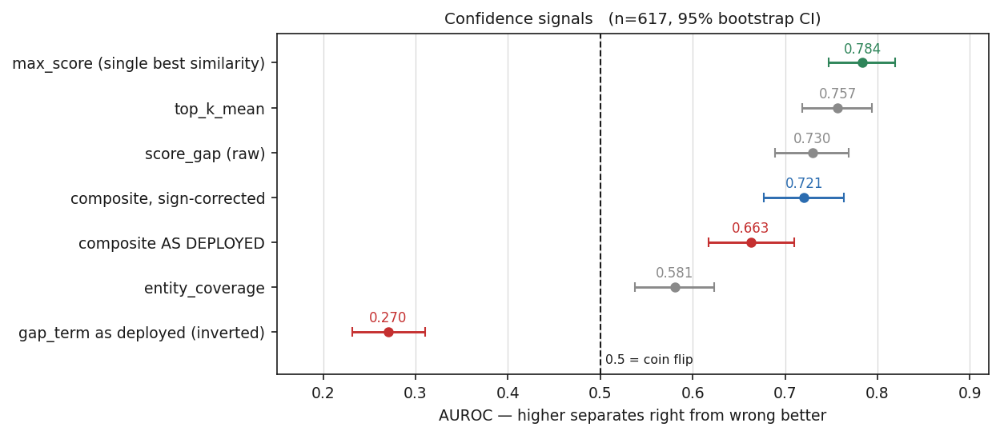

*F6 — The deployed composite (red) is beaten by three of its own ingredients. One term is inverted and scores below chance. Correcting the sign lifts the blend (blue) but it still loses to a single raw similarity (green). Measured under correctness definition retrieved@k at retrieval stage raw_15.*

The measure is AUROC: pick one right answer and one wrong answer at random, and
ask how often the right one scored higher. Half means the score is a coin flip.

The deployed composite scores 0.6631 [0.6172, 0.7096]. The
single highest similarity from the search — a number already sitting in the
logs, costing nothing — scores 0.7837 [0.7470, 0.8195]. Two of
the composite's own three ingredients also beat it: 0.7571 and
0.7298. **A blend of three signals is worse than one of the
signals alone.**

One ingredient turned out to be wired backwards. The gap between the best and
second-best result is evidence of a clear winner, but the deployed code treats
it as evidence of doubt, and measured on its own that inverted term scores
0.2702 — below half, meaning it points the wrong way.

That raised an obvious objection: perhaps the whole finding is just this bug.
It is not. Correcting the sign lifts the composite to
0.7207, a real improvement, but it still loses to the
simple number by -0.0630 [-0.0946, -0.0325]. **The bug
explains about half of the original -0.1207 shortfall; the rest
is the blend itself.** And when the three corrected signals are given the best
weighting that can be found, then tested on questions the search never saw, they
reach 0.7631 — a tie with the simple number, never a win.

**One thing does work, in one place.** A fourth signal was built for this
project: the fraction of retrieved passages that come from the statute the
question and its date imply. Overall it scores 0.6845 [0.6557, 0.7139],
no better than what already existed. But on the
197 questions where the named code and the offence date disagree —
precisely the hard case — it reaches **0.8300** [0.7819, 0.8750]. The
catch is that on most other questions the search filter was itself built from
the same date information, so the signal cannot fail there by construction. It
earns its keep only where the question and the date pull apart.

**How it could be wrong.** Under the strict `grounded` definition there are only
27 right answers among 617 questions, and every comparison under it is too
underpowered to separate anything. This finding rests on the other two
definitions.

### 6.5 There is no confidence setting that makes the system safe

**The finding.** The standard safety mechanism for a system like this is to
answer only when confident and stay silent otherwise. These measurements say
that mechanism cannot be built on the current confidence score.

**What this means in practice.** You cannot deploy this behind a rule like
"only answer when at least 90% likely to be right", because no such threshold
exists at any level of caution.

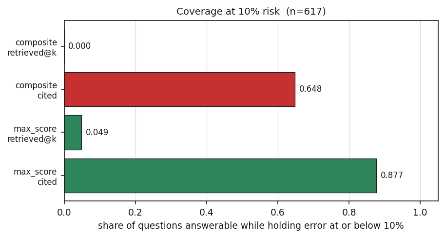

*F8 — Under retrieved@k, BOTH scores are at or near zero: there is no confidence threshold at which the system can answer any share of questions and be wrong only one time in ten. These zeros are measured, not missing. The full risk-coverage curve is not in the results files and is not shown.*

If the system answered only its most confident questions, what share could it
answer while being wrong at most one time in ten? For the composite score the
answer is **0.0000** — no threshold anywhere on the curve reaches that
error rate. For the simple similarity score it is 0.0486. These zeros
are measured values, not missing data.

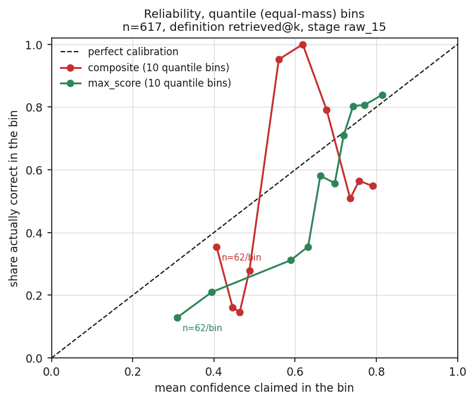

*F7 — On the diagonal means a claimed confidence matches observed accuracy. The deployed composite (red) is NON-MONOTONE: it peaks in the middle and falls back at the top, so its most confident answers are no better than its middling ones. max_score (green) rises throughout.*

The reason is visible in the shape of the curve. A well-behaved confidence score
climbs steadily: the more confident it is, the more often it is right. The
composite does not. It rises through the middle of its range and then **falls
back at the top**, so the answers it is most sure about are no better than its
middling ones. The simple similarity score climbs throughout.

A summary statistic hides this completely. The composite's calibration error is
0.2410 [0.2016, 0.2695] against 0.1270 [0.1065, 0.1681] for the
simple score — worse, but a single number cannot tell you *that the curve bends
the wrong way at the end*, which is the part that matters for safety.

**How it could be wrong.** The composite was never designed to be a probability;
it is a weighted sum of similarity scores. Calibration measures assume a
probability, so applying them here needs the caveat. The zeros are a real
property of this score, not proof that no score could work.

### 6.6 None of this shows up in the answers

**The finding.** The retrieval failure is invisible in what the system writes,
because the language model cites correct sections whether or not the search
found them.

**What this means in practice.** Anyone evaluating this system by reading its
answers would conclude it works. The failure is only visible if you inspect what
was retrieved — and a legal system whose failures are invisible is more
dangerous than one whose failures are obvious.

The gap between the two arms of the paired set is
0.5455 [0.3030, 0.7576] when measured on what was
*retrieved* — a large, clear difference. Measured on what was *cited* it is
-0.0303 [-0.1212, 0.0606], an interval straddling zero, which
means the data cannot distinguish the two arms at all. Under the strict
definition it is -0.0303 [-0.0909, 0.0000], again straddling
zero.

The mechanism is straightforward and was measured directly: the arm asking with
old-code numbering cites the correct section about nine times in ten, and the
arm asking with new-code numbering does about as well. The model supplies
correct citations from its own training regardless of what the search returned.

**How it could be wrong.** This is stated throughout as a claim about
*retrieval*. A reviewer who measures citation accuracy instead will not
reproduce the headline gap, and would be right not to. The finding is that the
two disagree — which is why every number in this report names its definition.

---

## 7 · What we got wrong

Leading with this rather than burying it. Each row: what was claimed, what is
true, and what caught it.

| What was claimed | What is true | What caught it |
|---|---|---|
| The corpus covers the BNS, BNSS, BSA, CrPC, Constitution, CPA, IPC and judicial precedents | **Four documents only** — IPC, BNS, CrPC, CPA. The rest were never ingested; tags for them existed only as artefacts of substring matching | Corpus audit, `GAPS.md` finding 10 |
| "Calibrated refusal — the system refuses rather than hallucinating" | The refusal gate **has never fired once** in 859 logged queries | Log audit across every recorded run |
| Composite confidence scoring is the key innovation | The composite scores **worse** than a single raw similarity number, and one of its three signals sits at chance | Signal ablation with paired significance tests |
| "Grounded answers — every claim backed by citations" | A large majority of what layman answers cite is **absent** from the passages supplied to the model | Citation-versus-retrieval audit |
| Deterministic routing eliminates routing errors | Routing was the **largest single source of error**; a fallback sent every criminal query to the penal code, making the IPC unreachable | Routing confusion matrix |
| 1,011 passages | **1,899** after the ingest rebuild | Index count |
| GPT-4o-mini | `google/gemini-3.7-flash` via OpenRouter, provider pinned | Provider migration |
| Validation results in the February architecture PDF, section 8 | Section 8.2 **cannot be produced by the stated formula**. It must not be carried into any paper | Formula reconstruction |
| "A counting bug halved a published figure — 7.5% should be 15.0%" | **False, and retracted.** Both figures were correct at their own retrieval stage. The text-parsing rule was verified correct 4,906 times out of 4,906 | A re-measurement that contradicted the claim |
| BNS-named recall of 33.3% is a retrieval failure | **It is a ceiling, not a failure.** Where a correct answer names a subsection the index stores only as a whole section, no retriever can find it | An independent re-derivation during the keyword-search experiment |
| The confidence formula is `0.55·top_k_mean + 0.15·score_gap + 0.30·entity_coverage` | The deployed code **inverts** the middle term. A documentation error, not a code defect — the recorded scores were always right | A reconstruction check: the documented formula matched none of the 617 rows; the real one matches to five decimal places |
| Two published confidence figures, 0.610 and 0.663 | They record neither which correctness definition nor which retrieval stage produced them, and none reproduces the pair. **Superseded, not reconcilable** | The pre-analysis gate check |
| — | **Two defects in this project's own measuring code.** One raised an error on real data; the fix for it then silently returned zero correct answers out of 617 while nothing crashed and every number looked plausible | The gate check, before any number was published |

The last row is the one worth dwelling on. A measurement that crashes is
harmless. A measurement that quietly returns a believable wrong number is how
this project lost six months earlier in its life, and it is why the verification
described in section 4 exists.

---

## 8 · Limitations

Stated as a reviewer would state them.

1. **All ground truth was decided by one person.** One of the four question sets,
   the layman set, required legal judgement about which section governs a
   described situation; the other three are certain by construction. No
   independent expert has validated any label. This is the largest threat to
   every finding in this report.
2. **A ceiling caps every retrieval figure.** Only 85.7%
   [82.4%, 88.5%] of 518 questions have a
   correct answer the index can return at all, because some gold labels name a
   subsection stored only as a whole section. On questions naming the code in
   force the ceiling is 33.3%. **Recall figures must be read
   against this, not against 100%** — and on that subset the retrieval that was
   measured reaches the ceiling exactly, meaning it is perfect on everything
   reachable.
3. **One embedding model, one vector database, one jurisdiction, four
   statutes.** No result generalises beyond this configuration without retesting.
4. **The strict correctness definition is underpowered**, with 27 right answers
   among 617 questions. Every comparison under it straddles zero.
5. **One significance claim is lost under proper clustering.** Three phrasings of
   one situation are not three independent facts. The layman retrieval rate after
   filtering is significant when rows are treated as independent
   [0.033, 0.125] and **not significant** when situations are
   [0.000, 0.167], because the successes concentrate in a
   few situations.
6. **One verification assertion is left deliberately failing.** Four clustered
   intervals came out narrower than their unclustered counterparts and remain
   unexplained after ruling out implementation bugs and random variation across
   five seeds. Those two subsets are marked unusable rather than explained away.
7. **Three labelled rows are dropped** by a deduplication rule, so the sample is
   617 where it could be 620. Disclosed rather than fixed, because changing it
   would shift every number in ten results files for a difference that moves no
   conclusion.
8. **The headline finding is definition-dependent** and does not survive at
   citation level, as section 6.6 states.
9. **Answer quality was not evaluated.** This work measures retrieval,
   confidence and citation behaviour. It does not assess whether the legal advice
   is sound.

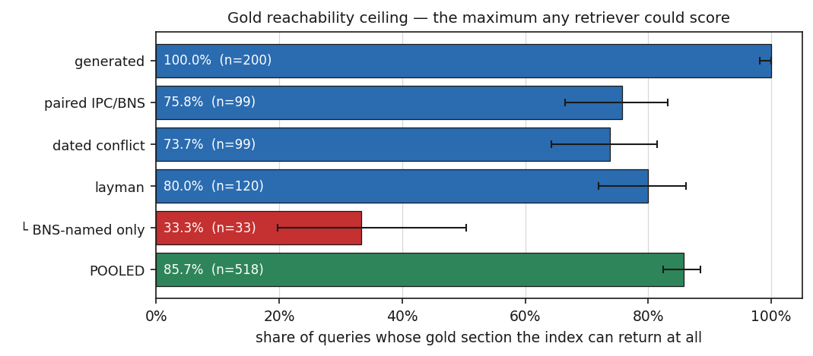

*F9 — Where gold labels name a subsection the index stores only as a bare section, no retriever can score them. BNS-named queries are capped at 33.3%: every recall figure must be read against this, not against 100%.*

---

## 9 · What could be done next

Candidates with rough cost and effort. No recommendation is made.

| Candidate | Cost | Effort |
|---|---|---|
| Independent expert validation of ~30 questions and their gold labels | none; needs an introduction | one day for the validator |
| Re-derive gold labels at subsection granularity, raising the 85.7% ceiling | none | 1–2 days, and it revises the evaluation set |
| Ingest the BNSS and BSA to close the corpus gap | about ₹50 in embeddings | 1 day, but it breaks comparability with the 1,899-passage index every figure here uses |
| Count how often terms occur within a passage, not just whether they occur, to complete section 5.3 | none | half a day |
| A second embedding model as a robustness check | about ₹50, or free with a local model | 1 day |
| Manual error taxonomy over the failing layman questions | none | 2 days of coding by hand |
| Build the statute-and-date resolution layer, then re-measure | about ₹5 | 3–4 days |
| Full risk-coverage curves rather than the three anchor points | none | half a day |

---

## Appendix A · Glossary

Every technical term used in this report, in plain language.

**adaptive score filter** — A step that discards retrieved passages scoring below a threshold set from the best score in that search. Distinct from the corpus filter, which restricts the search before it runs.

**AUROC** — Area Under the Receiver Operating Characteristic curve. Pick one correct answer and one wrong answer at random; AUROC is the probability the correct one has the higher score. 0.5 is a coin flip and means the score knows nothing; 1.0 is perfect separation; below 0.5 means the score points the wrong way.

**BM25** — A search method that ranks documents by which query words literally appear in them, weighted by how often and how rare each word is. Contrast with dense retrieval, which matches on meaning rather than exact words.

**BNS** — Bharatiya Nyaya Sanhita 2023. India's criminal code since 1 July 2024, replacing the Indian Penal Code.

**BNSS** — Bharatiya Nagarik Suraksha Sanhita 2023. The new criminal procedure code. NOT in this system's corpus.

**bootstrap confidence interval** — A range computed by resampling the data many times (here 10,000) and seeing how much the answer moves. It says: given this sample size, the true value plausibly lies in this range.

**Brier score** — The average squared difference between a claimed probability and what actually happened. Lower is better; 0 is perfect. Claiming 0.9 on something that happens costs (1−0.9)² = 0.01.

**calibration** — Whether a stated confidence matches reality. A perfectly calibrated system that says '70% confident' is right 70 times in 100.

**chunk** — One passage of statutory text stored in the database, typically a section or part of one. This corpus holds 1,899 of them.

**cluster bootstrap** — A confidence interval that resamples GROUPS rather than rows. Three phrasings of the same legal situation are not three independent facts; treating them as such makes intervals look narrower than they are.

**corpus filter** — A restriction applied BEFORE searching, limiting the search to one statute. Distinct from the adaptive score filter, which drops low-scoring passages afterwards. Conflating the two is a common error here.

**coverage at risk** — If you answered only the questions you were most confident about, what share could you answer while keeping errors at or below some level (here 10%)?

**CPA** — Consumer Protection Act 2019.

**CrPC** — Code of Criminal Procedure 1973. Still in this corpus; replaced in law by the BNSS.

**dense retrieval** — Search by meaning. Each passage and each question becomes a list of 1,536 numbers (an embedding); similar meanings give similar lists.

**ECE** — Expected Calibration Error. Sort answers by confidence, group them into bins, and average how far each bin's claimed confidence sits from its actual accuracy. Lower is better; 0 is perfect.

**embedding** — A list of numbers representing a piece of text's meaning. Here 1,536 numbers produced by openai/text-embedding-3-small.

**entity coverage** — One of the system's three confidence signals: whether section numbers named in the question appear in the retrieved passages.

**gold label** — See ground truth.

**ground truth** — The correct answer, decided in advance by a human and recorded before any system output was seen. Here: which statutory section correctly answers each query.

**IDF** — Inverse Document Frequency. How informative a word is, from how few documents contain it. A word in 30 of 1,899 chunks is a strong clue; a word in 1,500 tells you almost nothing.

**IPC** — Indian Penal Code 1860. Repealed on 1 July 2024 but still governing any offence committed before that date.

**lexical retrieval** — Search by exact words rather than meaning. BM25 is the lexical method used here.

**MRR** — Mean Reciprocal Rank. If the correct passage is at position 1 you score 1, at position 2 you score 1/2, at position 4 you score 1/4. Averaged over all queries. Rewards putting the right answer near the top.

**nDCG** — Normalised Discounted Cumulative Gain. Like MRR, a rank-sensitive score that penalises correct answers appearing further down the list.

**p-value** — The probability of seeing a difference at least this large if there were really no difference at all. Small means the difference is unlikely to be chance alone. It does NOT say how big or how important the difference is.

**paired test** — A comparison that uses the fact that two scores were measured on the SAME questions. Comparing two separate confidence intervals by eye is not a test and is far too conservative.

**precision@k** — Of the k passages returned, what share are correct. With a single correct section per query it equals recall@k divided by k, so it adds no information here and is reported only for completeness.

**Qdrant** — The vector database storing the 1,899 embedded passages and answering nearest-neighbour searches over them.

**RAG** — Retrieval-Augmented Generation. Fetch relevant documents first, then have a language model write an answer using only those documents. The idea is that the model quotes sources rather than inventing them.

**reachability ceiling** — The highest score any retriever could possibly achieve, given that some correct answers are not stored in a form the system can return. Scores must be read against this, not against 100%.

**recall@k** — Of the questions that have a correct section, the share where that section appeared among the top k retrieved passages. The central retrieval measure in this report.

**reciprocal rank fusion** — A way of combining two ranked lists: each document scores 1/(60 + its rank) in each list, and the scores are added. The constant 60 is from Cormack, Clarke and Buttcher, SIGIR 2009.

**recodification** — Replacing a statute wholesale with a new one rather than amending it. India replaced the Indian Penal Code 1860 with the Bharatiya Nyaya Sanhita 2023 on 1 July 2024. Both remain operative: which applies depends on when the offence occurred.

**reliability diagram** — A plot of claimed confidence against observed accuracy. A perfectly calibrated system sits on the diagonal.

**risk-coverage curve** — As you accept lower-confidence answers, coverage rises and so does error. The curve traces that trade-off.

**savings provision** — A clause keeping an old law alive for conduct that happened while it was in force, even after repeal. This is why both India's old and new criminal codes are simultaneously live law.

**score gap** — One of the three confidence signals: the difference between the best and second-best retrieval score. A large gap suggests a clear winner.

**self-naming** — Whether a statute writes its own name inside its own text. It determines whether searching for a statute by name finds it.

**statute consistency** — A fourth confidence signal, specified in the design and built for the first time in this work: the fraction of retrieved passages coming from the statute the question and its date imply.

**top-k mean** — One of the three confidence signals: the average similarity of the top few retrieved passages.

---

## Appendix B · Provenance

The ledger. Every headline value with its 95% confidence interval, sample size,
correctness definition, retrieval stage, source file, and the command that
regenerates it. Nothing in the body of this report was typed by hand; each of
these was extracted by a filter that must match exactly one row or the program
stops.

| Figure | Value | 95% CI | n | definition | stage | source | regenerate |
|---|---|---|---|---|---|---|---|
| IPC-named cross-statute accuracy, dense | 97.0% | [84.7%, 99.5%] | 33 | `dominant_corpus_among_top15` | `dense` | `hybrid_comparison.csv` | `./venv/Scripts/python.exe experiments/exp07_hybrid.py` |
| BNS-named cross-statute accuracy, dense | 51.5% | [35.2%, 67.5%] | 33 | `dominant_corpus_among_top15` | `dense` | `hybrid_comparison.csv` | `./venv/Scripts/python.exe experiments/exp07_hybrid.py` |
| IPC-named, BM25 | 0.0% | [0.0%, 10.4%] | 33 | `dominant_corpus_among_top15` | `bm25` | `hybrid_comparison.csv` | `./venv/Scripts/python.exe experiments/exp07_hybrid.py` |
| BNS-named, BM25 | 97.0% | [84.7%, 99.5%] | 33 | `dominant_corpus_among_top15` | `bm25` | `hybrid_comparison.csv` | `./venv/Scripts/python.exe experiments/exp07_hybrid.py` |
| IPC-named, hybrid RRF | 45.5% | [29.8%, 62.0%] | 33 | `dominant_corpus_among_top15` | `hybrid_rrf` | `hybrid_comparison.csv` | `./venv/Scripts/python.exe experiments/exp07_hybrid.py` |
| BNS-named, hybrid RRF | 78.8% | [62.2%, 89.3%] | 33 | `dominant_corpus_among_top15` | `hybrid_rrf` | `hybrid_comparison.csv` | `./venv/Scripts/python.exe experiments/exp07_hybrid.py` |
| Chance baseline, IPC share of index | 31.3% | no CI | 1899 | `n/a` | `n/a` | `hybrid_comparison.csv` | `./venv/Scripts/python.exe experiments/exp07_hybrid.py` |
| Chance baseline, BNS share of index | 22.3% | no CI | 1899 | `n/a` | `n/a` | `hybrid_comparison.csv` | `./venv/Scripts/python.exe experiments/exp07_hybrid.py` |
| Top-1 corpus, IPC-named, dense | 90.9% | [76.4%, 96.9%] | 33 | `corpus_of_top1_chunk` | `dense` | `hybrid_comparison.csv` | `./venv/Scripts/python.exe experiments/exp07_hybrid.py` |
| Top-1 corpus, BNS-named, dense | 42.4% | [27.2%, 59.2%] | 33 | `corpus_of_top1_chunk` | `dense` | `hybrid_comparison.csv` | `./venv/Scripts/python.exe experiments/exp07_hybrid.py` |
| Gold reachability ceiling, pooled | 85.7% | [82.4%, 88.5%] | 518 | `retrieved@k` | `n/a` | `hybrid_comparison.csv` | `./venv/Scripts/python.exe experiments/exp07_hybrid.py` |
| Gold reachability ceiling, BNS-named | 33.3% | [19.8%, 50.4%] | 33 | `retrieved@k` | `n/a` | `hybrid_comparison.csv` | `./venv/Scripts/python.exe experiments/exp07_hybrid.py` |
| Recall@15 generated | 0.692 | [0.624, 0.752] | 198 | `retrieved@k` | `raw_15` | `retrieval_metrics.csv` | `./venv/Scripts/python.exe experiments/exp01_retrieval.py` |
| Recall@15 paired IPC/BNS | 0.737 | [0.643, 0.814] | 99 | `retrieved@k` | `raw_15` | `retrieval_metrics.csv` | `./venv/Scripts/python.exe experiments/exp01_retrieval.py` |
| Recall@15 dated conflict | 0.492 | [0.423, 0.562] | 197 | `retrieved@k` | `raw_15` | `retrieval_metrics.csv` | `./venv/Scripts/python.exe experiments/exp01_retrieval.py` |
| Recall@15 layman | 0.150 | [0.097, 0.225] | 120 | `retrieved@k` | `raw_15` | `retrieval_metrics.csv` | `./venv/Scripts/python.exe experiments/exp01_retrieval.py` |
| Recall@15 pooled | 0.530 | [0.491, 0.569] | 617 | `retrieved@k` | `raw_15` | `retrieval_metrics.csv` | `./venv/Scripts/python.exe experiments/exp01_retrieval.py` |
| AUROC max_score | 0.7837 | [0.7470, 0.8195] | 617 | `retrieved@k` | `raw_15` | `ablation.csv` | `./venv/Scripts/python.exe experiments/exp04_ablation.py` |
| AUROC top_k_mean | 0.7571 | [0.7188, 0.7939] | 617 | `retrieved@k` | `raw_15` | `ablation.csv` | `./venv/Scripts/python.exe experiments/exp04_ablation.py` |
| AUROC score_gap raw | 0.7298 | [0.6894, 0.7684] | 617 | `retrieved@k` | `raw_15` | `ablation.csv` | `./venv/Scripts/python.exe experiments/exp04_ablation.py` |
| AUROC composite as deployed | 0.6631 | [0.6172, 0.7096] | 617 | `retrieved@k` | `raw_15` | `ablation.csv` | `./venv/Scripts/python.exe experiments/exp04_ablation.py` |
| AUROC entity_coverage | 0.5806 | [0.5376, 0.6232] | 617 | `retrieved@k` | `raw_15` | `ablation.csv` | `./venv/Scripts/python.exe experiments/exp04_ablation.py` |
| AUROC gap_term as deployed | 0.2702 | [0.2316, 0.3106] | 617 | `retrieved@k` | `raw_15` | `ablation.csv` | `./venv/Scripts/python.exe experiments/exp04_ablation.py` |
| AUROC composite sign-corrected | 0.7207 | [0.6765, 0.7640] | 617 | `retrieved@15 (raw_15)` | `raw_15` | `corrected_composite.csv` | `./venv/Scripts/python.exe experiments/exp09_corrected_composite.py` |
| Paired diff corrected minus max_score | -0.0630 | [-0.0946, -0.0325] | 617 | `retrieved@15 (raw_15)` | `raw_15` | `corrected_composite.csv` | `./venv/Scripts/python.exe experiments/exp09_corrected_composite.py` |
| Paired diff deployed minus max_score | -0.1207 | [-0.1623, -0.0798] | 617 | `retrieved@15 (raw_15)` | `raw_15` | `corrected_composite.csv` | `./venv/Scripts/python.exe experiments/exp09_corrected_composite.py` |
| Best corrected weighting, held out | 0.7631 | no CI | 247 | `retrieved@15 (raw_15)` | `raw_15` | `corrected_composite.csv` | `./venv/Scripts/python.exe experiments/exp09_corrected_composite.py` |
| ECE composite | 0.2410 | [0.2016, 0.2695] | 617 | `retrieved@k` | `raw_15` | `calibration.csv` | `./venv/Scripts/python.exe experiments/exp03_calibration.py` |
| ECE max_score | 0.1270 | [0.1065, 0.1681] | 617 | `retrieved@k` | `raw_15` | `calibration.csv` | `./venv/Scripts/python.exe experiments/exp03_calibration.py` |
| Coverage at 10% risk, composite | 0.0000 | no CI | 617 | `retrieved@k` | `raw_15` | `calibration.csv` | `./venv/Scripts/python.exe experiments/exp03_calibration.py` |
| Coverage at 10% risk, max_score | 0.0486 | no CI | 617 | `retrieved@k` | `raw_15` | `calibration.csv` | `./venv/Scripts/python.exe experiments/exp03_calibration.py` |
| Over-representation CrPC raw_15 | 1.49x | [1.35, 1.62] | 1800 | `retrieval_share/index_share` | `raw_15` | `routing_confusion.csv` | `./venv/Scripts/python.exe experiments/exp02_routing.py` |
| Over-representation CrPC filtered_n | 1.80x | [1.65, 1.93] | 608 | `retrieval_share/index_share` | `filtered_n` | `routing_confusion.csv` | `./venv/Scripts/python.exe experiments/exp02_routing.py` |
| Over-representation BNS raw_15 | 0.58x | [0.47, 0.69] | 1800 | `retrieval_share/index_share` | `raw_15` | `routing_confusion.csv` | `./venv/Scripts/python.exe experiments/exp02_routing.py` |
| Over-representation BNS filtered_n | 0.34x | [0.25, 0.44] | 608 | `retrieval_share/index_share` | `filtered_n` | `routing_confusion.csv` | `./venv/Scripts/python.exe experiments/exp02_routing.py` |
| statute_consistency pooled | 0.6845 | [0.6557, 0.7139] | 617 | `retrieved@k` | `raw_15` | `statute_consistency.csv` | `./venv/Scripts/python.exe experiments/exp06_statute_consistency.py` |
| statute_consistency dated-conflict | 0.8300 | [0.7819, 0.8750] | 197 | `retrieved@k` | `raw_15` | `statute_consistency.csv` | `./venv/Scripts/python.exe experiments/exp06_statute_consistency.py` |
| IPC-BNS gap, retrieved@15 | 0.5455 | [0.3477, 0.7368] | 66 | `retrieved@15` | `raw_15` | `robustness.csv` | `./venv/Scripts/python.exe experiments/exp05_robustness.py` |
| IPC-BNS gap, cited | -0.0303 | [-0.1600, 0.0956] | 66 | `cited` | `n/a` | `robustness.csv` | `./venv/Scripts/python.exe experiments/exp05_robustness.py` |
| IPC-BNS gap, grounded | -0.0303 | [-0.1000, 0.0000] | 66 | `grounded` | `n/a` | `robustness.csv` | `./venv/Scripts/python.exe experiments/exp05_robustness.py` |
| Layman rate raw_15 | 0.150 | [0.092, 0.217] | 120 | `retrieved@15` | `raw_15` | `robustness.csv` | `./venv/Scripts/python.exe experiments/exp05_robustness.py` |
| Layman rate filtered_n | 0.075 | [0.033, 0.125] | 120 | `retrieved@15` | `filtered_n` | `robustness.csv` | `./venv/Scripts/python.exe experiments/exp05_robustness.py` |
| Document frequency, 'sanhita' | 30 |  | 1899 | `sanhita` | `index` | `self_naming.csv` | `./venv/Scripts/python.exe experiments/exp10_self_naming.py` |
| Document frequency, 'penal' | 110 |  | 1899 | `penal` | `index` | `self_naming.csv` | `./venv/Scripts/python.exe experiments/exp10_self_naming.py` |
| IDF, 'sanhita' | 4.116 | no CI | 1899 | `sanhita` | `index` | `self_naming.csv` | `./venv/Scripts/python.exe experiments/exp10_self_naming.py` |
| IDF, 'penal' | 2.785 | no CI | 1899 | `penal` | `index` | `self_naming.csv` | `./venv/Scripts/python.exe experiments/exp10_self_naming.py` |
| 'penal' chunks in CrPC | 82 |  | 742 | `penal` | `index` | `self_naming.csv` | `./venv/Scripts/python.exe experiments/exp10_self_naming.py` |
| 'penal' chunks in IPC | 23 |  | 595 | `penal` | `index` | `self_naming.csv` | `./venv/Scripts/python.exe experiments/exp10_self_naming.py` |
| Self-naming rate, BNS | 7.1% | [5.0%, 9.9%] | 424 | `sanhita` | `index` | `self_naming.csv` | `./venv/Scripts/python.exe experiments/exp10_self_naming.py` |
| Self-naming rate, IPC | 3.9% | [2.6%, 5.7%] | 595 | `penal` | `index` | `self_naming.csv` | `./venv/Scripts/python.exe experiments/exp10_self_naming.py` |
| Indexed passages, total | 1899 |  | 1899 | `n/a` | `index` | `self_naming.csv` | `./venv/Scripts/python.exe experiments/exp10_self_naming.py` |

**Anything that could not be sourced from a results file:**

- F8: the full risk-coverage CURVE is not in calibration.csv — only three anchor points per score (coverage at 10% risk, AURC, risk at full coverage). Plotted as anchors, not a curve.

---

## Appendix C · File index

| File | Contents | Regenerate |
|---|---|---|
| `results/RESULTS.md` | All 2959 measurements plus appendices on changed numbers, failed assertions and caveats | `experiments/assemble_results.py` |
| `results/EXPLAIN.md` | One plain-English block per output, eight fixed headings each | written per experiment |
| `results/hybrid_comparison.csv` | Meaning-based vs keyword vs fused search; reachability ceilings | `experiments/exp07_hybrid.py` |
| `results/retrieval_metrics.csv` | Recall, precision and rank measures at every cut-off and stage | `experiments/exp01_retrieval.py` |
| `results/routing_confusion.csv` | Which book was searched, and each book's share of retrieval against its share of the index | `experiments/exp02_routing.py` |
| `results/calibration.csv` | Calibration error, reliability bins, risk anchors, probability rescaling | `experiments/exp03_calibration.py` |
| `results/ablation.csv` | Per-signal discrimination, leave-one-out, weight sweep | `experiments/exp04_ablation.py` |
| `results/robustness.csv` | Sensitivity to definition, and clustered intervals | `experiments/exp05_robustness.py` |
| `results/statute_consistency.csv` | The fourth confidence signal | `experiments/exp06_statute_consistency.py` |
| `results/filter_analysis.csv` | What the adaptive score filter costs and which threshold arm binds | `experiments/exp08_filter.py` |
| `results/corrected_composite.csv` | Sign-error decomposition and held-out reweighting | `experiments/exp09_corrected_composite.py` |
| `results/self_naming.csv` | Document frequency, informativeness and concentration by statute | `experiments/exp10_self_naming.py` |
| `results/smoke_test.md` | The three checks run before the main analysis was permitted to start | `experiments/gate_smoke.py` |
| `experiments/SCHEMA.md` | What the run logs actually contain | — |
| `docs/WORKLOG.md` | Dated record of every run, including every retraction | — |
| `figures/` | All 17 figures, and the Mermaid sources for the 8 architecture diagrams | `experiments/make_project_report.py` |
