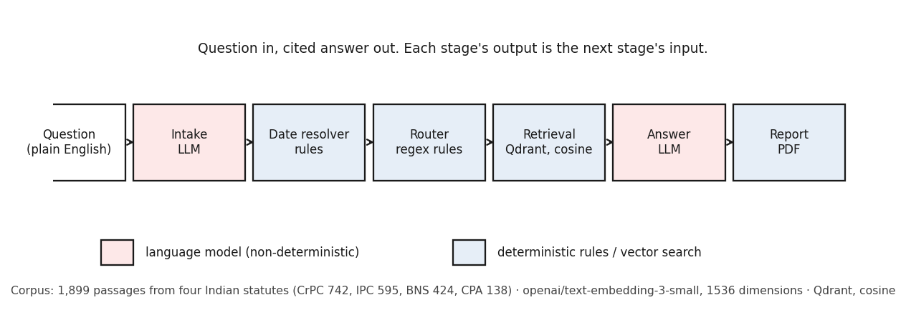

# Technical report — retrieval failure across a statutory recodification

**Udita Uniyal · Banasthali Vidyapith · 2 September 2026 · commit `95f5ac7`**

Written for a reader with no prior exposure to this project. Every technical
term is defined in section 2 before it is used.

No number in this document was typed. Every figure and table is generated by
filtering `results/*.csv`, with an assertion that each specification matches
exactly one row. Regenerate:
`./venv/Scripts/python.exe experiments/make_technical_report.py`

---

## 1 · Executive summary

On 1 July 2024 India replaced its 1860 criminal code with a new one. Both
remain in force: which applies depends on when the offence happened. This
project built a question-answering system over Indian statutes and then measured,
carefully, how well it copes with that split.

The main result is that it copes badly, and in a specific and surprising way.
When a question names the **old, repealed** code, the system finds the right law
97.0% of the time. When a question names the **new code that is
actually in force**, it finds the right law 51.5% of the time.
Both figures are on 33 questions each, with 95% confidence
intervals of [84.7%, 99.5%] and
[35.2%, 67.5%]. The system is most reliable on the law that
no longer applies.

The obvious fix does not work. Switching from meaning-based search to
exact-word search reverses the problem rather than solving it: exact-word search
scores 97.0% on new-code questions but 0.0% on
old-code questions. Combining the two methods is worse than either alone. We
traced the cause: the new statute writes its own name inside its own text, while
the old one never does, so the old statute's name is statistically a word
belonging to a *different* book.

The system's own confidence score does not help. It is beaten by a simpler
number that was already available for free, and there is no confidence threshold
at which the system can answer any share of questions while being wrong only one
time in ten.

Two things temper all of this. First, roughly one query in seven has a correct
answer the database physically cannot return, so no search method could score it
— every accuracy figure must be read against that ceiling, not against 100%.
Second, the failure is invisible in the system's written answers, because the
language model cites correct law regardless of what the search returned.

What remains open: no independent expert has checked the correct answers, which
were all decided by one person. That is the single largest threat to these
results and the first thing that should be fixed.

---

## 2 · Glossary

Every technical term used in this document or in the results files. A reader
should not need to look anything up elsewhere.

**AUROC** — Area Under the Receiver Operating Characteristic curve. Pick one correct answer and one wrong answer at random; AUROC is the probability the correct one has the higher score. 0.5 is a coin flip and means the score knows nothing; 1.0 is perfect separation; below 0.5 means the score points the wrong way.

**BM25** — A search method that ranks documents by which query words literally appear in them, weighted by how often and how rare each word is. Contrast with dense retrieval, which matches on meaning rather than exact words.

**bootstrap confidence interval** — A range computed by resampling the data many times (here 10,000) and seeing how much the answer moves. It says: given this sample size, the true value plausibly lies in this range.

**Brier score** — The average squared difference between a claimed probability and what actually happened. Lower is better; 0 is perfect. Claiming 0.9 on something that happens costs (1−0.9)² = 0.01.

**calibration** — Whether a stated confidence matches reality. A perfectly calibrated system that says '70% confident' is right 70 times in 100.

**chunk** — One passage of statutory text stored in the database, typically a section or part of one. This corpus holds 1,899 of them.

**cluster bootstrap** — A confidence interval that resamples GROUPS rather than rows. Three phrasings of the same legal situation are not three independent facts; treating them as such makes intervals look narrower than they are.

**corpus filter** — A restriction applied BEFORE searching, limiting the search to one statute. Distinct from the adaptive score filter, which drops low-scoring passages afterwards. Conflating the two is a common error here.

**coverage at risk** — If you answered only the questions you were most confident about, what share could you answer while keeping errors at or below some level (here 10%)?

**dense retrieval** — Search by meaning. Each passage and each question becomes a list of 1,536 numbers (an embedding); similar meanings give similar lists.

**ECE** — Expected Calibration Error. Sort answers by confidence, group them into bins, and average how far each bin's claimed confidence sits from its actual accuracy. Lower is better; 0 is perfect.

**embedding** — A list of numbers representing a piece of text's meaning. Here 1,536 numbers produced by openai/text-embedding-3-small.

**entity coverage** — One of the system's three confidence signals: whether section numbers named in the question appear in the retrieved passages.

**gold label** — See ground truth.

**ground truth** — The correct answer, decided in advance by a human and recorded before any system output was seen. Here: which statutory section correctly answers each query.

**IDF** — Inverse Document Frequency. How informative a word is, from how few documents contain it. A word in 30 of 1,899 chunks is a strong clue; a word in 1,500 tells you almost nothing.

**lexical retrieval** — Search by exact words rather than meaning. BM25 is the lexical method used here.

**MRR** — Mean Reciprocal Rank. If the correct passage is at position 1 you score 1, at position 2 you score 1/2, at position 4 you score 1/4. Averaged over all queries. Rewards putting the right answer near the top.

**nDCG** — Normalised Discounted Cumulative Gain. Like MRR, a rank-sensitive score that penalises correct answers appearing further down the list.

**p-value** — The probability of seeing a difference at least this large if there were really no difference at all. Small means the difference is unlikely to be chance alone. It does NOT say how big or how important the difference is.

**paired test** — A comparison that uses the fact that two scores were measured on the SAME questions. Comparing two separate confidence intervals by eye is not a test and is far too conservative.

**precision@k** — Of the k passages returned, what share are correct. With a single correct section per query it equals recall@k divided by k, so it adds no information here and is reported only for completeness.

**Qdrant** — The vector database storing the 1,899 embedded passages and answering nearest-neighbour searches over them.

**RAG** — Retrieval-Augmented Generation. Fetch relevant documents first, then have a language model write an answer using only those documents. The idea is that the model quotes sources rather than inventing them.

**recall@k** — Of the questions that have a correct section, the share where that section appeared among the top k retrieved passages. The central retrieval measure in this report.

**reciprocal rank fusion** — A way of combining two ranked lists: each document scores 1/(60 + its rank) in each list, and the scores are added. The constant 60 is from Cormack, Clarke and Buttcher, SIGIR 2009.

**recodification** — Replacing a statute wholesale with a new one rather than amending it. India replaced the Indian Penal Code 1860 with the Bharatiya Nyaya Sanhita 2023 on 1 July 2024. Both remain operative: which applies depends on when the offence occurred.

**reliability diagram** — A plot of claimed confidence against observed accuracy. A perfectly calibrated system sits on the diagonal.

**risk-coverage curve** — As you accept lower-confidence answers, coverage rises and so does error. The curve traces that trade-off.

**score gap** — One of the three confidence signals: the difference between the best and second-best retrieval score. A large gap suggests a clear winner.

**statute consistency** — A fourth confidence signal, specified in the design and built for the first time in this work: the fraction of retrieved passages coming from the statute the question and its date imply.

**top-k mean** — One of the three confidence signals: the average similarity of the top few retrieved passages.

---

## 3 · What was built

A five-stage pipeline that takes a plain-English legal question and returns an
answer with citations and a PDF report. Two stages use a language model; the
rest are deterministic rules or vector search.

*F1 — The five-agent pipeline. Two stages use a language model (pink); the rest are deterministic rules or vector search (blue). Only the retrieval stage is measured in this report's headline findings.*

**The corpus.** 1,899 passages drawn from four Indian statutes:
the Code of Criminal Procedure 1973 (742 passages), the Indian
Penal Code 1860 (595), the Bharatiya Nyaya Sanhita 2023
(424), and the Consumer Protection Act 2019
(138). Source: `results/self_naming.csv`.

Each passage is converted to an embedding of 1,536 numbers by
`openai/text-embedding-3-small` and stored in Qdrant, a vector database, which
answers searches by cosine similarity.

**Deliberately absent:** the Bharatiya Nagarik Suraksha Sanhita (the new
procedure code), the Bharatiya Sakshya Adhiniyam (the new evidence act), the
Constitution, and case law. Questions requiring them cannot be answered by
construction, and are counted as such rather than as failures.

---

## 4 · How it was evaluated

### 4.1 The query sets

Four sets, 518 unique queries, every one carrying its correct statutory section
recorded **before** any system output was seen.

| Set | Queries | How the correct answer was established |
|---|---|---|
| generated | 198 | Certain by construction — generated from a section, so the section is the answer |
| paired IPC/BNS | 99 | Certain by construction — a verified IPC↔BNS provision pair, asked once under each numbering |
| dated conflict | 197 | Judgement — the named code and the offence date disagree, and the date governs |
| layman | 120 | Judgement — a described situation, mapped by hand to the governing section |

The first two are mechanical. **The last two required legal judgement and were
made by one person, the author.** That is the limitation in section 7.

### 4.2 Three definitions of "correct", and why three

- **retrieved@k** — the correct section was among the top k passages fetched.
  A property of the search.
- **cited** — the correct section appears in the answer's citations. A property
  of the writing.
- **grounded** — every section the answer cited was actually present in the
  fetched passages. The strict one, and only 27 of 617 rows pass it.

They are not interchangeable, and a claim that holds under one can die under
another. Section 5.7 is exactly such a case.

### 4.3 Three retrieval stages, and why the distinction matters

Passages pass through three states: **raw_15** as the database returned them,
**reranked_15** after reordering, and **filtered_n** after a score threshold
drops the weakest. A recall figure means different things at each. Earlier
versions of this project published figures without recording which stage
produced them; that is corrected here, and every figure below names its stage.

### 4.4 Verification

- **237 automated tests**, including known-answer tests where the correct
  output was worked out by hand before the code ran. A metric that returns a
  plausible wrong number is the failure mode this project is guarding against.
- **One shared metric library.** Every experiment imports it; nobody
  reimplements a measurement.
- **A paired check per experiment** that re-derives at least one of its own
  numbers by an independent route and asserts agreement.
- **No number in any results document was manually transcribed.** Every figure
  and table is generated by filtering the results files, and the generator
  crashes rather than guessing if a specification matches more than one row.

---

## 5 · Findings

Ordered by strength of evidence.

### 5.1 Retrieval fails across the recodification, asymmetrically

**Claim.** A question naming the repealed code finds the right statute far more
often than a question naming the code in force.

*F2 — Naming the repealed statute works; naming the one in force barely beats chance. Red ticks are the chance baseline: each statute's share of the index, i.e. what a retriever ignoring the question would score.*

IPC-named **97.0%** [84.7%, 99.5%] against a
chance baseline of 31.3%; BNS-named **51.5%**
[35.2%, 67.5%] against 22.3%.
n=33 per arm, corpus filter disabled, stage
`dense`. Top-1 only: 90.9% against
42.4%. Source `results/hybrid_comparison.csv`.

**What it means.** A citizen asking about the law that governs them today is
served worse than one asking about a law repealed in 2024. The misses are not
random: they land on the repealed code.

**How it could be wrong.** n is 33 per arm, so the intervals
are wide. The measure is "which statute dominates the top 15", which is coarse —
section 5.2 shows a case where it scores 0% while placing the correct passage
first. And the corpus filter is switched off to make the question askable at all;
with it on, an IPC-named query cannot return BNS text by construction.

### 5.2 Exact-word search inverts the failure; fusion does not help

**Claim.** BM25 does not fix the problem — it fails on the opposite half.

*F3 — Exact-word search does not repair the failure, it reverses it. Fusing the two (green) lands between them and beats neither: averaging two opposite failure modes fails at both.*

n=33 per bar, definition
`dominant_corpus_among_top15`. Source `results/hybrid_comparison.csv`.

**What it means.** This answers the most obvious objection to section 5.1 — that
the failure is an artefact of choosing a meaning-based retriever. It is not: the
lexical alternative fails worse, in the other direction, and fusing them
produces a system that fails at both.

**How it could be wrong.** The 0.0% figure is a tail effect. On one query BM25
places the correct IPC section at rank 1, but ranks 6–15 fill with procedure-code
cross-references, so "dominant statute" scores it zero. On top-1 BM25 reaches
90.9%-comparable territory. The coarse measure exaggerates.

### 5.3 The mechanism: statutes name themselves asymmetrically

**Claim.** The new statute writes its own name in its own text; the old one does
not, so the old statute's name belongs statistically to a different book.

*F4 — Bars are coloured by the statute the term concentrates in (green BNS/CPA, red CrPC, grey mixed). 'sanhita' occurs in 30 chunks, all BNS — a perfect signpost. 'penal' occurs in 110, but 82 are CrPC and only 23 are IPC: the Penal Code's own name points elsewhere.*

`sanhita` appears in 30 passages, IDF
4.116, and **all 30 are BNS**.
`penal` appears in 110 passages, IDF 2.785,
of which **82 are CrPC and only
23 are IPC**. Self-naming rates: BNS
7.1% [5.0%, 9.9%] of its own passages, IPC
3.9% [2.6%, 5.7%]. n=1899
passages. Source `results/self_naming.csv`.

**What it means.** The 1860 drafters had no reason to write "penal" inside the
Penal Code, whereas the procedure code cites it constantly. So searching for the
Penal Code by name points at the procedure code. This is a property of statutory
drafting and statute age, and it should generalise to any recodification.

**How it could be wrong.** Only presence is counted, not how often a term occurs
within a passage; BM25 uses both, so this explains the direction of the effect
but does not fully reconstruct BM25's ranking. The corpus is four statutes.

### 5.4 The confidence score is beaten by a simpler number

**Claim.** The engineered three-signal confidence score discriminates worse than
a single raw similarity, and this survives fixing a sign error found in it.

*F6 — The deployed composite (red) is beaten by three of its own ingredients. One term is inverted and scores below chance. Correcting the sign lifts the blend (blue) but it still loses to a single raw similarity (green).*

n=617, definition `retrieved@k`, stage
`raw_15`. Deployed composite 0.6631
[0.6172, 0.7096] against `max_score` 0.7837
[0.7470, 0.8195]. One term is inverted in the deployed code and scores
0.2702 — below chance, i.e. pointing the wrong way. Correcting the
sign lifts the composite to 0.7207, but it still loses by
-0.0630 [-0.0946, -0.0325]; the sign error explains about
half of the -0.1207 deficit. Given the best weighting chosen on
data the evaluation never saw, the corrected signals reach 0.7631 —
a tie with `max_score`, never a win. Sources `results/ablation.csv`,
`results/corrected_composite.csv`.

**What it means.** Three signals combined carry no more information than one
signal that was free. That is a negative result about a designed component, and
it is more useful than a positive one would have been.

**How it could be wrong.** Under the strict `grounded` definition there are only
27 positives and every comparison contains zero, so this claim rests on the
other two definitions.

### 5.5 There is no usable confidence threshold, and the curve is non-monotone

**Claim.** No confidence cut-off lets the system answer any share of questions
with 10% error or less.

*F7 — On the diagonal means a claimed confidence matches observed accuracy. The deployed composite (red) is NON-MONOTONE: it peaks in the middle and falls back at the top, so its most confident answers are no better than its middling ones. max_score (green) rises throughout.*

*F8 — Under retrieved@k, BOTH scores are at or near zero: there is no confidence threshold at which the system can answer any share of questions and be wrong only one time in ten. These zeros are measured, not missing. The full risk-coverage curve is not in the results files and is not shown.*

Coverage at 10% risk: composite 0.0000, `max_score` 0.0486,
n=617, definition `retrieved@k`. ECE composite
0.2410 [0.2016, 0.2695] against `max_score` 0.1270
[0.1065, 0.1681] — lower is better. Source `results/calibration.csv`.

**What it means.** Selective answering — refusing when unsure — is the standard
safety mechanism for a system like this. These measurements say it cannot be
built on the current confidence score.

**How it could be wrong.** The composite was never designed as a probability; it
is a weighted sum of similarities. ECE is a calibration measure and applying it
to a non-probability needs care. The zeros are real but they are a property of
this score, not proof that no score could work.

### 5.6 The adaptive filter amplifies corpus bias

**Claim.** The step that drops low-scoring passages makes the corpus skew worse.

*F5 — The adaptive score filter costs every query set a little and the layman set half of what it had. But the layman line starts at 15%: the filter is not the main problem, the retrieval is.*

Over-representation ratio on layman queries — a statute's share of retrieval
divided by its share of the index, where 1.0 is chance. CrPC
1.49× → **1.80×**; BNS
0.58× → **0.34×**;
IPC 0.59× → 0.48×.
n=1800 passages at `raw_15`. Layman recall falls
0.150 → 0.075. Sources
`results/routing_confusion.csv`, `results/robustness.csv`.

**What it means.** A noise-removal step preferentially removes substantive
criminal law and concentrates procedure. But the layman line starts at
0.150: removing the filter entirely would still leave most
public-style questions unanswered.

**How it could be wrong.** The layman filtered rate is significant on a naive
interval [0.033, 0.125] and **not significant once clustered**,
[0.000, 0.167], because the successes concentrate in a few
situations.

### 5.7 The failure is invisible in the written answers

**Claim.** The retrieval gap does not appear at citation level.

| Correctness definition | IPC−BNS gap | clustered 95% CI |
|---|---|---|
| `retrieved@15` | **0.5455** | [0.3030, 0.7576] |
| `cited` | -0.0303 | [-0.1212, 0.0606] — contains 0 |
| `grounded` | -0.0303 | [-0.0909, 0.0000] — contains 0 |

n=66, paired set, no restrictions. Source `results/robustness.csv`.

**What it means.** The language model cites correct sections regardless of what
search returned, so the failure is hidden in the output. For a legal assistant
that is worse than a visible failure, not better.

**How it could be wrong.** This is stated as a retrieval claim throughout. A
reviewer measuring citations rather than retrieval will not reproduce the gap,
which is why the definition is named beside every figure.

### 5.8 A statute-aware confidence signal works, but only where it is not circular

**Claim.** A fourth signal measuring whether passages came from the admissible
statute beats the existing signals only on the subset where the named code and
the date disagree.

Pooled 0.6845 [0.6557, 0.7139], n=617 — no better than the
existing signals. On the dated-conflict subset **0.8300**
[0.7819, 0.8750], n=197. Source
`results/statute_consistency.csv`.

**What it means.** On most rows the corpus filter was derived from the same
question-and-date inputs the signal reads, so the signal cannot fail by
construction. A confidence signal downstream of a filter built from its own
inputs is a tautology. It earns its keep only where the two disagree.

**How it could be wrong.** The subset where it works is the subset it was
designed for, so this is close to a definition rather than a discovery.

### 5.9 A ceiling caps every recall figure

*F9 — Where gold labels name a subsection the index stores only as a bare section, no retriever can score them. BNS-named queries are capped at 33.3%: every recall figure must be read against this, not against 100%.*

Pooled **85.7%** [82.4%, 88.5%] of
518 queries have a gold section the index can return at all
under strict matching; BNS-named queries are capped at **33.3%**
[19.8%, 50.4%]. Source `results/hybrid_comparison.csv`.

**What it means.** Where a gold label names a subsection the index stores only
as a bare section, no retriever can score it. On BNS-named queries, dense and
hybrid retrieval both saturate this ceiling exactly: on reachable questions,
retrieval is perfect.

**How it could be wrong.** It is an artefact of strict matching. Lenient
matching would raise it but would also collapse genuinely distinct provisions,
which is the confusion this project measures.

---

## 6 · Corrections and retractions

Every number that changed from what was previously reported.

| What was reported | What is true | Cause | Found by |
|---|---|---|---|
| A "counting bug" halving the layman retrieval figure | **No bug existed.** Text parsing recovered the section 4,906 times out of 4,906, a 0.0% error rate. Both figures were correct at different retrieval stages | An unfiltered probe was compared against a filtered figure | A re-measurement that contradicted the claim |
| BNS-named gold recall of 33.3% reported as a retrieval failure | **It is the reachability ceiling.** 33.3% of BNS gold labels name subsections the index stores only as bare sections | Gold granularity finer than index granularity | The Wave 3 paired check |
| Confidence formula documented as `0.15·score_gap` | Deployed code computes `0.15·(1 − min(score_gap/0.3, 1))` — **the term is inverted**. A documentation error; the logged scores were always right | The written note diverged from the code | A reconstruction check: the documented formula matched 0 of 617 rows, the real one matches to 9e-05 |
| `entity_coverage` exceeds 1.0 and grants a free 0.30 default | Describes **superseded code**. Values are only {0, 0.5, 1.0} | A stale entry in the defects document | Confirmed independently twice |
| Confidence AUROC pair 0.610 / 0.663 | Records neither correctness definition nor retrieval stage, and no definition reproduces it. **Superseded, not reconcilable** | Figures published without their definition and stage | The smoke test |
| Two defects in this project's own measurement code | One raised an error on real data; the fix for it then silently returned **0 correct out of 617 while nothing crashed** | Non-idempotent normalisation | The gate check, before any number was published |

---

## 7 · Limitations

Stated as a reviewer would state them.

1. **Single annotator.** All ground truth was decided by one person, the author.
   Two of the four query sets required legal judgement. No independent expert has
   validated any label. This is the largest threat to every finding.
2. **A ceiling caps every recall figure.** Only 85.7%
   [82.4%, 88.5%] of 518 queries have a
   reachable gold section; BNS-named queries 33.3%. Figures must
   not be read against 100%.
3. **Single embedding model, single vector store, single jurisdiction, four
   statutes.** No claim generalises beyond this configuration without retesting.
4. **The strict `grounded` definition has 27 positives in 617 rows.** Every
   comparison under it is underpowered and contains zero.
5. **One significance claim is lost under clustering.** The layman `filtered_n`
   rate is significant naively [0.033, 0.125] and not significant
   clustered [0.000, 0.167].
6. **One assertion is left deliberately failing.** Four clustered AUROC
   intervals came out narrower than their naive counterparts and remain
   unexplained after ruling out resampler bugs and Monte Carlo noise across five
   seeds. Those two restricted subsets are marked unusable rather than explained
   away.
7. **Three labelled rows are dropped** by a deduplication rule, so n is 617 where
   it could be 620. Disclosed rather than fixed.
8. **The headline claim is definition-dependent.** It holds under
   `retrieved@15` and does not survive at citation level (section 5.7).
9. **Answer quality is not evaluated.** This work measures retrieval,
   confidence and citation behaviour. It does not assess whether the prose
   advice is legally sound.

---

## 8 · What could be done next

Factual list of candidates with rough cost and effort. No recommendation is
made.

| Candidate | Cost | Effort |
|---|---|---|
| Independent expert validation of ~30 queries and their gold labels | none, needs an introduction | one person-day for the validator |
| Re-derive gold at subsection granularity, raising the 85.7% ceiling | none | 1–2 days, and it revises the evaluation set |
| Ingest the BNSS and BSA to close the corpus gap | ~₹50 in embeddings | 1 day, but it invalidates comparability with the 1,899-passage index every figure here uses |
| Term-frequency as well as document-frequency analysis for section 5.3 | none | half a day |
| A second embedding model as a robustness check | ~₹50, or free with a local model | 1 day |
| Query-level error taxonomy over the failing layman questions | none | 2 days of manual coding |
| Statute-and-date resolution layer, then re-measure | ~₹5 | 3–4 days |
| Full risk-coverage curves rather than the three anchor points | none | half a day |

---

## 9 · File index

| File | Contents | Regenerate |
|---|---|---|
| `results/RESULTS.md` | All 2959 measurements, plus appendices: changed numbers, failed assertions, not-computable, caveats | `experiments/assemble_results.py` |
| `results/EXPLAIN.md` | One plain-English block per output, eight fixed headings each | written per experiment |
| `results/hybrid_comparison.csv` | Dense vs BM25 vs fusion; reachability ceilings | `experiments/exp07_hybrid.py` |
| `results/retrieval_metrics.csv` | Recall, precision, MRR, nDCG at every k and stage | `experiments/exp01_retrieval.py` |
| `results/routing_confusion.csv` | Routing matrix and base-rate control | `experiments/exp02_routing.py` |
| `results/calibration.csv` | ECE, Brier, reliability bins, risk anchors, Platt scaling | `experiments/exp03_calibration.py` |
| `results/ablation.csv` | Per-signal AUROC, leave-one-out, weight sweep | `experiments/exp04_ablation.py` |
| `results/robustness.csv` | Definition sensitivity and cluster bootstrap | `experiments/exp05_robustness.py` |
| `results/statute_consistency.csv` | The fourth confidence signal | `experiments/exp06_statute_consistency.py` |
| `results/filter_analysis.csv` | What the adaptive filter costs, and which threshold arm binds | `experiments/exp08_filter.py` |
| `results/corrected_composite.csv` | Sign-error decomposition and held-out reweighting | `experiments/exp09_corrected_composite.py` |
| `results/self_naming.csv` | Document frequency, IDF and concentration by statute | `experiments/exp10_self_naming.py` |
| `results/smoke_test.md` | The three gate numbers checked before the main analysis | `experiments/gate_smoke.py` |
| `experiments/SCHEMA.md` | What the logs actually contain | — |
| `docs/WORKLOG.md` | Dated record of every run, including retractions | — |

---

## 10 · Anything dropped from this document

- F8: the full risk-coverage CURVE is not in calibration.csv — only three anchor points per score (coverage at 10% risk, AURC, risk at full coverage). Plotted as anchors, not a curve.
