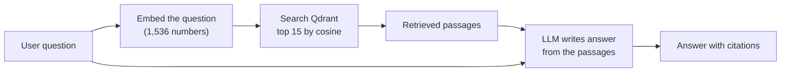

# Part 1 — Fundamentals

Every idea the project rests on. Each one is explained twice: first in plain
words (**ELI5** — "explain like I'm five"), then technically. Where possible
the example comes from this project's own data.

Read this before [02_ARCHITECTURE.md](02_ARCHITECTURE.md). You cannot defend the
system without these foundations.

---

## Contents

1. [The law you need](#1-the-law-you-need)
2. [Programs that talk to each other: APIs](#2-programs-that-talk-to-each-other-apis)
3. [Large language models](#3-large-language-models)
4. [OpenRouter, providers and reproducibility](#4-openrouter-providers-and-reproducibility)
5. [Embeddings: meaning as numbers](#5-embeddings-meaning-as-numbers)
6. [Cosine similarity](#6-cosine-similarity)
7. [Vector databases and Qdrant](#7-vector-databases-and-qdrant)
8. [Chunking](#8-chunking)
9. [RAG: Retrieval-Augmented Generation](#9-rag-retrieval-augmented-generation)
10. [Keyword search: BM25 and IDF](#10-keyword-search-bm25-and-idf)
11. [Hybrid search: Reciprocal Rank Fusion](#11-hybrid-search-reciprocal-rank-fusion)
12. [Top-k, reranking and thresholds](#12-top-k-reranking-and-thresholds)
13. [Agents and pipelines](#13-agents-and-pipelines)
14. [Confidence and calibration](#14-confidence-and-calibration)
15. [The software stack](#15-the-software-stack)
16. [Glossary](#16-glossary)

---

## 1. The law you need

### ELI5

A country keeps its rules in big books. Each rule has a number, called a
**section**. If someone hits you, there is a section that says hitting is a
crime and what the punishment is. To complain to the police you need that
number.

On **1 July 2024** India threw away three of its biggest rule books and wrote
new ones. Most of the rules stayed the same, **but almost every number
changed**. Cheating was rule 420 in the old book; it is rule 318(4) in the new
one.

Here is the tricky part. If something happened **before** 1 July 2024, the
**old** book still decides it. If it happened **on or after** that day, the
**new** book does. So the same question can have two right answers, and only
the date decides which.

### Technical

**The codes involved:**

| Old code (repealed) | New code (in force) | What it governs | In this project's index? |
|---|---|---|---|
| Indian Penal Code, 1860 (**IPC**) | Bharatiya Nyaya Sanhita, 2023 (**BNS**) | What counts as a crime, and its punishment | **Both** |
| Code of Criminal Procedure, 1973 (**CrPC**) | Bharatiya Nagarik Suraksha Sanhita, 2023 (**BNSS**) | Arrest, bail, FIR, trial | CrPC only |
| Indian Evidence Act, 1872 | Bharatiya Sakshya Adhiniyam, 2023 (**BSA**) | What may be proved, and how | Neither |
| — | Consumer Protection Act, 2019 (**CPA**) | Consumer complaints | Yes |

The repeal provisions are BNS s.358(1), BNSS s.531(1) and BSA s.170(1).

**Recodification** means rewriting and renumbering a body of law from scratch,
rather than amending it clause by clause. It is not just renumbering — some
offences changed in substance. IPC 379 (theft) became BNS 303(2), which adds
community service for a first theft below a small value. So a system that only
translated numbers would still get the law wrong.

**Why the old code still matters — savings provisions.** BNS s.358(2)–(4) and
s.6 of the General Clauses Act, 1897 preserve the old law for conduct that
happened before the new law began. Article 20(1) of the Constitution separately
forbids applying a heavier punishment retrospectively. So:

```
                         1 July 2024
  conduct here ──────────────┼──────────── conduct here
  governed by IPC            │             governed by BNS
  (and CrPC)                 │             (and BNSS)
```

**One contested point. Do not assert a rule here.** For *procedure*
(CrPC vs BNSS), BNSS s.531(2)(a) keeps the old code for matters **pending** on
1 July 2024. It says little about an old offence with no proceeding pending,
and the High Courts have disagreed. Substantive offences follow the date of the
conduct; procedure is not settled.

**Sections and sub-sections.** "Section 318(4)" means section 318,
sub-section (4). Section 318(1) of the BNS *defines* cheating; 318(4)
*punishes* it. This matters later: the index stores whole sections, labelled
"318", never "318(4)".

**Verified mappings you should know by heart:**

| Offence | IPC | BNS |
|---|---|---|
| Murder | 302 | 103(1) (101 is the definition; 103(2) is the new mob-lynching offence) |
| Attempt to murder | 307 | 109 |
| Cheating (punishment) | 420 | **318(4)** — *not* 320 |
| Theft (punishment) | 379 | 303(2) |
| Cruelty by husband | 498A | 85 (definition moved to 86) |
| Dowry death | 304B | 80 |
| Bribery by public servant | 161 | **none** — IPC 161 was repealed in 1988 |

---

## 2. Programs that talk to each other: APIs

### ELI5

An **API** is a waiter. You don't walk into the kitchen; you tell the waiter
what you want, and the waiter brings it back. Your program tells another
program "embed this sentence" or "answer this question", and gets a reply.

### Technical

- **API** — Application Programming Interface: an agreed way for one program to
  ask another for something.
- **Endpoint** — one specific address on an API, for example
  `POST http://127.0.0.1:8000/query`.
- **HTTP methods** — `GET` reads something (`/healthz`); `POST` sends data to
  be processed (`/query` sends a question).
- **Request / response** — what you send and what comes back. Both are usually
  **JSON**: text-formatted key–value data, such as `{"query": "..."}`.
- **Status codes** — `200` means it worked, `400` means you sent something bad,
  `500` means the server crashed.

This project uses APIs in **two directions**:

```
  Browser / Streamlit UI
        │  POST /query   (your API, served by FastAPI)
        ▼
  legal-mvp backend (app.py)
        │  ── HTTPS ──►  OpenRouter API   (language model + embeddings, paid)
        │  ── HTTP  ──►  Qdrant           (vector database, local, free)
```

---

## 3. Large language models

### ELI5

A **large language model (LLM)** has read an enormous amount of text and
learned to guess the next word. Ask it a question and it keeps guessing words
until it has written an answer. It is very good at sounding right. **It is not
always right.** Sometimes it confidently invents things — in law, a section
number that doesn't exist, or a real number attached to the wrong law. That is
called **hallucination**.

### Technical

| Term | Meaning | In this project |
|---|---|---|
| **Token** | A piece of text the model reads or writes — often part of a word. Models are priced and limited in tokens | The D0043 answer used **4,431** prompt tokens and **1,743** completion tokens |
| **Prompt** | Everything sent to the model | |
| **System message** | Standing instructions ("You are an Indian legal assistant…") | `agents/answer.py`, `agents/intake.py` |
| **User message** | The actual request | The question plus the retrieved passages |
| **Temperature** | Randomness of word choice. 0 means always pick the most likely word | `0` |
| **Seed** | A fixed number for the random generator, so repeated calls can match. **Best-effort** at the provider, not a guarantee | `20260822` |
| **max_tokens** | Cap on output length | Intake: 1,500. Answer: no cap |
| **JSON mode** | Ask the model to return a JSON object | Intake: on. Answer: **off** (plain text) |
| **Reasoning model** | A model that spends hidden "thinking" tokens before answering. That is why Intake needed 1,500 tokens, not 600 | Gemini 3.7 Flash |

The generation model is **`google/gemini-3.7-flash`**.

---

## 4. OpenRouter, providers and reproducibility

### ELI5

OpenRouter is a switchboard. You ring one number, and it connects you to
whichever company serves the model you asked for. That's convenient — but if
it quietly connected you to a *different* company each time, your results could
change without you knowing. So the project tells the switchboard: *always use
this exact company, never swap, and refuse my call rather than ignore one of my
settings.*

### Technical

- **OpenRouter** — one API in front of many model providers.
  Base URL: `https://openrouter.ai/api/v1`.
- **Provider** — the company actually running the model: *Google AI Studio*
  for generation, *OpenAI* for embeddings.
- Every request carries a **provider block** (`core/config.py`,
  `clients/openai_client.py`):
  - `only: [provider]` — pin the serving company
  - `allow_fallbacks: false` — never silently switch
  - `require_parameters: true` — fail loudly if a setting like `temperature`
    is unsupported, instead of silently dropping it. Without this, a paper
    could say "temperature 0" and it would not be true.
- Every call returns **metadata** (`CallMeta`: model, provider, token counts),
  and that metadata goes into the run log.

All language-model and embedding calls go through **one file**,
`clients/openai_client.py`. That is deliberate: instrumentation and pinning
then have exactly one place to live.

---

## 5. Embeddings: meaning as numbers

### ELI5

Imagine giving every sentence a home on a giant map, so that sentences meaning
similar things live close together. "My husband hits me" and "domestic
violence by spouse" would be neighbours, even though they share no words.
That address — a long list of numbers — is the **embedding**.

### Technical

- An **embedding** is a fixed-length list of numbers (a **vector**) produced by
  an **embedding model**.
- Here: **`openai/text-embedding-3-small`**, which returns **1,536 numbers** per
  text.
- Texts with similar meaning get vectors that point in similar directions.
- Every passage of law is embedded **once**, during ingestion. Every question is
  embedded **at query time**: one API call per question.

Toy example in **2** dimensions (real ones have 1,536):

| Text | Vector |
|---|---|
| "theft of property" | (0.9, 0.1) |
| "stealing someone's things" | (0.85, 0.2) |
| "grant of bail" | (0.1, 0.95) |

The first two point the same way, so they mean similar things. The third points
elsewhere.

**Why this matters for the project.** IPC 379 and BNS 303(2) both describe
theft in nearly the same words, so their embeddings are almost identical. The
one thing that separates them — *which book they belong to* — is exactly what
meaning-based search is built to ignore. This is the root of the main finding.

---

## 6. Cosine similarity

### ELI5

Two arrows. If they point the same way, the score is high. If they point at
right angles, the score is zero. If they point in opposite directions, it's
negative. We don't care how long the arrows are — only their direction.

### Technical

```
cosine(a, b) = (a · b) / (|a| × |b|)
```

- Range: **−1 to 1**. 1 means the same direction; 0 means unrelated.
- Qdrant returns this as each hit's **score**.
- Scores in this index run from about **0.25 to 0.88**. The best score per
  query ranges 0.256–0.875, with a median around 0.68.
- Older documents say "typical scores 0.35–0.55". That described the old
  1,011-chunk index and is out of date.

Worked example with the toy vectors above:

```
a = (0.9, 0.1), b = (0.85, 0.2)
a·b = 0.9×0.85 + 0.1×0.2 = 0.785
|a| = 0.906,  |b| = 0.873
cosine = 0.785 / (0.906 × 0.873) = 0.992   → very similar
```

---

## 7. Vector databases and Qdrant

### ELI5

A library where books are shelved by *meaning* instead of title. Hand the
librarian your question's map-address, and they bring the 15 books living
nearest to it.

### Technical

- **Qdrant** — an open-source **vector database**. It runs locally in Docker on
  port **6333**.
- **Collection** — a named set of vectors: here **`legal_mvp`**, cosine
  distance, 1,536 dimensions.
- **Point** — one stored item: an **ID**, a **vector**, and a **payload**.
  - The ID is a `uuid5` of the chunk ID, so it is deterministic: re-ingesting
    gives the same IDs.
  - The payload is metadata stored next to the vector: `text`, `doc_name`,
    `page`, `corpus` (IPC / BNS / CRPC / CPA), `section_number`, and others.
- **Search** — "give me the `limit` points whose vectors are most similar to
  this one." Here **limit = 15**.
- **Filter** — restrict the search by a payload field, such as `corpus = "BNS"`,
  or `corpus ∈ {"IPC", "BNS"}` (`match: any`).

**The index:** 1,899 points.

| Corpus | Passages | Share |
|---|---|---|
| CRPC | 742 | 39.07% |
| IPC | 595 | 31.33% |
| BNS | 424 | 22.33% |
| CPA | 138 | 7.27% |

**Why the shares matter.** A book holding 39% of the index will turn up in
about 39% of results *by chance*. That **chance baseline** is what results are
compared against — not zero.

---

## 8. Chunking

### ELI5

You can't search a 263-page book as one blob. So you cut it into small pieces,
one per rule, and search the pieces.

### Technical

- **Chunk** = one passage stored as one point in the index.
- Chunking here is **section-bounded**: text is split at statutory section
  headings, so **one section becomes one chunk**, and a provision is never cut
  mid-sentence (`ingest/chunk.py`).
- Only a section longer than **800 tokens** is split further, into pieces of
  about **450 tokens**, with no overlap. Here "tokens" means
  whitespace-separated words.
- `drop_shadowed_fragments` removes duplicate fragments that appear across page
  boundaries.
- Each chunk is tagged with its corpus by a **registry lookup**
  (`ingest/registry.py`): file name → IPC / BNS / CRPC / CPA. The registry used
  to be a keyword guesser, which mis-tagged the IPC as BNS. That was fixed in
  August.
- Text comes out of the PDFs via **PyMuPDF**, with **Tesseract OCR** (optical
  character recognition — reading text from an image) as a fallback for pages
  yielding fewer than 20 characters.
- The index is built by **`scripts/reingest.py`**, which produces exactly
  1,899 chunks. The `/ingest` endpoint skips the cross-page clean-up and gives
  1,905.

---

## 9. RAG: Retrieval-Augmented Generation

### ELI5

Instead of letting the model answer from memory — where it might make things
up — you first **look up** the relevant pages, hand them to the model, and say
*"answer only from these."* Like an open-book exam instead of a closed-book
one. Now you can check every citation against the pages it was given.

### Technical



RAG **reduces** hallucination; it does not eliminate it. A model can still cite
from memory instead of from the passages. This project's verifier exists to
detect exactly that, and the **0 of 120** finding (Part 3) shows how often it
happens.

Two kinds of failure, which need different fixes:

1. **Retrieval failure** — the right passage was never found.
2. **Generation failure** — the passage was found, but the model ignored or
   misused it.

The project measures them separately. That is why there are **three
definitions of "correct"** (Part 3, §4).

---

## 10. Keyword search: BM25 and IDF

### ELI5

The old-fashioned way to search: count matching words. A word that appears
almost everywhere ("the", "section") tells you nothing. A **rare** word that
appears in only a few passages is a strong clue.

### Technical

**BM25** is the standard keyword ranking formula. It scores a passage by which
query words appear in it, weighted by:

- **TF** (term frequency) — how often the word appears in the passage, with
  diminishing returns;
- **IDF** (inverse document frequency) — how rare the word is across all
  passages;
- **length normalisation**, so long passages don't win just by being long.

```
IDF(word) = ln( (N − n + 0.5) / (n + 0.5) )
   N = total passages (1,899)
   n = passages containing the word
```

**Worked example from this project's own index** (`results/self_naming.csv`):

| Word | Passages containing it (n) | Which books | IDF |
|---|---|---|---|
| "sanhita" | 30 | **all 30 are BNS** | **4.12** — rare and perfectly specific |
| "penal" | 110 | 82 CrPC, 23 IPC, others | 2.79 — and points mostly at the *wrong* book |

So when a question says "Bharatiya Nyaya **Sanhita**", BM25 has a perfect
signpost to the BNS. When it says "Indian **Penal** Code", the word "penal"
mostly points at the CrPC, which cross-refers to the Penal Code constantly. The
IPC barely uses its own name.

**This explains why keyword search inverts the main result:** BM25 gets 97.0%
of BNS-named questions right, and 0.0% of IPC-named ones.

---

## 11. Hybrid search: Reciprocal Rank Fusion

### ELI5

Ask two librarians, one who searches by meaning and one who searches by
keyword. Combine their lists: a book near the top of *both* lists wins.

### Technical

**RRF** combines ranked lists using only **ranks**, not scores:

```
RRF(d) = Σ over lists of  1 / (k + rank of d in that list),   k = 60
```

Worked example: a passage ranked 1st by dense search and 3rd by BM25 scores
1/61 + 1/63 = 0.0323. A passage ranked 10th and 2nd scores 1/70 + 1/62 = 0.0304.

**Finding:** fused, the result is 45.5% on IPC-named and 78.8% on BNS-named
questions. That lands **between** the two methods — 62.1% pooled, against dense
74.2% and BM25 48.5%. Fusion does **not** fix the problem, because the two
methods have *opposite* biases, and averaging opposite biases gives you neither
strength.

Some older documents say fusion is "worse than either alone". **That is
false.** It is between them.

---

## 12. Top-k, reranking and thresholds

### ELI5

The librarian brings 15 books (**top-k**). You put the ones that mention your
exact section number at the front (**reranking**). Then you throw away any book
much worse than the best one (**threshold**). But you always keep at least 3.

### Technical (`agents/retriever.py`)

| Step | Rule |
|---|---|
| top-k | Qdrant returns `limit = 15` |
| rerank | Hits whose text contains an extracted entity (e.g. "Section 379") move to the front, regardless of score |
| adaptive threshold | keep hits with score ≥ `max(best_score − 0.15, 0.35)` |
| minimum | if fewer than 3 survive, the first 3 (in reranked order) are forced through, **whatever their score**. So 0.35 is not a hard floor — 229 passages below 0.35 reached the model across all runs |

These produce the **three retrieval stages** measured in Part 3:

| Stage | What it is |
|---|---|
| `raw_15` | Qdrant's 15, in similarity order |
| `reranked_15` | the same 15, entity matches first |
| `filtered_n` | what survives the threshold — **what the model actually sees** |

---

## 13. Agents and pipelines

### ELI5

An assembly line. Each worker does one job and passes the result to the next:
one understands the question, one decides which book to search, one searches,
one writes the answer, one prints the report.

### Technical

The word "agent" is used loosely in AI. Be precise in the viva:

- **Autonomous agent** — a model that decides its own next step in a loop,
  choosing tools and repeating until it's done.
- **Multi-agent pipeline** (this project) — a **fixed sequence** of specialised
  stages, each with typed inputs and outputs. The order never changes, and no
  stage loops or chooses another stage.

This project is the second kind. Calling the stages "agents" is conventional,
but the honest description is **an eight-stage sequential pipeline, two of
whose stages call a language model**.

**Deterministic vs LLM stages.** A *deterministic* stage — a rule, a regex,
arithmetic — gives the same output for the same input every time, can be
unit-tested, and can be traced to the exact character that triggered it. An
*LLM* stage can be neither. So the design confines the language model to the two
stages that genuinely need language understanding: **Intake** and **Answer**.

**Typed contracts.** Each stage's output is a **Pydantic** model: a Python class
that validates its fields. `CaseContext` → `QueryPlan` → `RetrievalResult` →
answer dict. A malformed output fails at the boundary instead of travelling
silently down the line.

---

## 14. Confidence and calibration

### ELI5

The system gives each answer a confidence number between 0 and 1. A
**calibrated** system that says "70% sure" is right about 70% of the time. If it
says 70% but is right only 30% of the time, it's overconfident — and the number
is misleading the user.

### Technical

- **Confidence score** — a number the system attaches to its own output.
- **Calibration** — whether stated confidence matches observed accuracy.
  Measured by **ECE** (Expected Calibration Error): sort answers into bins by
  confidence, then average the gap between each bin's stated confidence and its
  actual accuracy. 0 is perfect.
- **Discrimination** — whether the score *ranks* good results above bad ones.
  Measured by **AUROC**: pick one good and one bad result at random; AUROC is
  the probability the good one scored higher. **0.5 is a coin toss**; 1.0 is
  perfect; **below 0.5 is actively misleading**.
- **Selective answering** — refusing the questions you're least sure of so
  you're right more often on the rest. Measured by **coverage at a given
  risk**.

This project's composite confidence formula and its measured failure are in
Part 2 §5 and Part 3.

---

## 15. The software stack

| Tool | What it is | Used for |
|---|---|---|
| **Python 3.13** | Programming language | Everything |
| **FastAPI** | Web framework for building APIs | `app.py` — the `/query` endpoint |
| **Uvicorn** | Server that runs FastAPI | `uvicorn app:app` |
| **Pydantic** | Data validation with typed classes | `CaseContext`, `QueryPlan` |
| **Streamlit** | Python library for quick web UIs | `streamlit_app.py` — the chat UI |
| **Qdrant** (+ `qdrant-client`) | Vector database | Storing and searching embeddings |
| **Docker** | Runs software in isolated containers | Running Qdrant (`docker-compose.yml`) |
| **OpenAI Python SDK** | Client library | Calling OpenRouter, which speaks the same protocol |
| **PyMuPDF**, pdfplumber, **Tesseract** | PDF text extraction and OCR | Ingestion |
| **fpdf2** | PDF generation | The report |
| **pytest** | Testing framework | 237 tests |
| **NumPy, pandas, SciPy, Matplotlib** | Numerical analysis and plotting | The `experiments/` measurement code |
| **rank-bm25** | BM25 implementation | The keyword-search comparison |
| **git / GitHub** | Version control | Every result carries the commit that made it |

---

## 16. Glossary

| Term | Plain meaning |
|---|---|
| Ablation | A controlled comparison where you remove or change **one** component, hold everything else fixed, and see what changes |
| AUROC | Probability a randomly chosen correct case scores higher than a randomly chosen incorrect one. 0.5 = coin toss |
| BM25 | Keyword search ranking formula (§10) |
| Bootstrap | Estimating uncertainty by recomputing a number on many random resamples of your data |
| Chance baseline | The score you'd get by ignoring the question — e.g. a book's share of the index |
| Chunk | One passage stored in the index (§8) |
| Cluster bootstrap | Bootstrap that resamples whole groups (e.g. all phrasings of one situation) instead of single rows, because related rows aren't independent |
| Corpus | The collection of documents the system can search. Here, also the tag (IPC / BNS / CRPC / CPA) on each chunk |
| Cosine similarity | Direction-similarity of two vectors, −1 to 1 (§6) |
| Dense retrieval | Search by meaning using embeddings |
| ECE | Expected Calibration Error (§14) |
| Embedding | A vector of numbers representing a text's meaning (§5) |
| Endpoint | One address of an API, e.g. `POST /query` |
| Gold label | The answer key: the section that correctly answers a test question, fixed **before** any output was seen |
| Grounded | Every section the answer cited was present in the passages the model was given |
| Hallucination | A model stating something false with confidence — here, a non-existent or wrong citation |
| IDF | Inverse document frequency — how rare a word is (§10) |
| Index | The searchable store of all chunks (the Qdrant collection) |
| LLM | Large language model (§3) |
| Payload | Metadata stored next to a vector in Qdrant |
| Provider | The company actually serving a model behind OpenRouter |
| RAG | Retrieval-Augmented Generation (§9) |
| Reachability ceiling | The best score any retriever could possibly get, given which gold sections the index can actually return |
| Recall@k (as used here) | Share of questions with at least one gold section in the top k — a **hit rate** |
| Recodification | Rewriting and renumbering a body of law from scratch (§1) |
| RRF | Reciprocal Rank Fusion (§11) |
| Token | A unit of text a model reads or writes (§3) |
| Vector | An ordered list of numbers |
| Wilson interval | A confidence interval for a proportion that behaves sensibly near 0% and 100% |
