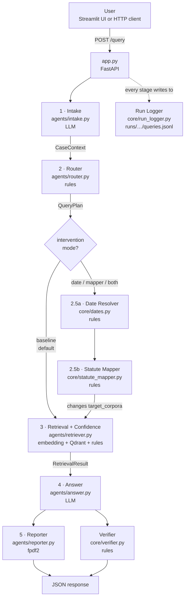
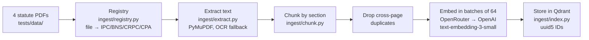
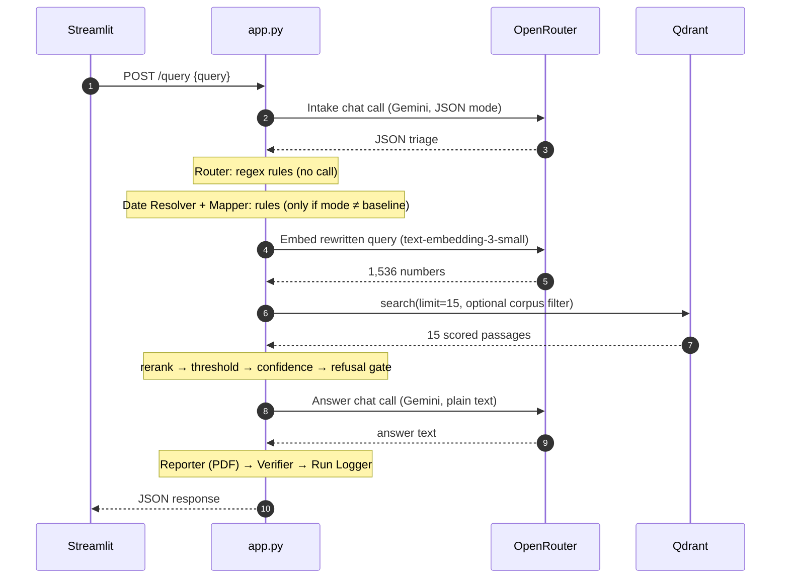

# Part 2 — Architecture

How the system works, stage by stage: what each stage does, its exact **input**
and **output** fields, which **APIs** it calls, **why** it was built that way,
and what is known to be wrong with it. Everything here was checked against the
code on 11 October 2026. Line numbers refer to that code.

If a term is unfamiliar, it's defined in [01_FUNDAMENTALS.md](01_FUNDAMENTALS.md).

---

## Contents

1. [The whole system, ELI5](#1-the-whole-system-eli5)
2. [The big picture](#2-the-big-picture)
3. [Phase A — building the library (ingestion)](#3-phase-a--building-the-library-ingestion)
4. [Phase B — answering a question](#4-phase-b--answering-a-question)
5. [Stage by stage](#5-stage-by-stage)
6. [One real query, traced end to end](#6-one-real-query-traced-end-to-end)
7. [Every external API call](#7-every-external-api-call)
8. [What was added, when, and why](#8-what-was-added-when-and-why)
9. [Design decisions and the reasoning behind them](#9-design-decisions-and-the-reasoning-behind-them)
10. [Known defects — be ready for these](#10-known-defects--be-ready-for-these)
11. [File structure](#11-file-structure)
12. [Configuration](#12-configuration)

---

## 1. The whole system, ELI5

Think of a small legal-help office with six workers in a row.

1. The **receptionist** (Intake) listens to your problem and fills in a form: what
   kind of problem it is, how urgent, what facts are missing.
2. The **clerk** (Router) reads your words and decides which law book to open.
   If you said "IPC", it opens the IPC.
3. *(Optional)* The **calendar checker** (Date Resolver) works out *when* your
   problem happened, and the **translator** (Statute Mapper) switches to the book
   that actually governs that date.
4. The **librarian** (Retrieval) finds the 15 passages closest in meaning to your
   question, keeps the best ones, and says how confident it feels.
5. The **writer** (Answer) writes advice using only those passages.
6. The **printer** (Reporter) turns it into a PDF.

Behind them, the **inspector** (Verifier) checks whether every law the writer
cited was really in the passages it was given, and the **secretary** (Run
Logger) writes down everything that happened, so it can be measured later.

Only two workers — the receptionist and the writer — use an AI language model.
Everyone else follows fixed rules.

---

## 2. The big picture



**Eight stages:** Intake, Router, Date Resolver, Statute Mapper, Retrieval,
Answer, Reporter, Verifier.

- **LLM stages:** Intake and Answer.
- **Optional stages:** Date Resolver and Statute Mapper. They are **off by
  default**.
- **Run Logger:** records every stage.

---

## 3. Phase A — building the library (ingestion)

This runs **once**, before any question is asked.



### The source documents

| File | Statute | Pages | Corpus tag |
|---|---|---|---|
| `tests/data/repealedfileopen.pdf` | Indian Penal Code, 1860 | 119 | `IPC` |
| `tests/data/Bharatiya_Nyaya_Sanhita_2023.pdf` | BNS, 2023 (Act 45 of 2023) | 102 | `BNS` |
| `tests/data/the_code_of_criminal_procedure,_1973.pdf` | CrPC, 1973 | 263 | `CRPC` |
| `tests/data/a2019-35.pdf` | Consumer Protection Act, 2019 | 39 | `CPA` |

### What ends up in the index

1,899 chunks: CRPC 742, IPC 595, BNS 424, CPA 138.

- **The correct builder** is `scripts/reingest.py`. It runs the cross-page
  duplicate drop and gives exactly 1,899 chunks.
- **The `/ingest` endpoint** chunks page by page and skips that drop, giving
  about 1,905. It is not what produced the measured index.

### Payload stored with each chunk

`text`, `doc_name`, `page`, `corpus`, `section_number`, `chunk_id`, a detected
language, and other metadata. The point ID is `uuid5(chunk_id)`, so it is
deterministic: re-ingesting gives the same IDs.

---

## 4. Phase B — answering a question



**Per question:** three paid OpenRouter calls (Intake, embedding, Answer) and one
local Qdrant search. A second Qdrant search happens only if a filter returned
nothing — which never happened in 859 runs. A typical run takes about 10
seconds; D0043 took 9.8 s.

---

## 5. Stage by stage

### 5.0 The front door — `POST /query` (`app.py:125-315`)

**ELI5.** The office door: it takes your question in and hands the finished
answer back.

**Request body** (a plain dictionary — not validated by Pydantic):

| Field | Required | Default | Meaning |
|---|---|---|---|
| `query` | yes | — | The question. Empty → HTTP 400 |
| `query_id` | no | `"adhoc"` | Label used by the evaluation runner |
| `style` | no | `"Detailed"` | Accepted but **never used** |
| `intervention` | no | env `INTERVENTION`, else `"baseline"` | `baseline` / `date` / `mapper` / `both` |
| `reference_date` | no | today | ISO date ("today" for resolving "last month"). Used only off-baseline |

Query parameter `format=json` (the default) or `format=html`.

**Response** (JSON):

| Field | Meaning |
|---|---|
| `answer` | The written advice (markdown text) |
| `citations[]` | One per passage sent to the model: `{source, page, snippet}`, where the snippet is the first **200** characters |
| `confidence` | Composite confidence, 0–1 |
| `refused` | Whether the system declined to answer |
| `prompt_variant` | HIGH / MEDIUM / LOW / REFUSED |
| `llm_ok`, `llm_error` | Whether the Answer call succeeded |
| `gen_provider`, `gen_model`, `prompt_tokens`, `completion_tokens` | Call metadata |
| `paralegal_context{}` | scenario, issues, persona, complexity, urgency, financial_status, missing_facts (from Intake) |
| `report_url` / `report_error` | The PDF link, or why it failed |
| `citation_audit{}` | Verifier summary: `n_cited`, `n_grounded`, `n_ungrounded`, `ungrounded_rate`, `ungrounded_rate_lenient`, `n_out_of_corpus`, … |
| `req_id` | 12-character request ID, also in the run log |

**Not returned:** retrieval scores, the routing decision, or the refusal reason.
All three are in the run log.

**Other endpoints**

| Endpoint | What it does |
|---|---|
| `GET /healthz` | `{ok, build}` — liveness check |
| `GET /diag/env` | Runs `config.check()`: reports missing keys or settings, never their values |
| `POST /ingest` | Upload PDF / DOCX / TXT to add to the index |
| `/static/...` | Serves the generated PDF reports |

---

### 5.1 Intake — `agents/intake.py` · LLM

**ELI5.** The receptionist reads your problem and fills in a form.

**Input:** the raw question (string).

**Output:** `CaseContext` (Pydantic):

| Field | Type | Meaning |
|---|---|---|
| `original_query` | str | The question, unchanged |
| `scenario` | str | 2–4 word summary, e.g. "IPC Theft Punishment" |
| `user_persona` | str | "Layman" or "Paralegal" |
| `urgency` | str | "Immediate" or "Deferred" |
| `financial_status` | str | "Low Income" / "Affluent" / "Unknown" |
| `complexity` | str | "Low" / "Medium" / "High" |
| `predicted_legal_domain` | str | e.g. "Criminal", "Civil" |
| `legal_issues` | list[str] | Possible causes of action |
| `missing_facts` | list[str] | What the user should have said |
| `llm_ok`, `fallback_used`, `llm_error`, `raw_response_chars` | logging | Whether the call worked |

**What happens inside:**

1. One chat call to Gemini via OpenRouter: system prompt + `"Query: …"`, JSON
   mode on, `max_tokens = 1500`, temperature 0, seed 20260822.
2. The code cuts the reply from the first `{` to the last `}` and parses it as
   JSON.
3. It maps the reply's keys onto `CaseContext`, accepting two spellings each —
   e.g. `"Domain"` or `"predicted_legal_domain"` — and filling defaults for any
   missing key.
4. A **paralegal override**: 16 case-insensitive patterns (`Section N`, `IPC`,
   `BNS`, `Bail`, `FIR`, `vs.`…) force `user_persona = "Paralegal"`.
5. On any exception, hard-coded defaults are used and
   `fallback_used = True` is set.

**Why it exists.** To understand messy human language — the one job a fixed
rule cannot do — and to give the Reporter a case summary.

**Why `max_tokens` is 1,500, not 600.** Gemini spends hidden reasoning tokens
before answering. 422 of 600 were used on a *simple* query, so harder ones were
cut off mid-JSON and failed to parse.

**⚠ Known defect — Intake currently contributes nothing to retrieval.** In
**all 859** logged runs, `predicted_legal_domain = "General"` and
`legal_issues = []`, while `fallback_used` is False. The call works, but its
domain and issues are **lost on the success path**.

- **Likely cause:** the prompt never states the exact JSON key names it wants,
  so the model's keys (probably lower-case `domain` / `issues`) match neither
  accepted spelling, and the defaults are used silently. This is an inference;
  the raw reply is never logged.
- **Consequence 1:** the Router's domain fallback never fired.
- **Consequence 2:** issues were never added to the search query.
- **What still works:** scenario, persona, urgency and complexity *are* parsed,
  and reach the UI and the PDF.

---

### 5.2 Router — `agents/router.py` · rules

**ELI5.** The clerk reads your words. If you named a law book, it opens that
book. If you named two, or none, it searches the whole library.

**Input:** `CaseContext`.

**Output:** `QueryPlan` (Pydantic):

| Field | Meaning |
|---|---|
| `original_query` | The question |
| `rewritten_query` | What actually gets embedded: `issues + entities + question` |
| `intent` | `statute` (a section was named) / `case_law` / `general`. `comparison` exists in the type but is never assigned |
| `target_corpus` | One corpus to filter on, or `None` for no filter |
| `target_corpora` | A list of corpora; filled only by the Statute Mapper |
| `entities` | Extracted references, e.g. `["Section 379"]` |
| `boost_terms` | Entities with and without a trailing full stop, plus issues |
| `decision_path` | **Which rule fired** — logged so a decision can be traced |
| `case_context` | Passed through |

**What happens inside:**

1. **Corpus mapping.** Lower-case the question and look for each key of
   `ACT_MAP` as a substring:

   | Words in the question | Corpus |
   |---|---|
   | `ipc`, `indian penal code`, `penal code` | IPC |
   | `bns`, `nyaya sanhita`, `bharatiya nyaya sanhita` | BNS |
   | `crpc`, `cr.p.c`, `criminal procedure`, `code of criminal procedure`, `bnss`, `nagarik suraksha` | CRPC |
   | `consumer protection`, `consumer court`, `consumer commission`, `consumer forum` | CPA |

   Exactly one corpus matched → filter on it (`act_map_single`). Several matched
   → no filter (`act_map_multi_no_filter`). None → no filter (`no_match`).
2. **Entity extraction.** The regex `(section|sec|article|art|order|rule) N`
   finds references like "Section 379"; `intent = statute`.
3. **Case-law detection.** `v.`, `vs.`, `judgment`, `appeal`, `petition`,
   `SCC`, `AIR N` → `intent = case_law`.
4. **Domain fallback.** If nothing matched and the domain is Criminal or Civil,
   still no filter. Recorded only in `decision_path`.
5. **Rewrite.** Prepend issues and entities to the question.

**In the logs:** `act_map_single` 605 times, `no_match` 254 times. No other path
ever fired.

**Why rules, not an LLM?** This decision has to be **auditable**: "it chose the
IPC because the string 'ipc' matched." "The model decided" is not defensible in
a viva or a paper.

**Why the IPC and BNS are kept separate.** The original map sent `"ipc"` to the
BNS. That was a workaround from when the IPC document was mis-tagged and
unreachable. It made the IPC unreachable in a different way, so it was removed
in Phase E (August 2026).

**⚠ Known quirk.** "bnss" contains "bns", so a question naming the BNSS matches
both BNS and CRPC and gets no filter. Measured impact is zero — no evaluation
question names the BNSS.

**⚠ How well it routes.** When a question names its code, the Router sends it to
the right book **33 / 33** times for the IPC and **33 / 33** for the BNS
(`results/routing_confusion.csv`). This is central to how you present the main
finding — see Part 3.

---

### 5.3 Date Resolver — `core/dates.py` · rules · off by default

**ELI5.** The calendar checker reads "this happened last month" and works out
whether that was before or after 1 July 2024.

**Input:** the question and a `reference_date` ("today").

**Output:** a verdict (logged under `date`):

| Field | Example (D0043) | Meaning |
|---|---|---|
| `era` | `BNS_ERA` | `IPC_ERA`, `BNS_ERA`, `BOTH_ERAS` (conduct spans the cutover) or `UNKNOWN` |
| `resolved` | `2026-07-23` | The date it worked out |
| `evidence` | `"last month"` | The words that triggered it |
| `rule` | `last_unit` | Which rule fired |
| `ambiguous` | false | Whether it was unsure |

**How it works.** A set of ordered regular-expression rules: explicit dates,
month-year, relative offsets ("2 years ago"), "last month", "yesterday",
"since…", bare years, and so on. Cutover = `date(2024, 7, 1)`; `>=` means BNS.

**Why rules, not an LLM?**

- **Auditable** — you can say *which words* decided it.
- **Reproducible** — the reference date is passed in, never read from the clock
  inside the logic, so re-running in December reproduces August.
- **Free and instant.**
- **`UNKNOWN` is a safe answer.** A missed date means "ask the user"; a guessed
  date would silently pick the wrong code.

**⚠ Known defects.** None affects any reported number — 0 of 576 evaluation
questions trigger them. They do affect real users.

| Input | Output | Should be |
|---|---|---|
| "on **15/08/2024**", "in **2024**" | `IPC_ERA` (a bare year is read as 1 January) | BNS, or ambiguous |
| "he took **Rs 2000**" | `IPC_ERA` (an amount read as a year) | no date |
| "under **BNS 2023** … Section 103 BNS" | `IPC_ERA` → the Mapper rewrites BNS 103 to **IPC 302** | no date |
| reference date 29 Feb, "2 years ago" | crash | a date |

---

### 5.4 Statute Mapper — `core/statute_mapper.py` · rules · off by default

**ELI5.** The translator. If you said "Section 379 IPC" but it happened last
month, it says: "that's BNS 303(2) now — search the BNS book."

**Input:** the question and the era from the Date Resolver.

**Output** (logged under `mapper`):

| Field | Example (D0043) | Meaning |
|---|---|---|
| `target_corpora` | `["BNS"]` | Which books to search instead |
| `original` | `["IPC 379"]` | What the user cited |
| `governing` | `["BNS 303(2)"]` | What actually governs on that date |
| `changed` | true | Whether it overrode the Router |
| `rule` | `translated_to_governing_code` | Which rule fired |
| `warnings`, `notes` | `"SUBSTANTIVE CHANGE: adds community service…"` | Caveats |

**How it works.** It looks each cited provision up in the hand-verified
**`data/recodification_map.json`**: 44 entries, 33 IPC↔BNS verified against the
bare Act text, plus 10 CrPC↔BNSS marked unverified (the BNSS isn't in the
corpus). Then `app.py:185-191` replaces `plan.target_corpora`.

**Why a hand-made map, not a model?** The mapping is many-to-many, and some
entries changed in substance (IPC 379 → 303(2) adds community service). It must
be verifiable line by line. **IPC 161 has no counterpart** — it was repealed in
1988 — and the mapper says so instead of inventing one.

**Why off by default?** So the system **without** it stays runnable byte for
byte, as a **control**. Then "the mapper improved retrieval by X" is a measured
difference, not an assertion (ADR-00Z in `docs/DECISIONS.md`).

**⚠ Four modes, two behaviours.**

- `date` only logs the era; retrieval is identical to `baseline`.
- `mapper` runs the Date Resolver too, so it behaves exactly like `both`.

The two components were never tested separately — but they can't work
separately anyway: the resolver supplies the era, and the mapper acts on it.

**⚠ Known defect — it changes the book, not the section number.** The Mapper
updates `target_corpora` but **not** `entities` or `rewritten_query`. So after
mapping, it searches the BNS for the user's *IPC* number. D0043 searched the BNS
for "Section 379", and `entity_coverage` came out 0. This happened in **121 of
129** remapped runs. The intervention still worked (Part 3), but its effect is
probably **understated**.

---

### 5.5 Retrieval + Confidence — `agents/retriever.py`

**ELI5.** The librarian finds the 15 passages closest in meaning, puts the ones
naming your section first, throws away the clearly worse ones, and says how sure
it feels.

**Input:** `QueryPlan` (uses `rewritten_query`, `target_corpora` or
`target_corpus`, `entities`, `original_query`).

**Output:** `RetrievalResult` (a dataclass):

| Field | Meaning |
|---|---|
| `chunks` | The passages that survived the threshold — what the model sees |
| `confidence` | Composite confidence, 0–1 |
| `top_k_mean` | Mean of the 5 best scores |
| `score_gap` | Best score minus the **5th-best** |
| `entity_coverage` | Share of extracted entities found in the top passages (0.5 if there were none) |
| `max_score` | The single best score |
| `total_retrieved` / `total_chunks` | 15 / how many survived |
| `refused`, `refusal_reason` | Whether to decline, and why |
| `scores_raw` | All 15 scores (in reranked order) |
| `filter_applied`, `filter_fallback_fired` | Which filter was used; whether it was dropped for returning nothing |
| `named_statutes`, `unavailable_statutes`, `partial_corpus_coverage` | Corpus-boundary information |
| `entity_coverage_default_used`, `embed_provider` | Logging |

**What happens inside:**

1. **Embed** `rewritten_query` → 1,536 numbers (**API call**).
2. **Filter.** One corpus → `match value`; several → `match any`; none → no
   filter.
3. **Search** Qdrant, `limit = 15`.
4. If a filter returned nothing, search again without it (never happened).
5. **Rerank.** Passages whose text contains an entity move to the front.
6. **Threshold.** Keep scores ≥ `max(best − 0.15, 0.35)`. If fewer than 3
   survive, force the first 3 through regardless of score.
7. **Confidence**, computed over all 15 scores:

   ```
   m   = mean of the 5 best scores
   gap = best − 5th best ;      g = min(gap / 0.3, 1)
   e   = entities found in the first 5 passages / entities   (0.5 if none)
   C   = min( 0.55·m  +  0.15·(1 − g)  +  0.30·e ,  1 )
   ```

8. **Refusal gate**, checked in order:
   - no passages → `no_chunks`
   - **every** Act the user named is outside the index → `out_of_corpus_statute`
   - best score < 0.25 → `below_nonsense_floor`

   **It never fired in 859 runs.**

**Why the refusal gate checks Act names, not scores.** On this index, an
out-of-corpus question (Hindu Marriage Act, never indexed) scored **0.519**,
higher than five of six legitimate questions. Similarity cannot tell "we don't
hold this law" apart from "this is a hard question". A name check can.

**Why `ENTITY_NEUTRAL = 0.5`, not 1.0.** Originally a question naming no section
got entity coverage 1.0 — the full 0.30 weight for free. That pushed exactly the
layman questions (which never name sections) into the HIGH tier, with the least
evidence. 0.5 means "unknown", neither reward nor penalty.

**Why the middle term is `(1 − g)`.** The design assumed a *small* gap meant
"consistent relevance" and a *large* gap meant "one lucky hit". The data refute
that: on its own the deployed term scores AUROC **0.270**, below a coin toss.
This was a design hypothesis that turned out wrong, not a typo.

**⚠ Known quirks.**

- 0.35 is not a hard floor: **229** passages below it reached the model.
- `compute_confidence` runs on the **reranked** list, so "first 5" means
  "entity matches first".
- Entity matching is a plain substring test: "Section 30" matches
  "Section 302".

---

### 5.6 Answer — `agents/answer.py` · LLM

**ELI5.** The writer reads your question and the passages, and writes advice in
seven fixed sections. If the librarian wasn't confident, the writer is told to
add warnings.

**Input:** the question and the `RetrievalResult`.

**What happens inside:**

1. If `refused` or there are no passages → return a fixed refusal message. No
   API call.
2. Pick a **tier** from the confidence:

   | Confidence | Tier | Extra instruction prepended |
   |---|---|---|
   | < 0.38 | LOW | "Provide only general guidance… **Do NOT cite specific sections unless they appear in the retrieved text**… recommend a lawyer" |
   | 0.38 – 0.55 | MEDIUM | "Say which parts are supported by the retrieved documents… recommend a lawyer" |
   | ≥ 0.55 | HIGH | none |

3. Build the user message: `User Query: …` followed by every surviving passage,
   in full (`Doc: name (Page p)\nText: …`).
4. **One chat call** to Gemini: temperature 0, seed 20260822, no `max_tokens`,
   **no JSON mode**.
5. Build `citations[]` from the passages, each with a 200-character snippet.

**Output** (a dict): `answer`, `citations`, `confidence`, `refused`,
`prompt_variant`, `llm_ok`, `llm_error`, `gen_provider`, `gen_model`,
`prompt_tokens`, `completion_tokens`.

**The answer format** (system prompt): informal solution → evidence to gather →
police help → **relevant legal provisions (a table)** → administrative and civil
remedies → practical tips → offer to draft.

**⚠ Known issues — an examiner may ask about these.**

- The HIGH-tier prompt never says "cite only the passages you were given". Only
  the LOW disclaimer does, and HIGH covered **490 / 859** runs. The prompt even
  contains an example table naming "BNS Sec 290 / CrPC Sec 133". This plausibly
  contributes to the ungrounded rate.
- **Tier-logging bug (fixed).** `prompt_variant` used to be set to HIGH and never
  updated, so **369 / 859** logged records show the wrong tier. The disclaimer
  actually sent was always correct; only the log field was wrong. All 859
  existing records predate the fix — D0043 is logged as "HIGH" with confidence
  0.4767, which is really MEDIUM.
- If the LLM call fails, the answer becomes an apology string, `refused` stays
  False, and a PDF is still produced.

---

### 5.7 Reporter — `agents/reporter.py` · rules (fpdf2)

**ELI5.** The printer turns the answer into a PDF you can download.

**Input:** the question, the `QueryPlan` (for `entities`), and the answer dict.

**Output:** `static/report_<8 hex>.pdf`. The response carries its URL.

**Sections:** 1 Case Summary (query, scenario, persona, complexity, urgency,
missing facts) · 2 Relevant Statutes (`plan.entities`) · 3 Legal Analysis · 4
References.

**Detail:** text is forced to Latin-1, so Devanagari or Tamil cannot appear in
the PDF. It runs **before** the Verifier, so the PDF has no citation audit.

---

### 5.8 Verifier — `core/verifier.py`, called at `app.py:280-299` · rules

**ELI5.** The inspector reads the answer, lists every law it cites, and ticks the
ones that were really in the passages the writer was given.

**Input:** the answer text, and `retrieved_text`.

**Output** (logged under `verifier`, summarised in `citation_audit`):

| Field | Meaning |
|---|---|
| `cited` | Provisions found in the answer |
| `grounded` | Of those, present in the retrieved text |
| `ungrounded` | Of those, **not** present |
| `out_of_corpus` | Cited from an Act that isn't in the index |
| `ungrounded_rate` | ungrounded / cited — **strict**: a sub-section must match exactly. This is the headline |
| `ungrounded_rate_lenient` | Same, but "318(4)" may match a passage labelled "318" |
| vintage fields | Whether it cited the old code where the new one governs, or the reverse |

**Why it exists.** It is both a **safety check** and the **measuring instrument**
for the "answered from memory" finding. The same code produces the number and
could power a fix.

**⚠ Known limitations.**

- `retrieved_text` is built from the citations' **200-character snippets**, not
  the full passages the model read. Re-checking against every section the model
  was sent does **not** change the headline finding (Part 3).
- Retrieved passages carry no statute name, so grounding matches **by number
  only** — "IPC 302" counts as grounded against a BNS 302 passage. This biases
  grounding *upward*, which makes "0 of 120 grounded" a *conservative* result.
- An answer that cites nothing counts as "grounded". 2 of the 27 grounded
  answers are like this, one of them an error message.

---

### 5.9 Run Logger — `core/run_logger.py`

**ELI5.** The secretary writes down everything for every question, so the whole
system can be measured later without re-asking anything.

**Where:** `runs/<YYYY-MM-DD_HHMM>_<git sha>/` — one folder per server process.
`runs/` is git-ignored, so it is **not** on GitHub.

| File | Contents |
|---|---|
| `meta.json` | Start time, git SHA, dirty flag, branch, models, API base, full config |
| `queries.jsonl` | One line per question: `req_id`, timestamp, `query_id`, `query_raw`, `git_sha`, `total_latency_ms`, and one bucket per stage: `language, intake, date, router, mapper, retrieval, confidence, answer, verifier` |

**Why it exists — the single most important file.** Before August 2026, no
retrieval score had ever been recorded, so **nothing was measurable**. An early
claim of good results rested on two hand-picked examples that couldn't be
reproduced. Every number in Part 3 exists because this logger exists. This is
your supervisor's evaluation item 2.

**⚠ Known gap.** If a stage throws an exception, the server returns HTTP 500
before the record is written, so failed questions leave **no log row**.

---

### 5.10 The user interface — `streamlit_app.py`

A chat page that POSTs to `/query` and shows:

- the answer;
- a confidence badge using the same 0.55 / 0.38 tiers;
- the citations;
- the paralegal context;
- a PDF link.

Two quirks:

- The detail-style selector appends text to the question itself instead of
  sending `style`.
- "Also fetch HTML report" runs the whole pipeline a second time.

---

## 6. One real query, traced end to end

**D0043** from the dated-conflict test set, run on 23 August 2026 at commit
`302e1f8`, in `both` mode. Every value below is copied from the run log.

**Question:** *"What is the punishment for punishment for theft under Section 379
of the Indian Penal Code? This happened last month."* The doubled "punishment
for" is a template bug in the test set — see Part 3.

| Stage | What came out |
|---|---|
| **Intake** | scenario "IPC Theft Punishment", persona **Paralegal** (the override fired on "Section 379"), urgency Deferred, complexity Low, domain "**General**", issues `[]` (the defect in §5.1) |
| **Router** | `target_corpus = IPC`, `decision_path = act_map_single`, `entities = ["Section 379"]`, `rewritten_query = " Section 379 What is the punishment…"` |
| **Date Resolver** | `era = BNS_ERA`, evidence "last month", resolved 2026-07-23, rule `last_unit` |
| **Statute Mapper** | IPC 379 → **BNS 303(2)**, `target_corpora = ["BNS"]`, note "adds community service for first-time theft under Rs 5,000" |
| **Retrieval** | filter **BNS**, 15 retrieved, 15 kept. Best scores 0.643, 0.628, 0.619, 0.614, 0.611. Top passages: BNS 305, 317, 306 |
| **Confidence** | m = 0.623, gap = 0.0318, **e = 0** (it searched the BNS for "Section 379" — the defect in §5.4) → **C = 0.4767** |
| **Answer** | tier really **MEDIUM**, logged as "HIGH" (the old bug). Gemini via Google AI Studio, 4,431 prompt tokens, 1,743 completion tokens |
| **Verifier** | cited BNS 303(2), BNS 305, IPC 379 → grounded **BNS 305** only → **ungrounded_rate = 0.667** |
| **Total** | 9,772 ms |

Check the confidence by hand:

```
0.55 × 0.623                    = 0.3427
0.15 × (1 − min(0.0318/0.3, 1)) = 0.15 × 0.894 = 0.1341
0.30 × 0                        = 0
                         total  = 0.4767   ✓
```

**What this one record teaches you:**

- The Mapper correctly moved the search to the BNS.
- But it searched for the wrong section number, so entity coverage was 0.
- The model still cited the right law, BNS 303(2) — but the inspector couldn't
  find it in what was retrieved. Either the answer came from the model's own
  knowledge, or it was missed by the 200-character snippet check.

---

## 7. Every external API call

| When | Call | Model / service | Provider | Paid? | Code |
|---|---|---|---|---|---|
| Ingestion | embeddings, batches of 64 | `openai/text-embedding-3-small` | OpenAI via OpenRouter | yes | `clients/openai_client.py:embed_texts` |
| Ingestion | upsert | Qdrant `legal_mvp` | local Docker | no | `ingest/index.py` |
| Query · Intake | chat, JSON mode, max 1,500 | `google/gemini-3.7-flash` | Google AI Studio via OpenRouter | yes | `chat_json` → `chat` |
| Query · Retrieval | embedding ×1 | `openai/text-embedding-3-small` | OpenAI via OpenRouter | yes | `embed_one` |
| Query · Retrieval | search ×1 (×2 only if a filter returns nothing) | Qdrant | local | no | `agents/retriever.py` |
| Query · Answer | chat, plain text | `google/gemini-3.7-flash` | Google AI Studio via OpenRouter | yes | `chat` |

Every OpenRouter call carries `provider: {only: [X], allow_fallbacks: false,
require_parameters: true}`, temperature 0 and seed 20260822, and returns
`CallMeta` (model, provider, token counts) for the log.

---

## 8. What was added, when, and why

Dates are from `git log`.

| When | What | Why |
|---|---|---|
| Aug–Oct 2025 | Basic RAG: ingest, embed, search, answer; Streamlit scaffold | First version |
| **19 Jan 2026** | **Router, Retrieval and Answer agents** (`0e44d28`) | Split one monolith into specialised stages |
| **22 Jan 2026** | **Intake and Reporter agents**, "paralegal mode" (`1ccbecb`) | Triage messy questions; give users a PDF advisory |
| **25 Feb 2026** | **Composite confidence + tiered disclaimers** (`ce1bded`) | Warn users when retrieval is weak |
| Aug 2026 | Documentation pass → **23 defects found** (`docs/GAPS.md`) | Nothing had ever been measured; the reasoning behind design choices was lost |
| **23 Aug 2026** | **Ingest rebuilt** — registry tags, section-bounded chunks, deterministic IDs → 1,899 chunks (`227adf9`) | The old keyword tagger mis-tagged the IPC as BNS and the CrPC as BNSS. Duplicate chunks from random IDs |
| 23 Aug | **Phase E fixes** (`1320f82`) — Router IPC/BNS separation, entity-coverage formula, neutral 0.5, `top_score = max`, criminal fallback no longer forced to BNS | Each was a measured defect |
| 23 Aug | **OpenRouter + provider pinning; Run Logger; tests** | The OpenAI key died. Reproducibility. Measurability |
| 23 Aug | **Query sets**: paired, generated, layman (Phase F) | The old set had 11 queries — too few to measure anything |
| 23 Aug | **Phase G baseline**: 419 runs (`074df28`) | The "before" measurement |
| 23 Aug | **Phase H: Date Resolver (`ad86159`), Statute Mapper (`aac8856`), wired behind a mode flag (`e1a62aa`), dated-conflict set (`01b6b17`)** | The fix for the recodification failure, measured against the baseline |
| 1 Sep 2026 | **Measurement waves 0–4**: shared metric library, known-answer tests, the gate, five metric families, hybrid and BM25, reachability ceiling | Turn logs into defensible numbers with confidence intervals |
| 1 Sep | Tier-logging bug and citation-binding bug fixed (`f02e4c2`) | Found by the measurement |
| 1 Sep | Corrected-composite analysis (`69388f5`) | Is the confidence failure just the sign error? No — it survives the repair |
| 2 Sep | `exp10` self-naming (`95f5ac7`) | Turn the "statutes don't name themselves" mechanism from prose into a measurement |
| 2–3 Sep | Supervisor brief, technical report, project report, testing workbook | Communication |
| 17–18 Sep | Synopsis | Department submission |
| Oct 2026 | `exp11` intervention result written to a results file (not yet committed) | The intervention numbers existed only as August prose |

---

## 9. Design decisions and the reasoning behind them

Full records are in `docs/DECISIONS.md`.

| Decision | Reasoning |
|---|---|
| **Only two LLM stages** | Rules are testable and traceable; model calls aren't. If behaviour changes, you can blame a component, not sampling noise |
| **Regex Router, not an LLM** | Auditable: "chose IPC because 'ipc' matched at character N" |
| **Corpus boundary checked by name, not score** | An out-of-corpus question scored higher (0.519) than most in-corpus ones. Scores carry no "do we hold this law" information |
| **`ENTITY_NEUTRAL = 0.5`** | 1.0 handed free confidence to exactly the questions with the least evidence |
| **Interventions off by default** | Keeps the baseline reproducible, so every improvement is a measured difference |
| **Hand-verified recodification map** | Many-to-many, with substantive changes; must be checkable line by line |
| **Date resolution by rules; `UNKNOWN` is allowed** | Auditable, reproducible, free. A missed date asks the user; a hallucinated one picks the wrong law |
| **Section-bounded chunks** | One provision per chunk; never split mid-sentence |
| **Deterministic `uuid5` IDs** | Re-ingesting doesn't create duplicates |
| **Provider pinning + `require_parameters`** | Same model, same company, every time; unsupported settings fail loudly |
| **Hand-rolled pipeline, not LangGraph** | Every decision must be inspectable and logged in this project's own schema |
| **One shared metric library** | No metric has two implementations that could disagree |
| **Every reported number is a CSV row** | No hand-typed numbers; each is reproducible from a script |
| **Multilingual input designed, then deferred** | The corpus is English-only, so a Hindi query would measure the translator, not legal retrieval |

---

## 10. Known defects — be ready for these

Full list with evidence: [`../AUDIT_2026-10-10.md`](../AUDIT_2026-10-10.md).

| Defect | Affects reported numbers? | One-line answer if asked |
|---|---|---|
| Intake's domain and issues dropped (859 / 859) | No — they were never used | "A key-name mismatch; scenario and persona still work; domain and issues never reached retrieval" |
| Mapper changes the book, not the section number | Understates the intervention | "Even with that bug, it went from 0 to 39 of 65" |
| Verifier reads 200-character snippets | No — re-checked at section level | "0 of 120 holds when checked against every section sent" |
| Date edge cases (bare year, rupees, Act year) | No — 0 of 576 evaluation questions trigger them | "Real users could hit them; listed as next fixes" |
| HIGH-tier prompt lacks "cite only retrieved" | Plausibly raises the ungrounded rate | "That's a fix the verifier result motivates" |
| `make_synopsis_tex.py` has a syntax error | No | Documentation tooling only |
| `requirements.txt` misses the measurement packages | No | numpy, pandas, scipy, matplotlib, openpyxl, rank-bm25 |

---

## 11. File structure

✅ live · 🧪 measurement · 📄 documentation · 💤 dead / legacy · 🗑 debris

```
legal-mvp/
├── app.py                      ✅ FastAPI server: /query, /ingest, /healthz, /diag/env
├── streamlit_app.py            ✅ Chat UI → POST /query
├── docker-compose.yml          ✅ Runs Qdrant on :6333
├── requirements.txt            ✅ Runtime dependencies (measurement ones missing — see §10)
├── CLAUDE.md                   📄 Instructions for Claude Code sessions (partly stale)
├── README.md                   📄 Project overview
│
├── agents/                     ✅ The pipeline stages
│   ├── intake.py                  Stage 1 · LLM triage → CaseContext
│   ├── router.py                  Stage 2 · regex corpus choice → QueryPlan
│   ├── retriever.py               Stage 3 · embed, search, rerank, threshold, confidence, refusal
│   ├── answer.py                  Stage 4 · tiered prompt → LLM answer
│   └── reporter.py                Stage 5 · PDF report
│
├── core/                       ✅ Shared logic
│   ├── config.py                  All settings and env vars; provider block
│   ├── dates.py                   Date Resolver (intervention)
│   ├── statute_mapper.py          Statute Mapper (intervention)
│   ├── recodification.py          Loads the IPC↔BNS map; corpus boundary set
│   ├── citations.py               Finds "Section N of Act" in text; matching rules
│   ├── verifier.py                Are cited provisions in the retrieved text?
│   ├── run_logger.py              One JSONL record per query
│   ├── logging.py                 Request-ID helper (barely used)
│   └── schemas.py                 💤 Unused v1 schemas
│
├── clients/                    ✅ The only code that calls OpenRouter
│   ├── openai_client.py           chat(), chat_json(), embed_texts(), embed_one()
│   └── qdrant_client.py           Qdrant connection; create collection
│
├── ingest/                     ✅ Building the index
│   ├── registry.py                File name → corpus tag
│   ├── extract.py                 PDF / DOCX / TXT → text (PyMuPDF, OCR fallback)
│   ├── chunk.py                   Section-bounded chunking; cross-page de-duplication
│   ├── index.py                   Embed + upsert to Qdrant (uuid5 IDs)
│   └── extract_backup.py          💤 Byte-identical copy of extract.py
│
├── data/
│   ├── recodification_map.json    ✅ 44 hand-verified IPC↔BNS and CrPC↔BNSS mappings
│   └── ipc_bns_map_candidates.csv  ⚠ 511 machine-generated, UNVERIFIED candidates — several wrong (e.g. 420→320). Not used by any code
│
├── eval/                       🧪 The test questions (the "answer key")
│   ├── generated_queryset.jsonl   200 questions generated from known sections
│   ├── paired_queryset.jsonl      99 = 33 offences × {IPC-named, BNS-named, neutral}
│   ├── paired_dated_queryset.jsonl 99 = 33 × {conflict IPC-named, conflict BNS-named, control}
│   ├── layman_queryset.jsonl      120 = 30 situations × 4 phrasings
│   ├── queryset.jsonl             58 legacy hand-written; only Q001–Q003 were ever run
│   └── *.py                       The generators for each set
│
├── scripts/                    Running things
│   ├── reingest.py                ✅ Builds the 1,899-chunk index (use this)
│   ├── run_eval.py                ✅ Sends a query set to /query; refuses a dirty git tree
│   ├── analyze_eval.py            🧪 August Phase G tables
│   ├── compare_runs.py            🧪 August Phase H baseline vs intervention
│   ├── ablate_filter.py           🧪 Filter on/off probe
│   ├── build_ipc_bns_map.py       Wrote the unverified candidates CSV
│   ├── sync_context.py            Mirrors plan and memory into docs/
│   ├── query_cli.py               Command-line client
│   ├── ingest_cli_debug.py        ⚠ Posts to /ingest → 1,905 chunks, not 1,899
│   ├── ingest_cli.py              💤 Old buggy keyword tagger — do not use
│   └── backfill_session_log.py, audit_recorded_runs.py  One-off utilities
│
├── experiments/                🧪 The measurement layer (Part 3)
│   ├── metrics_lib.py             The ONE implementation of every metric
│   ├── exp01 … exp11              One experiment each → results/*.csv
│   ├── check01 … check11          Independent re-derivation of each experiment
│   ├── rerun_stages.py            Rebuilds the three retrieval stages → stages.jsonl
│   ├── assemble_results.py        CSVs → results/RESULTS.md
│   └── make_*.py, *_text.py       Document builders (reports, synopsis, abstract, workbook)
│
├── results/                    🧪 Every measured number
│   ├── *.csv                      11 files, one per experiment family
│   ├── RESULTS.md                 All of them, assembled
│   └── EXPLAIN.md                 What each file means
│
├── figures/                    Charts and diagrams (PNG + Mermaid sources)
├── tests/                      ✅ 237 pytest tests; tests/data/ holds the 4 statute PDFs
├── docs/                       📄 Documentation — see docs/README.md
│   └── study/                     ← this guide
│
├── answer/, retrieve/          💤 Version-1 modules, replaced by agents/
├── report/                     ✅ render.py: HTML report for ?format=html
├── app_backup.py, debug_qdrant.py, check_pdfs.py, test_ingest.py  💤 / 🗑
├── out.html, .scratch/          🗑
└── full_codebase.py            🗑 42 MB January dump of old code plus library code. No secrets
```

**Git-ignored, so not on GitHub:** `runs/` (the logs), `venv/`, `.env` (your
API key), `static/` (generated PDFs), `qdrant_storage/`.

---

## 12. Configuration

Set in `.env`, read in `core/config.py`. Values are never printed by the code.

| Variable | Default | Meaning |
|---|---|---|
| `OPENROUTER_API_KEY` | — | The API key |
| `OPENAI_BASE_URL` | `https://openrouter.ai/api/v1` | Where the OpenAI SDK sends requests |
| `MODEL_NAME` | `google/gemini-3.7-flash` | Generation model |
| `GEN_PROVIDER` | — | Pinned generation provider |
| `GEN_TEMPERATURE` | 0 | Generation temperature |
| `EMBED_MODEL` | `openai/text-embedding-3-small` | Embedding model |
| `EMBED_PROVIDER` | — | Pinned embedding provider |
| `EMBED_DIM` | 1536 | Vector size |
| `ALLOW_FALLBACKS` | false | Never let OpenRouter switch provider |
| `REQUIRE_PARAMETERS` | true | Fail if a setting is unsupported |
| `SEED` | 20260822 | Generation seed |
| `QDRANT_URL` | `http://localhost:6333` | Vector database address |
| `QDRANT_COLLECTION` | `legal_mvp` | Collection name |
| `TOP_K` | 15 | **Logged but unused** — retrieval hard-codes 15 |
| `LANGS_OCR` | `eng+hin+tam+tel` | OCR languages |
| `USE_TRANSLATION` | false | **Unused** (multilingual input deferred) |
| `INTERVENTION` | `baseline` | Default intervention mode (read in `app.py`) |

**Hard-coded constants:**

| Constant | Value |
|---|---|
| Search limit | 15 |
| Adaptive drop | 0.15 |
| Threshold floor | 0.35 |
| Nonsense floor | 0.25 |
| Entity neutral | 0.5 |
| Confidence weights | 0.55 / 0.15 / 0.30 |
| Gap normaliser | 0.3 |
| Tiers | 0.55 / 0.38 |
