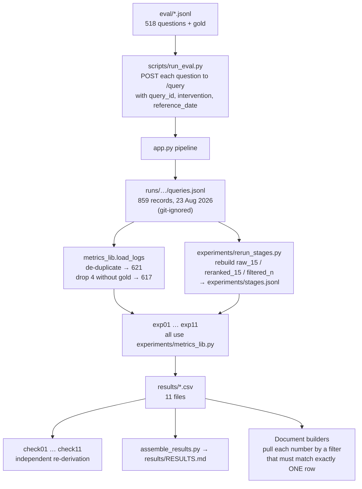

# Part 3 — Measurement

How the system was tested, what every statistic means, what was found, and —
just as important — what each result does **not** say.

Every number in this document is a row in a file under `results/`. The few that
are not are marked **(audit check, not yet in a CSV)**. Read
[01_FUNDAMENTALS.md](01_FUNDAMENTALS.md) and
[02_ARCHITECTURE.md](02_ARCHITECTURE.md) first.

---

## Contents

1. [Measurement, ELI5](#1-measurement-eli5)
2. [The answer key — the four question sets](#2-the-answer-key--the-four-question-sets)
3. [How the measurements were produced](#3-how-the-measurements-were-produced)
4. [Three stages, three definitions of "correct"](#4-three-stages-three-definitions-of-correct)
5. [The statistics toolbox](#5-the-statistics-toolbox)
6. [How the numbers are protected from mistakes](#6-how-the-numbers-are-protected-from-mistakes)
7. [The eleven experiments](#7-the-eleven-experiments)
8. [The results](#8-the-results)
9. [Stress-testing the results](#9-stress-testing-the-results)
10. [Limitations](#10-limitations)
11. [Where every number lives](#11-where-every-number-lives)

---

## 1. Measurement, ELI5

To test a student you need three things:

1. **An exam paper** — the questions.
2. **An answer key**, written **before** marking, so nobody can quietly change
   the answers to match what the student wrote.
3. **A fair way to mark** — and an honest statement of how sure you are of the
   final score.

Here, the questions are the four test sets, the answer key is the **gold
labels** written down before the system ever ran, and "how sure" is the
**confidence interval** printed beside every number.

One more rule: **nothing is typed by hand.** Every number in every document is
pulled by a script from a results file, and the script crashes if it can't find
exactly one matching row.

---

## 2. The answer key — the four question sets

Each question carries the section that correctly answers it (its **gold label**,
the `expected_sections` field). Every gold label was fixed **before** any output
was seen.

| Set | File | n | How it was built | What it isolates |
|---|---|---|---|---|
| **Generated** | `eval/generated_queryset.jsonl` | **200** | From known sections. Either *"What does Section 168 of the BNS provide?"* or topic-only *"What is the law on voyeurism in India?"*. By book: IPC 60, CrPC 60, CPA 60, **BNS 20** | Baseline retrieval across all four books |
| **Paired recodification** | `eval/paired_queryset.jsonl` | **99** | 33 verified IPC↔BNS offences × 3 variants: `ipc_numbered` (names the IPC section), `bns_numbered` (names the BNS section), `neutral_topic` (names neither) | The same offence asked once per code |
| **Paired dated conflict** | `eval/paired_dated_queryset.jsonl` | **99** | The same 33 offences × 3 variants (below) | Whether the system follows the **date**, not the code named |
| **Layman** | `eval/layman_queryset.jsonl` | **120** | 30 real-life situations × 4 phrasings: `no_date`, `ipc_era` ("March 2023"), `bns_era` ("last month"), `vague` | Ordinary language, no section numbers |
| **Total** | | **518** | | |

**The dated set, in full:**

| Variant | The question names… | The date says… | So the gold label is |
|---|---|---|---|
| `conflict_ipc_named` | the IPC section | "last month" (after the cutover) | the **BNS** section |
| `conflict_bns_named` | the BNS section | "March 2023" (before it) | the **IPC** section |
| `agree_control` | the IPC section | "March 2023" | the **IPC** section — nothing should change |

**How certain are the gold labels?**

- **Generated, paired, dated:** `certain_by_construction`. The question was
  generated *from* a known section, so that section is the answer by definition.
- **Layman:** needed human judgement about which provision governs a described
  situation.
  - **52** rows are marked `uncontroversial`; **68** are marked `needs_review`.
  - **5** rows have a BNSS gold label, which is not in the index, so they are
    unanswerable by construction.
  - **60** rows accept either era's code (`gold_mode = either_era`); 60 need the
    exact one.

**A legacy set,** `eval/queryset.jsonl` (58 questions), predates all of this. Only
3 of its questions (Q001–Q003) were ever run, and it feeds no reported result.

**Known flaws in the answer key** (from the audit — §9 shows the results survive
them):

- 9 of the 33 offences ask for the **punishment** but carry the **definition**
  section as gold. Example: theft → IPC 378 / BNS 303(1); the punishment is 379
  / 303(2). Some templates read *"What is the punishment for punishment for
  theft…"* or *"…theft - definition under Section 378…"*.
- **22 of the 33** BNS gold labels in the paired sets are sub-sections, such as
  103(1). The index only stores parent sections, such as "103", so these can
  never be matched exactly (the **reachability ceiling**, §5.10).
- One layman row (**L0043**) is contradictory: "2021 or 2022 … This happened
  last month".

---

## 3. How the measurements were produced



1. **Running.** `scripts/run_eval.py` sent each question to `/query` on
   **23 August 2026**, at code commit **`302e1f8`** (Phase G and Phase H). It
   refuses to run on uncommitted code, so every run is tied to a commit.
2. **Logging.** The Run Logger wrote **859** records.
3. **Cleaning.** `load_logs` removes duplicate re-runs (→ 621), then drops 4
   rows with no gold label (one smoke test and three deliberately dropped rows:
   G0107, G0190, D0094) → **617 analysed runs**.
4. **Why 617 and not 518:**

   | Set | Runs |
   |---|---|
   | Generated | 198 (G0107 and G0190 deliberately dropped) |
   | Paired | 99 |
   | Dated | **197** — run twice: 99 with the interventions **off** + 98 with them **on** |
   | Layman | 120 |
   | Legacy | 3 (Q001–Q003; they carry gold, so they are in the pooled figures) |
   | **Total** | **617** |

5. **Stage reconstruction.** The logs record what was *sent* to the model, but
   not every intermediate ranking. `rerun_stages.py` rebuilt the three
   retrieval stages (§4) in September by re-searching with the same queries and
   filters. It is a close replay, not the original passages: 613 of 617
   filtered lists match the logged length.
6. **Analysis.** Eleven experiments compute metrics through **one shared
   library**, `experiments/metrics_lib.py`, and write `results/*.csv`.
7. **Checking.** Each `check*.py` recomputes its experiment by a different route
   and halts if they disagree.

---

## 4. Three stages, three definitions of "correct"

### Three stages

**ELI5.** The librarian brings 15 books, reshuffles them, then throws some away.
You can mark the result at any of those three moments.

| Stage | What it is |
|---|---|
| `raw_15` | Qdrant's 15, in similarity order |
| `reranked_15` | The same 15, with passages naming the asked-about section moved first |
| `filtered_n` | What survives the threshold — **what the model actually saw** |

Every result names its stage, because the numbers differ. For layman questions:
**15.0%** at `raw_15`, **7.5%** at `filtered_n`.

### Three definitions of "correct"

**ELI5.** "Did it get it right?" can mean three different things.

| Definition | Means | Measures |
|---|---|---|
| **retrieved@k** | The gold section is among the top *k* passages (here k = 15) | The search |
| **cited** | The gold section appears among the answer's citations | The written answer |
| **grounded** | **Every** section the answer cited was present in the passages the model was given | Whether the answer is backed by evidence or written from memory |

They come apart in practice. An answer can cite the right section that search
never found — meaning the model knew it already. That is exactly the
"answered from memory" finding.

**`recall_at_k` here is a hit rate:** the share of questions with at least one
gold section in the top k. It is *not* the textbook "fraction of all relevant
items retrieved", which is reported separately as
`recall_at_k_fraction_of_gold`.

---

## 5. The statistics toolbox

### 5.1 Proportion

**ELI5.** How many out of how many. 17 out of 33 is 51.5%.

### 5.2 Confidence interval — Wilson

**ELI5.** You tested 33 questions, not every possible question, so 51.5% is an
*estimate*. The interval is the range where the true value probably lies. Wide
interval = unsure; narrow = sure.

**Technical.** A 95% **Wilson score interval** for a proportion. Wilson rather
than the textbook "p ± 1.96·SE", because that version claims certainty at 0% or
100% — at 33/33 it gives ±0.

```
p = k/n,  z = 1.96
centre = (p + z²/2n) / (1 + z²/n)
half   = z·sqrt(p(1−p)/n + z²/4n²) / (1 + z²/n)
```

Worked: 17/33 → centre 0.514, half-width 0.161 → **[35.2%, 67.5%]**.

### 5.3 Bootstrap

**ELI5.** You can't get more data, so you pretend. Pick 617 rows *with
replacement* from your 617 (some twice, some not at all), recompute the number,
and repeat 10,000 times. The spread of those 10,000 answers shows how much the
number could wobble.

**Technical.** 10,000 resamples, fixed seed **20260901** (`metrics_lib.SEED`,
`N_BOOT`). The 95% interval is the 2.5th to 97.5th percentile. Used for AUROC
and differences, where Wilson doesn't apply.

### 5.4 Cluster bootstrap

**ELI5.** Four phrasings of the same situation aren't four independent opinions
— they're one situation asked four ways. Count them as four and you'd think
you're more sure than you are.

**Technical.** Resample whole **clusters** (all rows sharing a `pair_id` /
situation), not single rows. The layman set is 30 situations × 4, so clustered
intervals are wider: 15.0% becomes **[3.3, 27.5]**, and 7.5% becomes
**[0.0, 16.7]** — which **includes zero**.

### 5.5 Paired bootstrap and p-value

**ELI5.** To ask "is score A better than score B on the *same* questions",
resample the questions and recompute A − B each time. If the difference almost
never flips sign, it's real.

**Technical.** A two-sided p-value from 10,000 paired resamples. The smallest
non-zero p it can show is **0.0002**, so read "p = 0.0002" as "at the
resolution limit".

### 5.6 AUROC

**ELI5.** Take one question the system got right and one it got wrong. Did the
confidence score rate the right one higher? Do that for every such pair. AUROC
is the fraction of pairs where it did. **0.5 = coin toss**, 1.0 = perfect,
**below 0.5 = it points the wrong way**.

Worked example: right answers scored {0.7, 0.6, 0.4}; wrong answers {0.5, 0.3,
0.2}. Of the 9 right–wrong pairs, the right one is higher in 8 → AUROC = 8/9 =
**0.889**.

**Technical.** Area under the ROC curve, computed via the Mann–Whitney U
statistic, with ties counted as half.

### 5.7 ECE — Expected Calibration Error

**ELI5.** Group answers by how confident the system said it was. In each group,
compare what it *claimed* with how often it was *actually* right. Average the
gaps.

Worked: 10 answers at confidence 0.9, of which 6 were right → gap 0.3. 10 answers
at confidence 0.3, of which 3 were right → gap 0.0. ECE = (10×0.3 + 10×0)/20 =
**0.15**.

**Technical.** Quantile bins. 0 is perfect; lower is better.

### 5.8 Brier score

The mean squared difference between confidence and the 0/1 outcome. Lower is
better. Reported alongside ECE.

### 5.9 Coverage at risk

**ELI5.** "If I only answer when I'm confident enough to be wrong at most 10% of
the time, how many questions can I answer?"

**Technical.** Sort by score; find the largest fraction of questions that can be
answered while the error rate stays ≤ 10%. **0.000** means *no threshold at all*
achieves 10% error.

### 5.10 Reachability ceiling

**ELI5.** If the answer key says "318(4)" but the library only labels books
"318", nobody — not even a perfect librarian — can find a "318(4)" book. The
ceiling is the best possible score.

**Technical.** The share of questions whose gold section *exists as a label* in
the index. Results must be read against the ceiling, not against 100%.

### 5.11 Chance baseline and over-representation

**ELI5.** If 39% of the library is one book, a librarian picking at random
brings that book 39% of the time. Beat *that*, not zero.

**Technical.**

- **Chance baseline** = the book's share of the index: IPC 31.3%, BNS 22.3%,
  CrPC 39.1%, CPA 7.3%.
- **Over-representation ratio** = (the book's share of retrieved passages) ÷
  (its share of the index). 1.0 = exactly chance; above 1 = over-represented.

### 5.12 Platt scaling

Fits a two-parameter curve that maps a raw score to a probability. It is fitted
on a **training split** and tested on a held-out split, so it never sees the
data it's evaluated on.

### 5.13 Ablation

**ELI5.** Take one ingredient out and taste again.

**Technical.** Change exactly one component, hold everything else fixed, and
attribute the difference to that component. Here: each confidence signal alone,
leave-one-out, and the sign-corrected composite.

---

## 6. How the numbers are protected from mistakes

| Safeguard | What it prevents |
|---|---|
| **One metric library** (`experiments/metrics_lib.py`) | Two implementations of the same metric quietly disagreeing |
| **Known-answer tests** (`tests/test_metrics_known_answers.py`) | A metric that returns a plausible but wrong number. Answers were worked out by hand first |
| **`check*.py` scripts** | Each experiment recomputed by a second route; halts on disagreement |
| **One-row-or-crash sourcing** | A document quoting a number that isn't in a results file |
| **Fixed seeds** (20260901, 10,000 resamples) | Results changing between runs |
| **`run_eval.py` refuses a dirty tree** | Results that can't be tied to a commit |
| **Every row carries n, interval, definition and stage** | Numbers quoted without their conditions |

**These caught real errors in the project's own measurement code.** One fix made
a section-name function non-idempotent: "BNS:190" became "BNS::190", which
**silently zeroed every retrieval metric — 0 out of 617, no crash**. The gate
caught it. That class of failure is why the infrastructure exists.

**237 tests pass.** To check: `./venv/Scripts/python.exe -m pytest tests/ -q`.

---

## 7. The eleven experiments

Regenerate any of them with `./venv/Scripts/python.exe experiments/<script>`.

| Script | Question it answers | Output |
|---|---|---|
| `exp01_retrieval.py` | How often is the gold section retrieved, per set and per stage? (recall, precision, MRR, nDCG at k = 1, 3, 5, 10, 15) | `retrieval_metrics.csv` |
| `exp02_routing.py` | Which book does retrieval come from, versus its share of the index? Does the Router route named questions correctly? | `routing_confusion.csv` |
| `exp03_calibration.py` | Is confidence calibrated? (ECE, Brier, reliability, coverage at risk, Platt) | `calibration.csv` |
| `exp04_ablation.py` | What does each confidence signal contribute? | `ablation.csv` |
| `exp05_robustness.py` | Do conclusions survive a change of correctness definition, and clustering? | `robustness.csv` |
| `exp06_statute_consistency.py` | Would a "right book?" fourth signal help? (offline only) | `statute_consistency.csv` |
| `exp07_hybrid.py` | Meaning vs keyword vs fused search, with the filter **off**; the reachability ceiling | `hybrid_comparison.csv` |
| `exp08_filter.py` | What does the adaptive threshold cost? | `filter_analysis.csv` |
| `exp09_corrected_composite.py` | Is the confidence failure just the inverted term? | `corrected_composite.csv` |
| `exp10_self_naming.py` | How often does each statute's text contain its own name? | `self_naming.csv` |
| `exp11_intervention.py` | Did the Date Resolver + Mapper help, per variant? | `intervention.csv` |

---

## 8. The results

### Finding 0 — the Router works, when the code is named

**ELI5.** If you *tell* the system which book, it opens the right one every time.

| Paired questions, deployed Router on | Routed to the correct code |
|---|---|
| name the IPC | **33 / 33** |
| name the BNS | **33 / 33** |

`routing_confusion.csv`, `paired_routing_accuracy_*`.

**Why it matters.** It frames everything else: Findings 1–3 are about what
search does **without** that help — which is the situation of anyone who
doesn't name the code.

### Finding 1 — searching by meaning alone favours the repealed code

**ELI5.** Ask the librarian about a crime by its *old* number and it brings the
right book almost every time. Ask by its *new* number and it's barely better
than a coin flip.

**Setup:** 66 paired questions, the corpus filter **switched off**, the raw
question text, a fresh search (`exp07`). "Correct" means most of the top 15
passages come from the code the question named.

| Question names… | Meaning search | 95% CI | Chance baseline |
|---|---|---|---|
| the IPC (repealed) | **97.0%** (32/33) | [84.7, 99.5] | 31.3% |
| the BNS (in force) | **51.5%** (17/33) | [35.2, 67.5] | 22.3% |

On the strictest form — is the single top passage from the right code? — it is
90.9% for the IPC and 42.4% for the BNS.

**What it does not say.**

- It is not the deployed system's behaviour when the code is named (Finding 0).
- It is the behaviour of meaning-based search on its own — which is what the
  system relies on whenever nothing is named.

### Finding 2 — keyword search reverses it, and fusion doesn't fix it

| Method | IPC-named | BNS-named | Pooled |
|---|---|---|---|
| Meaning (dense) | 97.0% | 51.5% | **74.2%** |
| Keyword (BM25) | **0.0%** | 97.0% | 48.5% |
| Fused (RRF) | 45.5% | 78.8% | 62.1% |

**ELI5.** The two librarians are wrong about *opposite* books. Averaging them
gives you neither one's strength.

Fusion lands **between** the two (62.1%) — not "worse than either", as some
older documents say.

### Finding 3 — a likely mechanism: the statutes barely name themselves

| Word | Passages containing it | Which books | IDF |
|---|---|---|---|
| "sanhita" | 30 of 1,899 | **all BNS** — 30 of its 424 passages (7.1%) | 4.12 |
| "penal" | 110 | 82 CrPC, **23 IPC** (3.9% of the IPC's 595) | 2.79 |

**What it explains:** **keyword** search. "Sanhita" is a perfect signpost to the
BNS. "Penal" points mostly at the CrPC, which cross-refers to the Penal Code
constantly, while the IPC barely uses its own name. Hence BM25's 0% on
IPC-named questions.

**What it does *not* explain:** why **meaning** search favours the IPC. The BNS
actually names itself *more* often (7.1%) than the IPC does (3.9%). The dense
asymmetry is a finding without a proven cause. The planned **statute-metadata
ablation** — adding each statute's name to its passages and re-measuring — is
the experiment that would test it.

### Finding 4 — how often search finds the right section

`retrieval_metrics.csv`, stage `raw_15`, k = 15:

| Set | Gold section in top 15 | n |
|---|---|---|
| Paired | 73.7% | 99 |
| Generated | 69.2% | 198 |
| Dated | 49.2% | 197 |
| **Layman** | **15.0%** | 120 |
| All | 53.0% | 617 |

### Finding 5 — the people the system exists for are served worst

**ELI5.** When ordinary people describe their problem in their own words, the
librarian finds the right law about 1 time in 7. The writer then names the right
law 2 times in 3 anyway — from its own memory. **Not one** of the 120 answers
had every citation backed by what the librarian actually found.

| Layman, n = 120 | Value | 95% CI |
|---|---|---|
| Gold section in top 15 (`raw_15`) | **15.0%** | Wilson [9.7, 22.5]; clustered [3.3, 27.5] |
| …after the threshold (`filtered_n`) | **7.5%** | clustered [0.0, 16.7] |
| Answer cites the gold section | **66.7%** | [58.3, 75.0] |
| Answers with **every** citation in the retrieved text | **0 of 120** | — |
| Share of retrieved layman passages from the CrPC | 58.2% (`raw_15`) → **70.2%** (`filtered_n`) | — |
| CrPC over-representation | **1.49×** (`raw_15`) → **1.80×** (`filtered_n`) | — |

**Why the CrPC dominates.** With no code named, there is no filter, and the CrPC
is the biggest book (39% of the index) and mentions offences constantly while
describing procedure. The threshold then *worsens* it: the share goes from
58.2% to 70.2%.

**Note on the "cited" figure.** 66.7% uses the **fixed** citation parser
(`robustness.csv`). An older figure of 63.3% in `retrieval_metrics.csv` came
from the parser before its fix. Use 66.7%.

### Finding 6 — grounding is rare everywhere

| Set | Fully grounded answers |
|---|---|
| Generated | 25 / 198 (12.6%) |
| Paired | 2 / 99 (2.0%) |
| Dated | 0 / 197 |
| Layman | 0 / 120 |
| **All** | **27 / 617 (4.4%)** |

**What it does not say.** "Grounded" is strict — *every* citation must be in the
retrieved text, and a single extra citation fails it. But naming the section in
the question does **not** make answers grounded: the dated set names sections
and is still 0 of 197.

### Finding 7 — the confidence score doesn't do its job

**ELI5.** The score is meant to warn the user when an answer is shaky. It is
worse at that than one plain number the system already computes: the strength
of the single best match.

**Discrimination (AUROC)** when "correct" means *search found the gold section*
(`ablation.csv`, `raw_15`, n = 617, 327 positives):

| Signal | AUROC | 95% CI | Reading |
|---|---|---|---|
| `max_score` — best single match | **0.784** | [0.747, 0.819] | best |
| `top_k_mean` | 0.757 | | an input; beats the blend |
| `score_gap`, raw | 0.730 | | not itself an input |
| **Composite (deployed)** | **0.663** | [0.617, 0.710] | worse than its best input |
| `entity_coverage` | 0.581 | | |
| **Gap term, as deployed** | **0.270** | [0.232, 0.311] | **below a coin toss** |

**It holds under every definition of "correct":**

| "Correct" means | Composite | max_score |
|---|---|---|
| retrieved@15 | 0.663 | 0.784 |
| cited | 0.591 | 0.689 |
| grounded | 0.531 | 0.589 |

**Is it just the inverted gap term?** No (`corrected_composite.csv`):

- Flipping the term's sign raises the composite to **0.721**.
- It still loses to `max_score` by **−0.063** [−0.095, −0.033], p = 0.0002.
- Even the best re-weighted composite, chosen on training data and tested on
  held-out data, only ties: 0.763 vs 0.762.

**Calibration** (retrieval label):

| Measure | Composite | max_score |
|---|---|---|
| ECE | **0.241** | 0.127 |
| Coverage at 10% risk | **0.000** | 0.049 |

- At the retrieval level, **no threshold** gives 10% error.
- At the answer ("cited") level, coverage at 10% risk is **0.648** — so say
  which label you mean.

**Why the gap term points backwards.** It was designed on the hypothesis that a
*small* gap between the best and fifth-best score means "consistent relevance".
The data say the opposite: a *large* gap signals a clear, correct winner. A
design hypothesis was refuted. The code does what was intended; the intention
was wrong.

### Finding 8 — the reachability ceiling

| Set | Best possible score | Why |
|---|---|---|
| All 518 questions | **85.7%** (444/518) | some gold labels are sub-sections |
| IPC-named paired | 93.9% (31/33) | |
| **BNS-named paired** | **33.3%** (11/33) | 22 of 33 gold labels are sub-sections like 103(1) |

**Why it matters.** At section level, BNS-named retrieval reaches its ceiling
exactly: 11 of 11 reachable. The BNS gap in strict section terms is mostly the
answer key, not the search.

### Finding 9 — retrieved vs cited: read this one carefully

| IPC-named minus BNS-named, paired set | Difference | 95% CI (clustered) |
|---|---|---|
| Gold section retrieved@15 | **+0.545** | [0.303, 0.758] |
| Gold section cited | **−0.030** | [−0.121, 0.061] (includes zero) |

**Older documents say:** "retrieval fails on BNS, but the answer hides it".

**Careful reading:** the +0.545 sits almost entirely inside the ceiling
difference — IPC ceiling 31/33 vs BNS 11/33 = 0.606. BNS retrieval reached
everything it could. So this pair of numbers is not, on its own, evidence of
concealment. The **layman** result (Finding 5: 15.0% retrieved, 66.7% cited,
0 / 120 grounded) is the evidence that answers come from memory.

### Finding 10 — the date fix works where it was designed to

**ELI5.** The question names the old law but the event happened last month — or
the other way round. Without the date components, the system **never** found the
correct law. With them, it usually did. And on questions where code and date
agree, it changed nothing — so it's following the date rule, not just preferring
one book.

**Setup:** the dated set, 23 August 2026, commit `302e1f8`. Interventions
**off** (`baseline`) vs **on** (`both`). One variable changed.
`results/intervention.csv`, `retrieved@k`, `raw_15`.

| Variant | Off | On |
|---|---|---|
| Names the BNS, conduct before 2024 → IPC gold | 0 / 33 | **28 / 33** (84.8%) |
| Names the IPC, conduct recent → BNS gold | 0 / 33 | **11 / 32** (34.4%) |
| **Both conflict types** | **0 / 66** | **39 / 65 = 60.0%** [47.9, 71.0] |
| Control — code and date agree | 29 / 33 (87.9%) | 29 / 33 (87.9%) — unchanged |
| All three pooled — *not the headline* | 29 / 99 | 68 / 98 |

**Why 34.4% vs 84.8%.** 22 of the 33 IPC-named conflicts have sub-section gold
labels (e.g. 103(1)) the index cannot match. On **reachable** conflicts the
intervention scores **39 / 44 = 88.6%** (audit check, not yet in a CSV).

**What it does not say.**

- It is **retrieval**, not final answers.
- It comes from **one run**.
- It is on a test set **built for this case**.
- The two components were not tested separately: `date` alone changes nothing;
  `mapper` = `both`.
- The Mapper bug (it searches the new book for the *old* section number) means
  this is probably an **under**-estimate.
- The August write-up (`docs/results/PHASE_H.md`) gave 78.8% / 36.4%. Those
  came from an older script, before the September library. Use the September
  numbers above.

### Finding 11 — a fourth confidence signal (offline only)

`statute_consistency` asks: *"did the passages come from the book this question
should use?"*

| | AUROC |
|---|---|
| Pooled | **0.685** [0.656, 0.714] |
| Dated runs | 0.830 |

Caveats — **state them if you mention it:**

- It exists only in `experiments/exp06`, not in the deployed system.
- Its "which book should it be" input comes from the answer key's
  `applicable_regime` annotation — **oracle** information a real system wouldn't
  have.
- The 0.830 is over 197 dated **runs**, including the control.

### Finding 12 — a logging bug, found and fixed

`prompt_variant` was set to HIGH and never updated, so **369 of 859** logged
records (43%) show the wrong tier. The disclaimer actually sent to the model was
always correct; only the log field was wrong. Fixed in `agents/answer.py`
(`tier_for_confidence`).

---

## 9. Stress-testing the results

These checks were run during the 10 October audit, read-only, through
`metrics_lib`. **They are not yet rows in a results file**, so by the project's
own rule they can be *said* in a viva but not *printed* in a paper until a script
writes them.

| Attack | Result |
|---|---|
| "0 / 120 grounded is because the verifier only reads 200 characters" | Re-checked at section level against **every** section the model was sent: still **0 / 120**. Only 136 of 985 layman citations (13.8%) name a section that was sent |
| "…because sub-section matching is strict" | Lenient matching: still **0 / 120**; average lenient ungrounded rate **0.804** |
| "68 of your layman gold labels were never reviewed" | Uncontroversial rows only: retrieved **21.2%** [12.2, 34.0], grounded **0 / 52** |
| "14 of your conflict gold labels are definitions, not punishments" | Removing them: **0 / 52 → 34 / 51 = 66.7%** [53.0, 78.0] — the effect *grows* |
| "21 conflict gold labels are unreachable sub-sections" | Reachable only: **39 / 44 = 88.6%**; unreachable 0 / 21 |
| "The confidence finding depends on your definition of correct" | It loses under all three (Finding 7) |

---

## 10. Limitations

Say these before you're asked.

1. **A single annotator.** No legally trained second reader has checked the gold
   labels. Validating about 30 with an agreement statistic is the top next step.
2. **Small samples.** 33 per arm; one run per condition. Hence the wide
   intervals.
3. **One embedding model** (`text-embedding-3-small`). A second model is a
   planned check.
4. **The answer key has template flaws** (§2). The results survive them (§9).
5. **Four statutes only.** No BNSS, BSA, Constitution or case law.
6. **English only.** Multilingual input was designed, then deliberately deferred
   — it would have measured the translator, not legal retrieval.
7. **Stage reconstruction is a replay.** `rerun_stages.py` re-searched in
   September; it matches the logs closely, but not byte for byte.
8. **The run logs are not on GitHub** (`runs/` is git-ignored), so a reader
   cannot re-derive from raw logs without them.
9. **Generation seeds are best-effort** at the provider.

---

## 11. Where every number lives

| Number | File | Filter |
|---|---|---|
| 97.0% / 51.5%, BM25, RRF | `hybrid_comparison.csv` | metric `corpus_dominant_accuracy`, query_set `paired_numbered_{ipc,bns}_named`, stage `dense` / `bm25` / `hybrid_rrf` |
| Ceilings 85.7% / 33.3% | `hybrid_comparison.csv` | metric `gold_reachable_ceiling` |
| Router 33/33 | `routing_confusion.csv` | metric `paired_routing_accuracy_*` |
| CrPC 1.49× / 1.80× | `routing_confusion.csv` | metric `over_representation_ratio_CRPC` |
| Recall by set | `retrieval_metrics.csv` | metric `recall_at_k`, stage `raw_15`, k 15 |
| Grounded by set | `retrieval_metrics.csv` | metric `positive_rate`, definition `grounded` |
| Layman 15.0 / 7.5 / 66.7 / 0 | `robustness.csv` | metric `layman_rate` |
| Retrieved vs cited gap | `robustness.csv` | metric `paired_gap_ipc_minus_bns` |
| AUROCs | `ablation.csv` | metric `auroc_signal` |
| Corrected composite | `corrected_composite.csv` | metric `auroc` |
| ECE, coverage | `calibration.csv` | metric `ece`, `coverage_at_risk_0.10` |
| Self-naming | `self_naming.csv` | metric `document_frequency*`, `idf_okapi` |
| Intervention | `intervention.csv` | metric `retrieved_baseline` / `retrieved_both` |
| statute_consistency | `statute_consistency.csv` | |

To regenerate everything:

```
./venv/Scripts/python.exe experiments/exp01_retrieval.py   # … through exp11
./venv/Scripts/python.exe experiments/assemble_results.py
```

These need `runs/` and `experiments/stages.jsonl`. `exp07`, `exp06` and `exp10`
also need Qdrant running.
